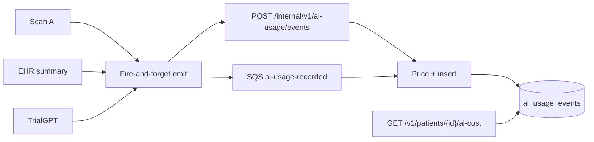

# Patient AI Cost Analytics

Internal API: pass a Hekma `patient_id`, get tokens and USD cost across Scan AI, EHR summary, and TrialGPT, split by provider and model.

The code lives in [`ai-usage/`](../README.md): `backend/` is the API, `frontend/` is the local monitor. It is the first slice of metering inside `hekma-platform`, not a sixth deployable. See [AI_USAGE_OVERVIEW.md](./AI_USAGE_OVERVIEW.md) for the problem and architecture, and [AI_USAGE_HLD.md](./AI_USAGE_HLD.md) for the developer design.

## Why this exists

LLM spend today is invisible at patient grain:

| Product | What happened before this |
|---------|---------------------------|
| Scan AI | OpenAI vision `usage` was ignored |
| EHR summary | Tokens returned on the HTTP response only; cache HIT zeros them |
| TrialGPT | Matching computed tokens then dropped them before Postgres |

Unit economics (`$ / patient`) requires an append-only fact table, priced at ingest.

## Flow



The patient-facing request never waits on metering. Failed LLM calls and cache hits emit nothing.

## API

Base: AI Usage API on `:8090`, or gateway `:9080`.

| Method | Path | Purpose |
|--------|------|---------|
| `GET` | `/v1/patients/{patient_id}/ai-cost` | Totals + by product + by provider/model |
| `GET` | `/v1/patients/{patient_id}/ai-cost/events` | Drill-down rows |
| `GET` | `/v1/ai-cost/prices` | Active list-price catalog |
| `GET` | `/v1/ai-cost/health` | Liveness |
| `POST` | `/internal/v1/ai-usage/events` | Ingest one event |

Query parameters on the patient endpoints: `from`, `to` (ISO-8601), `product` (`scan_ai` \| `patient_summary` \| `trial_match`), `tenant_id`.

If `AI_COST_API_KEY` is set, send `X-API-Key`.

Example:

```bash
curl -s "http://localhost:8090/v1/patients/203664/ai-cost"
```

```json
{
  "patient_id": "203664",
  "currency": "USD",
  "totals": {
    "llm_calls": 42,
    "prompt_tokens": 180000,
    "completion_tokens": 22000,
    "total_tokens": 202000,
    "cost_usd": 12.47
  },
  "by_product": [],
  "by_provider": []
}
```

## What is attributed

| Product | Feature examples | Providers |
|---------|------------------|-----------|
| `scan_ai` | `smart_scan.allergies`, `smart_scan.gap_fill`, `prescription_scan` | OpenAI |
| `patient_summary` | `patient_summary.narrative_batch`, `patient_summary.overview`, `patient_summary.mimic`, `patient_summary.validation` | OpenAI |
| `trial_match` | `trial_match.ehr_ingest`, `trial_match.keywords`, `trial_match.matching`, `trial_match.aggregation`, `trial_match.embedding` | OpenAI, Anthropic, Google |

TrialGPT stores the MySQL `patient_id` (not the internal `subject_id`) so the query API matches the rest of Hekma.

## Pricing

`ai_model_prices` is versioned (`effective_from` / `effective_to`). Cost is frozen on the event row. A later OpenAI price change does not rewrite history.

Unknown models ingest with `pricing_status=unpriced` and `cost_usd=0`. Add a catalog row; new events pick it up. Past unpriced rows stay unpriced unless you backfill deliberately.

## Local run

```bash
cd hekma-platform
./scripts/local-dev.sh up
# With Docker: Postgres + gateway + ai-usage
# Without Docker: AI Usage API on SQLite at http://127.0.0.1:8090
# Dashboard: cd ai-usage/frontend && python3 server.py  → http://127.0.0.1:8091
```

Point product services at it:

```
AI_USAGE_ENABLED=true
AI_USAGE_INGEST_URL=http://localhost:8090/internal/v1/ai-usage/events
```

Production can set `AI_USAGE_SQS_QUEUE_URL` instead; the AI Usage API will long-poll the queue.

## Out of scope (v1)

- Reconstructing historical scan / TrialGPT spend (it was never stored)
- PHI Shield
- Trial corpus generation and other calls with no patient id, including the Groq study summary (the hook runs, then drops the event)
- Embeddings outside a patient job. Embeddings inside a patient match are recorded as `trial_match.embedding`
- Offline scripts and the `TrialGPT_RAG` tree
- Customer-facing invoices (tenant rollups reuse the same events later)

## Code map

| Piece | Path |
|-------|------|
| Query + ingest API | [backend/app/main.py](../backend/app/main.py) |
| Event schema | [event-schemas/ai.usage.recorded.v1.json](../../event-schemas/ai.usage.recorded.v1.json) |
| Canonical emitter | [backend/hekma_ai_usage/client.py](../backend/hekma_ai_usage/client.py) |
| Local dashboard | [frontend](../frontend) |
| Scan / summary vendor | `hekma_data_pipleline/services/ai_common/usage_emitter.py` |
| TrialGPT vendor | `TrialGPT/trailgpt/services/ai_usage.py` |
