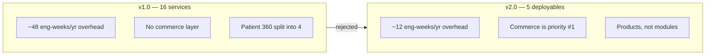
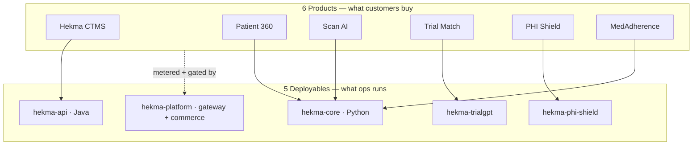
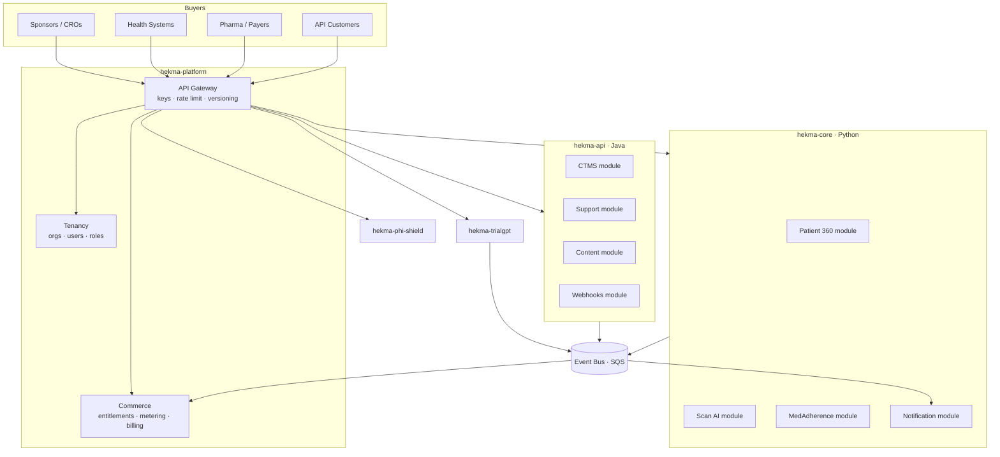
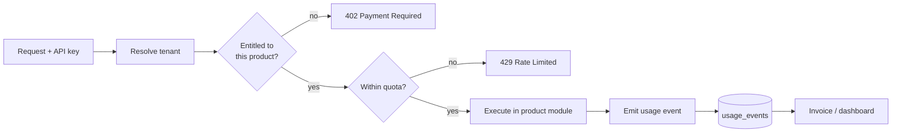
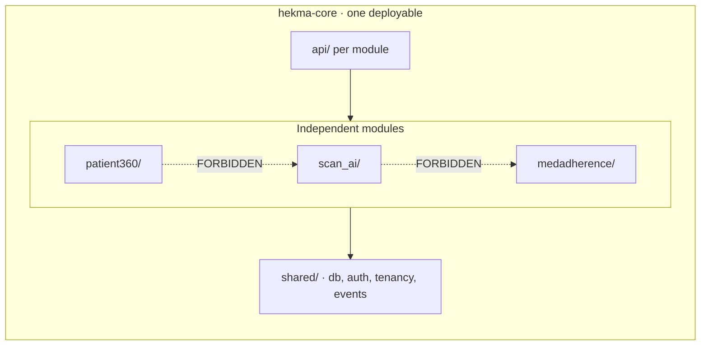
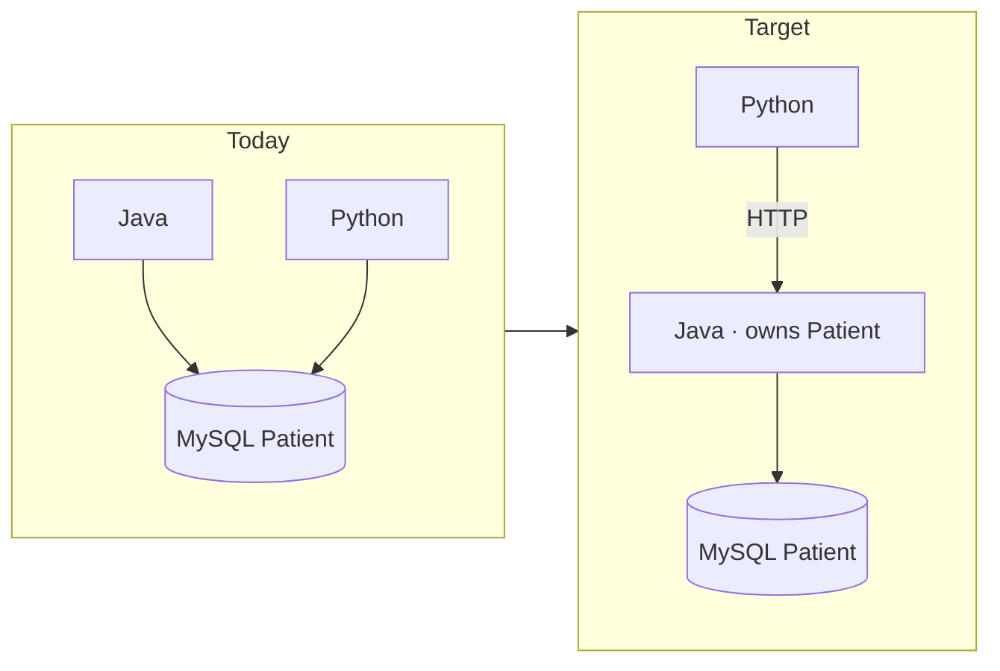
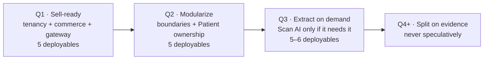

# Hekma Platform Architecture — v2.0

> **Supersedes** [MICROSERVICE_ARCHITECTURE.md](./MICROSERVICE_ARCHITECTURE.md) (v1.0, 16 services).
>
> **Business goal:** sell each feature as a standalone service.
> **Hard constraint:** 2–3 backend engineers.
> **Decision:** 6 sellable products, 5 deployable units. Do not decompose further.

---

## 1. Why v1.0 was rejected

v1.0 proposed 16 microservices. Two problems.

**Capacity.** Each independently deployed service costs roughly half an engineer-week per quarter in dependency updates, CVE patching, runtime upgrades, and pipeline repair. At 16 services that is ~48 engineer-weeks a year. A 2–3 person team has ~100–150 engineer-weeks of total capacity. The plan spends **30–45% of all engineering on overhead that no customer can see.**

**Wrong axis.** v1.0 decomposed by code module. The business goal is selling features. Those produce different boundaries — and v1.0 had no service for tenancy, entitlements, metering, or billing, which is exactly what selling requires.



---

## 2. Core principle: a product is not a deployable

This is the key idea in v2.0.

**You do not need to extract a service in order to sell it.**

A sellable product needs four things, none of which require its own container:

| Requirement | What it means |
|-------------|---------------|
| Its own API surface | Stable, versioned, documented endpoints |
| Entitlement check | "Has this tenant bought it?" |
| Usage metering | "How much did they use?" |
| Its own SLA and support | Measured and reported separately |

A product earns its own deployable **only** when it has a different scaling profile, a different runtime, or a different compliance boundary — not because it has a price tag.



You already run 4 of these 5. The only new deployable in v2.0 is `hekma-platform`.

---

## 3. Target architecture



### Deployables

| ID | Deployable | Stack | Products inside | Status |
|----|-----------|-------|-----------------|--------|
| D1 | `hekma-api` | Java | CTMS | Exists |
| D2 | `hekma-core` | Python | Patient 360, Scan AI, MedAdherence | Exists |
| D3 | `hekma-trialgpt` | Python | Trial Match | Exists |
| D4 | `hekma-phi-shield` | Python | PHI Shield | Exists |
| D5 | `hekma-platform` | Go / Node / Python | Gateway, Tenancy, Commerce | **Build this** |

### Products

| Product | Buyer | Pricing model | Lives in |
|---------|-------|---------------|----------|
| **Hekma CTMS** | Sponsors, CROs | Per study / per site / seat | D1 |
| **Patient 360** | Health systems, sponsors | Per patient / per connection | D2 |
| **Scan AI** | Anyone — pure API | Per scan | D2 |
| **Trial Match** | Sponsors, sites | Per match job | D3 |
| **PHI Shield** | Health-tech vendors | Per request / volume tier | D4 |
| **MedAdherence** | Pharma, payers | Per patient / month | D2 |

---

## 4. The commerce layer — priority #1

This is what unlocks selling, and it does not exist today.



### Data model

| Table | Purpose |
|-------|---------|
| `tenants` | Organizations that buy things |
| `tenant_api_keys` | Hashed keys, scopes, rotation |
| `product_entitlements` | `tenant_id` × `product` × `plan_tier` × `expires_at` |
| `usage_events` | `tenant_id` × `product` × `metric` × `quantity` × `ts` |
| `usage_rollups` | Pre-aggregated for billing and dashboards |

The entitlement shape follows the pattern already accepted in
[ADR-001](../../Backend%20API%20Hekma/hekma_data_pipleline/docs/adr/ADR-001-advocacy-multitenancy.md)
(`plan_tier` defaults with per-org overrides, `source`, `expires_at`) — promoted
from one module to platform-wide.

### Why this comes first

Without it you cannot sell anything, no matter how many services you extract.
With it, **you can sell Scan AI as a metered API tomorrow, from inside the existing
Python monolith.**

---

## 5. Multi-tenancy

Today the platform is implicitly single-tenant: Hekma is the only tenant. Only two
files in the Python codebase reference `org_id` or `tenant_id`.

**Decision:** extend ADR-001's row-level scoping platform-wide.

| Rule | Detail |
|------|--------|
| Column | `tenant_id BIGINT NOT NULL` on every tenant-owned table |
| Repository signature | `tenant_id` is the **first positional parameter**; PR blocker otherwise |
| Indexes | Composite indexes lead with `tenant_id` |
| Global tables | Reference data (LOINC, trials corpus) carries no `tenant_id` |
| Defense in depth | Postgres RLS via `SET LOCAL app.current_tenant_id` — Phase 2, no schema change needed |
| Isolation test | Two-tenant smoke test asserting no list endpoint leaks across tenants |

Do this **before** the codebase grows. It is invasive and touches every repository
function, and the cost rises every month it is deferred.

---

## 6. Module boundaries inside each deployable

Modules are the unit of future extraction. Enforce boundaries now and extraction
later becomes a Dockerfile.



### Rules

1. **No cross-module imports.** `scan_ai` may not import from `patient360`. Enforced by an import linter in CI.
2. **No cross-module SQL.** A module queries only its own tables. Cross-module data goes through a published in-process interface or an event.
3. **Shared code is infrastructure only** — database connections, auth, tenancy, event publishing. Never business logic.
4. **Each module owns its migrations.**

Cross-module calls use a function interface today and become HTTP later, with no
caller changes:

```python
# patient360 needs scan data — goes through the published interface,
# never a direct table read.
from shared.contracts import scan_ai_client

scans = scan_ai_client.list_scans(tenant_id, patient_id)
```

---

## 7. The blocker to fix regardless of plan

`hekma_api` (Java) and `hekma_data_pipleline` (Python) both write the MySQL
`Patient` and `AUTH_USER_DETAILS` tables directly. Neither calls the other. This is
the highest-severity coupling in the platform.



**Decision:** `hekma-api` (Java) owns `Patient` and `AUTH_USER_DETAILS`. Python
reads through an internal API. One owner, one writer.

---

## 8. Roadmap



### Q1 — Make it sellable

| # | Task | Why |
|---|------|-----|
| 1 | Stand up `hekma-platform`: gateway, tenant resolution, API keys | Front door for all products |
| 2 | Build the commerce module: entitlements, usage events | Cannot sell without it |
| 3 | Add `tenant_id` to core Python repositories | Invasive — do it early |
| 4 | Meter Scan AI including per-scan OpenAI cost | Know unit economics before pricing |

**Outcome: Scan AI is sellable as a metered API.** No service extracted.

### Q2 — Make it maintainable

| # | Task | Why |
|---|------|-----|
| 5 | Restructure `hekma-core` into `patient360/`, `scan_ai/`, `medadherence/` | Extraction readiness |
| 6 | Add import-boundary linting to CI, both stacks | Boundaries erode without enforcement |
| 7 | Give `Patient` a single owner; Python switches to API reads | Highest-severity coupling |
| 8 | Add `tenant_id` to the Java side | Parity |

### Q3 — Extract only what earns it

Extract a module into its own deployable **only** when it meets a trigger in §9.
Most likely candidate: Scan AI, if API customers arrive and GPU/LLM scaling diverges
from the rest of the Python app.

### Q4 and beyond

Split further only on evidence. "We might need it later" is not evidence.

---

## 9. When to actually split a module

Extract only when **at least one** is objectively true:

| Trigger | Example |
|---------|---------|
| **Scaling divergence** | Scan AI needs 10× the compute of everything else |
| **Runtime conflict** | A module needs GPU, or a Python/JVM version the rest cannot take |
| **Compliance boundary** | A customer requires on-prem or VPC-isolated deployment |
| **Team ownership** | A dedicated team owns it full-time — requires headcount you do not have yet |
| **Blast radius** | Its failures repeatedly take down unrelated products |
| **Release cadence conflict** | It must ship daily while the rest ships weekly |

Not triggers: "it has its own price", "it feels separate", "microservices are best practice".

---

## 10. Cost

Directional AWS estimates — production plus staging, ECS Fargate, RDS with standby.

| | v1.0 · 16 services | Product-aligned · 9 | **v2.0 · 5 deployables** |
|---|---|---|---|
| Compute | ~$2,000/mo | ~$1,100/mo | **~$550/mo** |
| Databases | ~$2,200/mo | ~$1,000/mo | **~$450/mo** |
| Gateway, NAT, observability | ~$900/mo | ~$600/mo | **~$300/mo** |
| **Infra** | **~$5,100/mo** | **~$2,700/mo** | **~$1,300/mo** |
| **Engineering overhead** | ~48 wk/yr | ~27 wk/yr | **~12 wk/yr** |
| **% of a 3-person team** | **30–45%** | **18–27%** | **~8%** |

The engineering number matters more than the infra number and is almost always
omitted from migration plans.

---

## 11. What we are deliberately not doing

| Not doing | Reason |
|-----------|--------|
| 16 microservices | Consumes a third of a 3-person team's capacity |
| Splitting Patient 360 into 4 services | One product, one SKU, one database — splitting adds hops and failure modes |
| Separate Identity service | Auth stays in `hekma-api` until there is a reason to move it |
| Kubernetes | ECS or equivalent is sufficient at 5 deployables; k8s is a full-time job |
| Kafka | SQS is already in both stacks and adequate at this volume |
| GraphQL federation | One GraphQL schema in one deployable needs no federation |

Each of these becomes correct at a larger team size. None of them is correct today.

---

## 12. Summary

| | Today | v2.0 target |
|---|-------|-------------|
| Deployables | 4 | **5** |
| Sellable products | 0 — nothing is metered | **6** |
| Multi-tenancy | Single-tenant | Row-level `tenant_id` |
| Commerce | None | Entitlements + metering + billing |
| `Patient` table | Two writers | One owner |
| Module boundaries | Implicit | Enforced in CI |

**The headline:** you reach six sellable products by adding **one** deployable, not
twelve. The work that unlocks revenue is tenancy and commerce, not decomposition.

---

*v2.0 — October 2026. Supersedes v1.0.*
