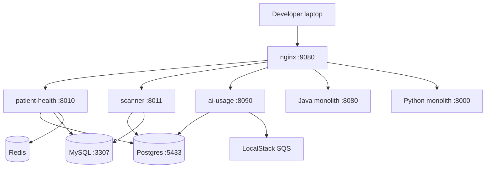
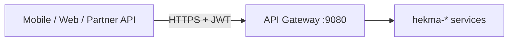
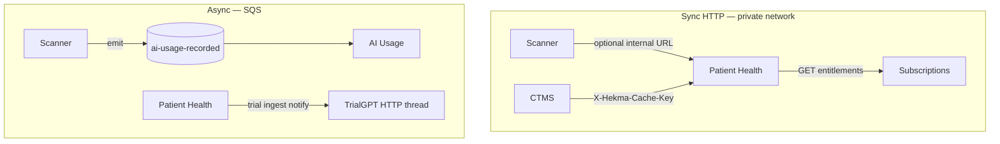
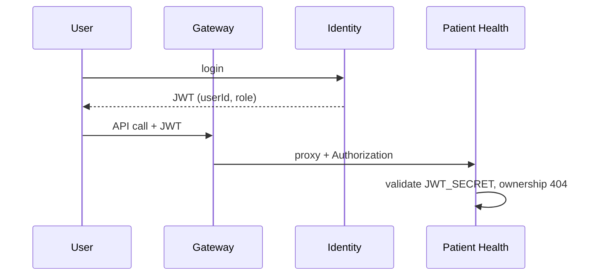
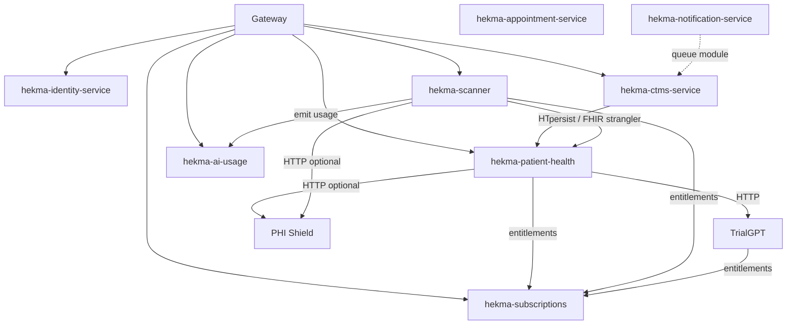

# Deployment & communication — hekma-platform microservices

> **Short answer:** Yes, this is a **microservice architecture**, but a **pragmatic** one.
> Each `hekma-*` folder is a **separate deployable** (its own container/process, own
> health check, own scale). Clients hit **one API gateway**; services talk over
> **HTTP (sync)** and **SQS (async)**. They do **not** share code at runtime and
> should not share database tables without an explicit strangler plan.
>
> Aligns with [ARCHITECTURE.md](./ARCHITECTURE.md) and [SERVICE_DECOMPOSITION.md](./SERVICE_DECOMPOSITION.md).

---

## 1. What you have in the monorepo today

| Folder | Role (platform) | Runtime | In `docker-compose` today | Typical port |
|--------|-----------------|---------|---------------------------|--------------|
| **hekma-identity-service** | S1 · Identity (JWT, login, RBAC) | Java / Spring | Not yet — add when cut over | 8081 (reserved) |
| **hekma-ctms-service** | S2 · CTMS (studies, sites, GraphQL slice) | Java | Not yet | 8082 (reserved) |
| **hekma-appointment-service** | Scheduling (CTMS-adjacent) | Java | Not yet | 8083 (reserved) |
| **hekma-notification-service** | Email / SMS / push / support desk | Java | Not yet | 8084 (reserved) |
| **hekma-patient-health** | S3 · Patient record, Fasten, FHIR, meds, HealthKit | Python / FastAPI | **Yes** | 8010 |
| **hekma-scanner** | S4 · Clinical scan + EHR summary | Python / FastAPI | **Yes** | 8011 |
| **hekma-ai-usage** | Metering ledger (not subscriptions) | Python / FastAPI | **Yes** | 8090 |
| **hekma-trial-matching** | S5 · TrialGPT / trial match | Python / FastAPI | Not yet | 8000 |
| **hekma-phi-shield** | S6 · PHI / PII de-identification | Python / FastAPI | Not yet | 8080 |
| **api-gateway** | nginx path routing | nginx | **Yes** | 9080 |
| **platform-docs** | Aggregated Swagger (dev) | Python | Optional local | 8099 |
| **shared/** | Copied libraries (e.g. AI emitter) | — | — | — |
| **event-schemas/** | SQS contract JSON | — | — | — |

**Planned compose / gateway:**

| System | Role | Deploy |
|--------|------|--------|
| **hekma-subscriptions** (planned) | User plans + entitlements | Python :8020 |

**Copied into monorepo (source repos unchanged):**

| Folder | Original path |
|--------|----------------|
| `hekma-trial-matching/` | `TrialGPT/trailgpt` |
| `hekma-phi-shield/` | `PHI_PII/PHI-PII` |

**Strangler (still used until cutover):**

| Legacy | Port | Gateway sends |
|--------|------|----------------|
| `hekma_api` (Java monolith) | 8080 | `/graphql`, `/login`, `/auth`, … |
| `hekma_data_pipleline` (Python) | 8000 | Leftover `/api/*` not yet in platform |

---

## 2. Is this “real” microservices?

**Yes**, against these criteria:

| Criterion | How Hekma does it |
|-----------|-------------------|
| Independently deployable | Each `hekma-*` has its own `Dockerfile` and can ship without redeploying siblings |
| Separate failure domain | Scanner LLM outage should not take down Patient Health (different processes) |
| API-first integration | HTTP + documented routes; no importing another service’s Python/Java packages |
| Owned data (target) | Schema-per-service on one Postgres cluster; no cross-service SQL writes long term |

**No**, in the sense that:

- You are **not** aiming for 16 containers (see [archive/REJECTED-v1-16-services.md](./archive/REJECTED-v1-16-services.md)).
- **Notification** is coded as its own folder but [NOTIFICATION_SERVICE_DESIGN.md](./NOTIFICATION_SERVICE_DESIGN.md) recommends **module inside CTMS + queue**, not a public seventh product deployable — keep one JVM for ops until load demands split.
- **One Postgres cluster** locally is fine; isolation is by **schema + role**, not 7 RDS instances on day one.

**Product vs deployable:** Customers may buy “Scan AI” and “Patient 360” separately; that is **entitlements + metering**, not necessarily one container per SKU ([ARCHITECTURE.md §2](./ARCHITECTURE.md)).

---

## 3. Deployment model

### 3.1 Local (what you run now)

```bash
cd hekma-platform
cp .env.example .env
./scripts/local-dev.sh up
```



Java `hekma-*` services: run with Maven/`spring-boot:run` on host ports until added to compose.

### 3.2 Production (recommended pattern)

**One environment = one VPC (or account), many small services:**

| Layer | Technology | Notes |
|-------|------------|--------|
| Edge | ALB or CloudFront → **nginx / API Gateway** | TLS termination, WAF |
| Compute | **ECS Fargate** or **EKS** (or EC2 + compose for early stage) | **One task definition per `hekma-*` service** |
| Data | RDS Postgres, RDS/ElastiCache Redis, RDS MySQL (until CTMS fully migrated) | Same cluster, multiple schemas |
| Async | **SQS** (+ DLQ) | AI usage ingest, future domain events |
| Secrets | Secrets Manager / SSM | `JWT_SECRET`, API keys, Stripe |
| Observability | CloudWatch + correlation id `X-Request-ID` | Already set in FastAPI services |

**Deploy unit = one image from one folder:**

```text
hekma-platform/hekma-patient-health  →  ECR:hekma/patient-health:tag  →  ECS service patient-health (N tasks)
hekma-platform/hekma-scanner       →  ECR:hekma/scanner:tag         →  ECS service scanner
...
```

**CI/CD:** build/test per folder on path change; deploy independently with smoke `/health`.

**Not recommended:** one giant “platform.jar” or one Python process running all modules — that is the monolith you are leaving.

### 3.3 What gets deployed together vs separately

| Deploy together | Deploy separately |
|-----------------|-----------------|
| Postgres, Redis, LocalStack (infra stack) | Each FastAPI / Spring service |
| nginx gateway config (when routes change) | TrialGPT, PHI Shield (other repos) |
| DB migrations **inside** the service that owns the schema | — |

---

## 4. How services communicate

### 4.1 North-south (clients → platform)



- **Single public base URL** (e.g. `https://api.hekma.ai`).
- **JWT** from Identity (`Authorization: Bearer` or `Token`).
- Gateway **path-based routing** ([api-gateway/nginx.conf](../api-gateway/nginx.conf)) — no client-side knowledge of internal ports.

### 4.2 East-west (service → service)

Prefer **three patterns**, in order:

| Pattern | When | Example |
|---------|------|---------|
| **A · Sync HTTP** | Need an answer now; low fan-out | CTMS → Patient Health internal FHIR project; Patient Health → Subscriptions entitlements; Scanner → (future) Patient Health for FHIR |
| **B · Async event (SQS)** | Fire-and-forget; decouple latency | `ai.usage.recorded` → hekma-ai-usage worker; future `ehr.ingested` → TrialGPT |
| **C · Shared nothing** | Never | Cross-service SQL joins, importing `hekma_data_pipleline` packages |



**Auth between services:**

| Mechanism | Use |
|-----------|-----|
| **JWT forwarded** | User-initiated chain (gateway passes `Authorization`) |
| **Internal API key** | `X-Hekma-Cache-Key`, `X-API-Key` (AI usage), subscription admin key |
| **mTLS / service mesh** | Optional phase 2 in EKS |

**Never** expose internal routes on the public gateway (`/internal/*`, ingest URLs).

### 4.3 Identity and trust



All Python services share **`JWT_SECRET`** (validate only). Identity **issues**; others **verify**.

### 4.4 Data and caching

| Store | Who uses it | Rule |
|-------|-------------|------|
| Postgres `hekma_platform` | PH, Scanner, AI Usage, (future) Subscriptions | **Schema per service** over time |
| MySQL `operations_hekma` | PH, Scanner (strangler), Java CTMS/Identity | Read-only strangler until CTMS extracted |
| Redis | PH, Scanner, Identity blacklist | Cache keys namespaced by service |

---

## 5. Service interaction map (target)



---

## 6. Rollout order (deployment)

| Phase | Deploy | Gateway |
|-------|--------|---------|
| **Now** | patient-health, scanner, ai-usage, nginx | Python/Java strangler paths |
| **Next** | hekma-subscriptions | `/v1/users/me/entitlements` |
| **Next** | identity-service → cut login/GraphQL auth slice | Move `/login`, `/auth` off monolith |
| **Then** | ctms-service (+ appointment, notification as modules or sidecars) | `/graphql` to new CTMS |
| **Parallel** | TrialGPT, PHI Shield | Env-based HTTP from PH/Scanner |

Each phase: deploy new service → point nginx → smoke test → reduce monolith traffic.

---

## 7. Environment matrix

| Concern | Local | Staging | Production |
|---------|-------|---------|------------|
| Gateway | `:9080` | ALB | ALB + WAF |
| Secrets | `.env` | SSM | Secrets Manager |
| AI Usage SQS | LocalStack | AWS SQS | AWS SQS |
| Entitlement enforcement | Off / soft | On | On (fail closed) |
| Java services | Host JVM | ECS | ECS |

---

## 8. Anti-patterns to avoid

1. **One deployable per code module** (16-way split) — ops cost exceeds team size.
2. **Synchronous chains** deeper than 2 hops for user requests (e.g. gateway → PH → SUB → TM → back) — cache entitlements at PH/Scanner.
3. **Shared Python package imports** across repos — use HTTP or copied `shared/` emitter only.
4. **Public exposure** of `/internal/*` or admin keys in mobile apps.
5. **Subscription logic inside AI Usage** — keep metering separate ([hekma-subscriptions](../../hekma-subscriptions/docs/SUBSCRIPTIONS_HLD.md)).

---

## 9. Related docs

| Doc | Topic |
|-----|--------|
| [ARCHITECTURE.md](./ARCHITECTURE.md) | 6 products, 5 deployables philosophy |
| [SERVICE_DECOMPOSITION.md](./SERVICE_DECOMPOSITION.md) | Why 6 business services |
| [MONETIZATION_ROADMAP.md](./MONETIZATION_ROADMAP.md) | Subscriptions + metering |
| [NOTIFICATION_SERVICE_DESIGN.md](./NOTIFICATION_SERVICE_DESIGN.md) | Notification as module |
| [event-schemas/README.md](../event-schemas/README.md) | SQS contracts |
| [hekma-subscriptions/DEPLOYMENT.md](../../hekma-subscriptions/docs/DEPLOYMENT.md) | Subscriptions deploy |

---

## 10. Summary for leadership / new engineers

- **Monorepo** `hekma-platform` holds **multiple microservices** (`hekma-*`), each shipped as **its own container**.
- **Users** see one API; **nginx** routes to the right service.
- **Services** cooperate via **JWT-protected HTTP** and **SQS events**, not shared databases.
- **Legacy** Java/Python apps stay in the path until each route moves — that is normal strangler migration, not “not microservices.”
