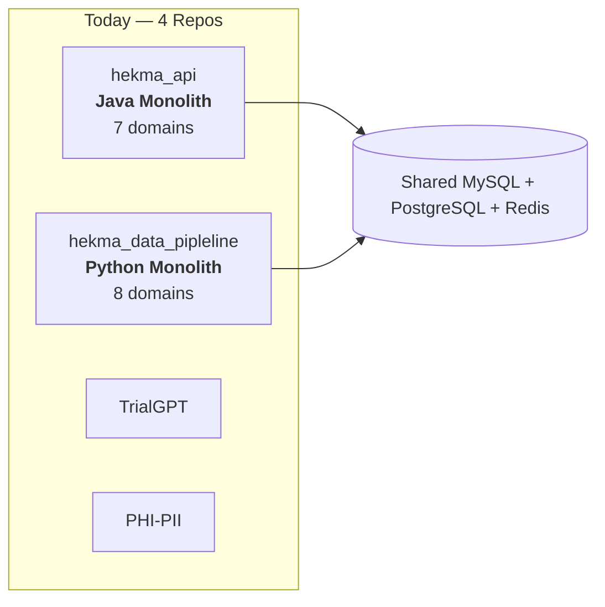
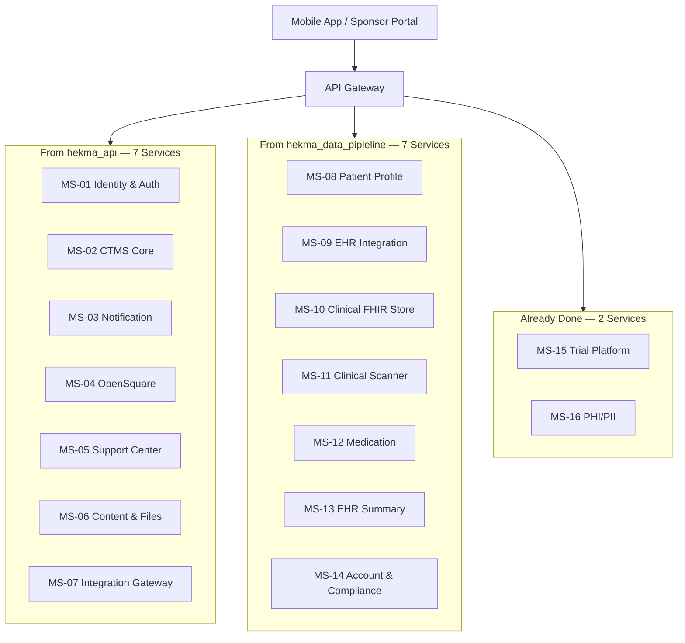
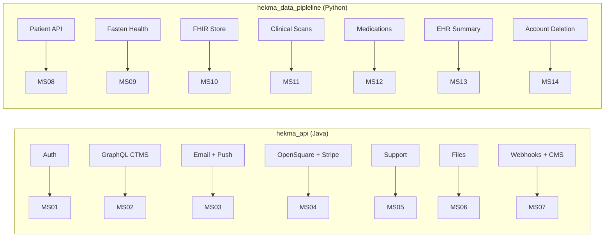
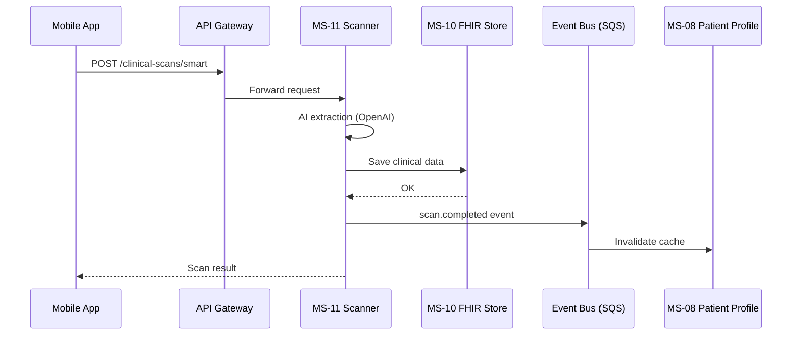
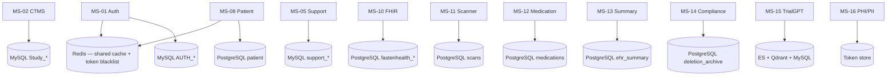

# Microservice Architecture Design — v1.0 (SUPERSEDED)

> ⚠️ **Superseded by [ARCHITECTURE.md](./ARCHITECTURE.md) (v2.0).**
>
> This plan proposed 16 microservices. It was rejected for a 2–3 engineer team:
> maintenance overhead alone would consume 30–45% of total capacity, and it
> contained no tenancy, entitlement, or metering layer — the things actually
> required to sell features as services.
>
> Retained for reference. The coupling analysis in §1 and §5 remains accurate and
> carries forward into v2.0.

---

**Goal:** Split 2 monoliths into 16 independent microservices.
**Status:** TrialGPT and PHI-PII are already separate. 14 services still need to be extracted.

---

## 1. Current State

You have **4 codebases** today. Two are monoliths with many features bundled inside.

| Repo | Type | Problem |
|------|------|---------|
| `hekma_api` | Java monolith | Auth, CTMS, notifications, support — all in one app |
| `hekma_data_pipleline` | Python monolith | Patient, scanner, meds, EHR — all in one app |
| `TrialGPT/trailgpt` | Microservice | Already separate |
| `PHI_PII/PHI-PII` | Microservice | Already separate |

**Main issue:** Java and Python share the same MySQL tables (`Patient`, `AUTH_USER_DETAILS`). They don't call each other — they both write to the same database.

> This remains the highest-severity coupling in the platform. v2.0 §7 resolves it by
> giving `Patient` a single owner.

---

## 2. Target State — 16 Microservices

---

## 3. Service List

### From Java (`hekma_api`) → 7 services

| ID | Service | What it does |
|----|---------|--------------|
| MS-01 | Identity & Auth | Login, JWT, OTP, sessions, roles |
| MS-02 | CTMS Core | Studies, sites, sponsors, enrollment, schedules |
| MS-03 | Notification | Email (SendGrid), push (Firebase), reminders |
| MS-04 | OpenSquare | Trial marketplace, cart, Stripe payments |
| MS-05 | Support Center | Support tickets, SLA, public portal |
| MS-06 | Content & Files | S3 uploads, artifacts, video recordings |
| MS-07 | Integration Gateway | CMTS webhooks, 1upHealth, localization, privacy/terms |

### From Python (`hekma_data_pipleline`) → 7 services

| ID | Service | What it does |
|----|---------|--------------|
| MS-08 | Patient Profile | Patient header, detail, search, cache |
| MS-09 | EHR Integration | Fasten Health connect, webhooks, FHIR export |
| MS-10 | Clinical FHIR Store | Unified FHIR store (allergies, labs, vitals, etc.) |
| MS-11 | Clinical Scanner | Document OCR, smart scan, AI extraction |
| MS-12 | Medication | Meds, prescriptions, compliance, reminders |
| MS-13 | EHR Summary | LLM patient timeline summaries |
| MS-14 | Account & Compliance | Account deletion, PHI retention, purge |

### Already separate

| ID | Service | Repo |
|----|---------|------|
| MS-15 | Trial Platform | `TrialGPT/trailgpt` |
| MS-16 | PHI/PII | `PHI_PII/PHI-PII` |

---

## 4. Monolith → Microservice Map

---

## 5. How Services Talk to Each Other

**Today (bad):** Both monoliths write to the same MySQL tables directly.
**Target (good):** Services communicate via API calls and events.

### Key rules

1. **No shared database writes** — each service owns its own tables.
2. **JWT from MS-01** — all services validate tokens, none issue them (except Auth).
3. **Events for side effects** — cache invalidation, notifications, EHR ingest triggers.
4. **API calls for reads** — CTMS asks Patient Profile for patient data, not MySQL directly.

> These four rules carry forward into v2.0 unchanged. They apply between *modules*
> just as well as between services.

---

## 6. Database Ownership

---

## 7. Migration Plan — 5 Phases

| Phase | Extract | From | Effort |
|-------|---------|------|--------|
| 0 | MS-15, MS-16 | Already done | — |
| 1 | MS-05 Support, MS-11 Scanner, MS-12 Medication | Java + Python | Low |
| 2 | MS-01 Auth, MS-03 Notification, MS-14 Compliance | Java + Python | Medium |
| 3 | MS-09 EHR, MS-10 FHIR, MS-13 Summary, MS-04 OpenSquare | Java + Python | Medium |
| 4 | MS-08 Patient, MS-06 Files, MS-07 Gateway | Java + Python | High |
| 5 | MS-02 CTMS Core | Java | Very High |

---

## 8. Shared Platform Components

| Component | Purpose |
|-----------|---------|
| API Gateway | Route traffic; proxy to new services during migration |
| Event Bus (SQS) | Replace shared DB writes with async events |
| Auth Library | JWT validation SDK for Java + Python |
| Centralized Logging | Correlation IDs across all services |

---

## 9. Summary

| | Today | v1.0 target |
|---|-------|--------|
| Deployable units | 4 repos (2 monoliths) | 16 microservices |
| Java services | 1 monolith | 7 services |
| Python services | 1 monolith | 7 services |
| Already separate | 2 | 2 (no change) |
| Shared DB coupling | Java + Python share MySQL | Each service owns its DB |
| Communication | Direct SQL | APIs + Events |

---

*v1.0 — September 2026. Superseded by [ARCHITECTURE.md](./ARCHITECTURE.md).*
