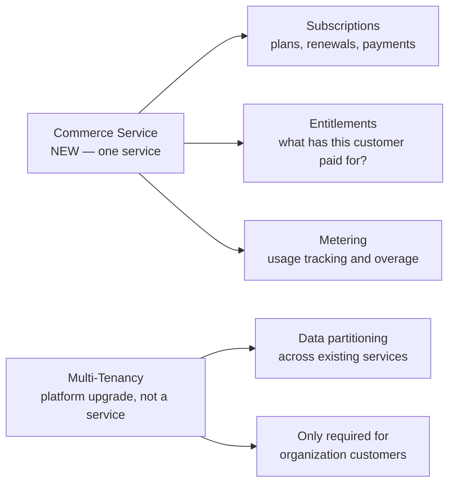
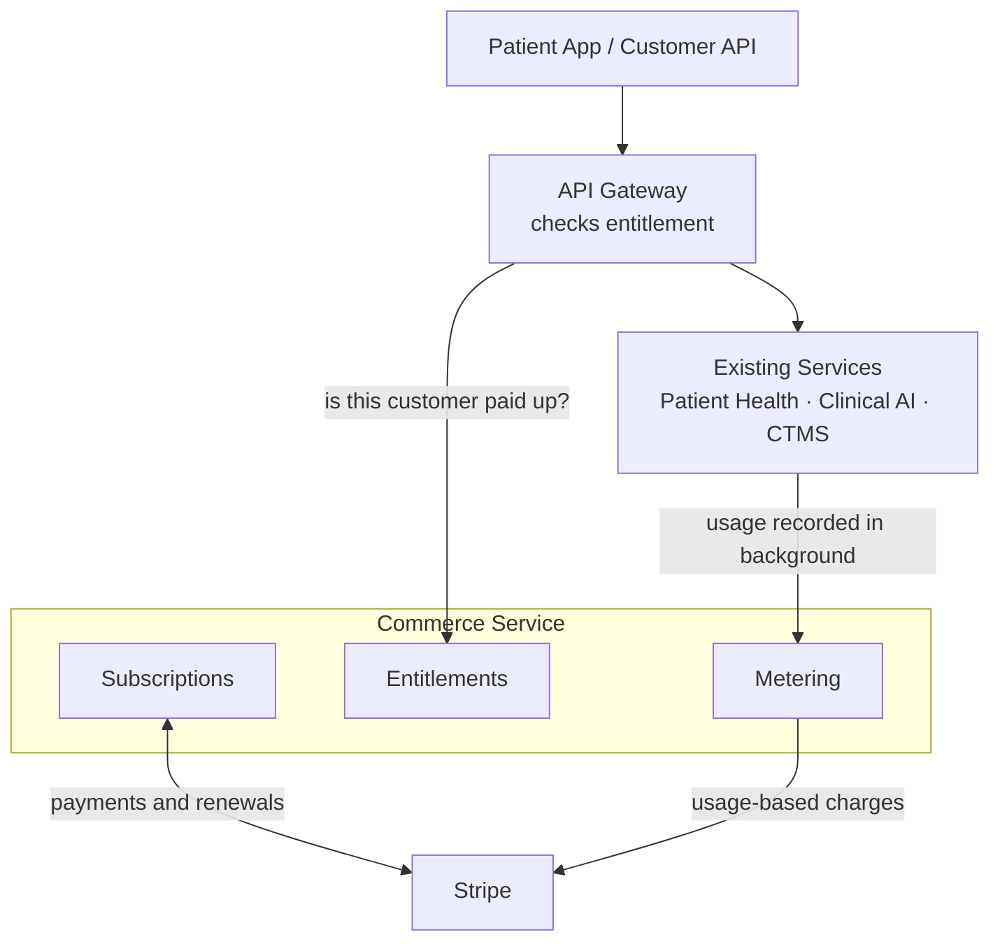
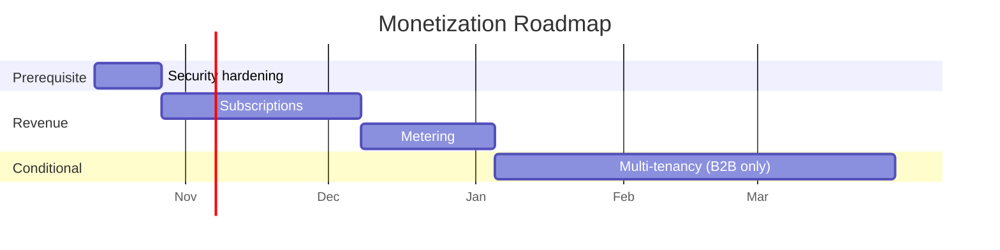
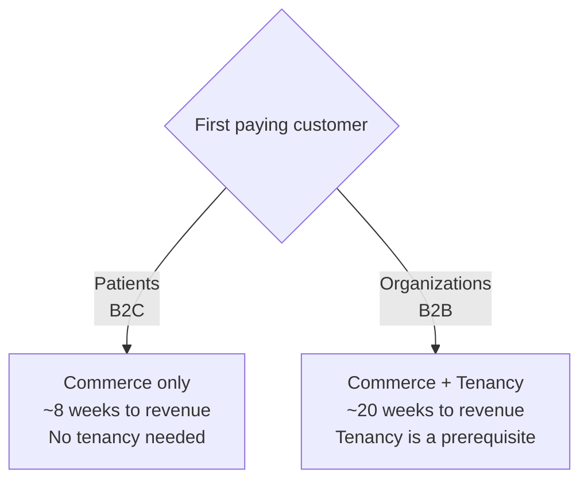

# Monetization Roadmap

**Audience:** Senior leadership
**Date:** October 2026
**Scope:** Subscriptions, metering, and multi-tenancy

---

## Executive summary

| | |
|---|---|
| **What was asked** | Build three services: subscription, metering, multi-tenancy |
| **What we recommend** | Build **one service** and **one platform upgrade** |
| **Time to first revenue** | **6–8 weeks** |
| **Decision needed from leadership** | Who do we charge first — patients, or organizations? |

Subscription and metering are not separate systems. They share the same customer,
plan, and usage data, and every invoice needs all three. Splitting them would add
cost and risk with no benefit.

Multi-tenancy is not a service at all — it is a change to how existing services
store and filter data. **It is only needed if we sell to organizations.**

---

## What we are building

---

## Architecture

**Two design rules protect the product:**

| Rule | Why it matters to the business |
|------|-------------------------------|
| The gateway **caches** entitlements | A billing outage must never take the product down |
| Usage is recorded **in the background** | Metering never slows down a customer request |

---

## Current state

| Capability | Status |
|------------|--------|
| Stripe one-time payments | **Exists** — basic integration already in place |
| Stripe subscriptions | Not built |
| Plans, entitlements, invoices | Not built — no billing data model exists |
| Usage tracking | Not built |
| Organization-level data separation | Not built (privacy service has a model we can reuse) |

We are not starting from zero on payments, but we are starting from zero on
**recurring revenue**.

---

## Roadmap

| Phase | Delivers | Duration | Revenue impact |
|-------|----------|----------|----------------|
| **0 · Security hardening** | Fixes access-control gaps | 1–2 weeks | Blocks Phase 1 |
| **1 · Subscriptions** | Customers can pay us monthly | 4–6 weeks | **First revenue** |
| **2 · Metering** | Usage-based and tiered pricing | 3–4 weeks | Expands revenue per customer |
| **3 · Multi-tenancy** | Sell to organizations | 8–12 weeks | **Only if B2B** |

Estimates assume **2–3 engineers using AI-assisted development**.

---

## Phase 0 is not optional

A paywall built on broken access control protects nothing.

We have endpoints that accept a patient identifier from the request without
verifying the caller is that patient. Until that is fixed, any entitlement check we
add can be bypassed — and the same gap is a patient-data exposure risk independent
of billing.

It is also the cheapest item on this roadmap. **1–2 weeks, and it de-risks everything
after it.**

Two related items should be handled in the same window:

- Database credentials are committed to source control and need rotation
- Database connections are not encrypted in transit

Neither depends on the roadmap. Both are hours of work.

---

## The decision we need from leadership

**Who do we charge first?**

| | Patients (B2C) | Organizations (B2B) |
|---|---|---|
| Customer is | An individual user | A hospital, sponsor, or API buyer |
| Multi-tenancy needed | **No** | **Yes — prerequisite** |
| Time to revenue | ~8 weeks | ~20 weeks |
| Deal size | Small, high volume | Large, low volume |

**Our recommendation: start with patient subscriptions.** It is faster, independent,
and generates revenue while any B2B work proceeds in parallel. Multi-tenancy becomes
a funded project once a B2B deal is real, rather than speculative infrastructure.

---

## Where AI helps, and where it does not

We are building with AI assistance. This is factored into the estimates above.

| Accelerated significantly | Not accelerated |
|---------------------------|-----------------|
| Data models and scaffolding | Payment edge cases — failed charges, refunds, proration |
| Stripe integration code | Production data migration |
| Test generation | Verification and QA across 130 tables |
| API endpoints | Pricing and packaging decisions |

The pattern: AI accelerates **writing new code**, not **safely changing existing
systems**. That is why Phase 3 carries the longest timeline despite being
conceptually simple.

---

## Risks

| Risk | Impact | Mitigation |
|------|--------|------------|
| Payment edge cases underestimated | Phase 1 slips 1–2 weeks | Budget explicit time for failure-mode testing |
| Pricing model not decided | Blocks Phase 2 design | Decide packaging during Phase 1 |
| B2B deal arrives mid-roadmap | Tenancy pulled forward | Phases are independent; resequencing is possible |
| Billing outage affects product | Customer-visible downtime | Entitlement caching at the gateway |

---

## What we are asking for

1. **Approve Phase 0** — security hardening, 1–2 weeks, starts immediately
2. **Confirm the first customer type** — patients or organizations
3. **Decide pricing and packaging** during Phase 1, so Phase 2 can be designed against it

---

*Companion documents: [ARCHITECTURE.md](./ARCHITECTURE.md) for platform design,
[TENANCY_DESIGN.md](./TENANCY_DESIGN.md) for multi-tenancy detail.*
