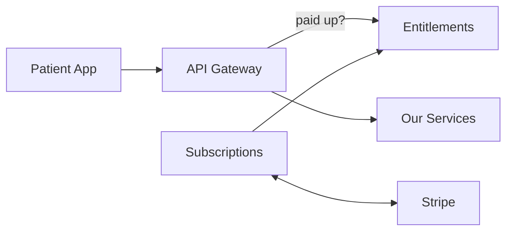
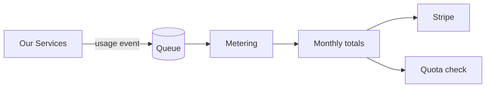
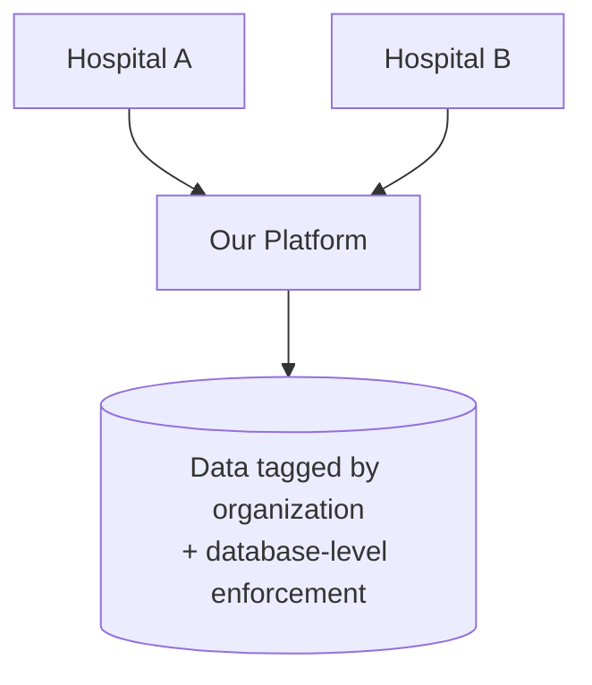
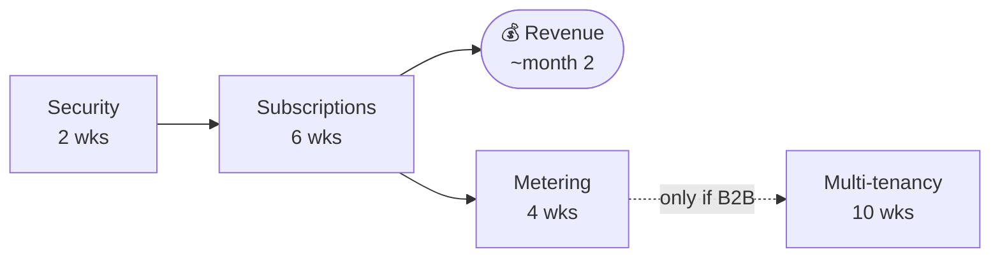

# Monetization Roadmap

**For:** Senior leadership · **Date:** October 2026
**Team assumption:** 2–3 engineers building with Cursor

---

## Summary

| Service | What it does | Time |
|---------|--------------|------|
| **1 · Subscriptions** | Customers pay us monthly | **6 weeks** |
| **2 · Metering** | Track usage, charge for it | **4 weeks** |
| **3 · Multi-tenancy** | Sell to organizations, not just individuals | **10 weeks** |

**First revenue: ~6 weeks.** Multi-tenancy is only needed if we sell to
organizations — not for individual patient subscriptions.

> Subscriptions and Metering ship as **one deployable**. They share customer, plan,
> and usage data. Shown separately here because they are separate milestones.

---

## 1 · Subscriptions

Lets a customer buy a plan and keeps that plan current — renewals, upgrades,
cancellations, failed payments. Tells the rest of the platform **what this customer
is allowed to use**.

| | |
|---|---|
| **Time** | 6 weeks |
| **Already have** | Stripe one-time payments (159 lines) |
| **Need to build** | Plans, recurring billing, entitlements, webhooks |
| **Main risk** | Payment edge cases — failed charges, refunds, proration |

---

## 2 · Metering

Counts what each customer actually uses — scans run, API calls made — and turns that
into charges. Enables tiered plans and usage-based pricing.

| | |
|---|---|
| **Time** | 4 weeks |
| **Already have** | Nothing |
| **Need to build** | Usage events, monthly rollups, quotas, overage billing |
| **Main risk** | Low — usage is recorded in the background, never blocking a request |

---

## 3 · Multi-tenancy

Lets one account hold many users with data kept separate between organizations.
Required to sell to hospitals, sponsors, or API customers.

**Not required for individual patient subscriptions.**

| | |
|---|---|
| **Time** | 10 weeks |
| **Already have** | A working model in the privacy service to copy |
| **Need to build** | Organization tagging across ~130 tables, backfill, access rules |
| **Main risk** | Touching every table in the platform |

---

## Prerequisite — 2 weeks

A paywall on top of broken access control protects nothing.

Some endpoints accept a patient identifier from the request without verifying the
caller is that patient. Until that is fixed, any payment gate can be bypassed — and
the same gap is a patient-data exposure risk regardless of billing.

Two related items fit the same window: database credentials currently in source
control need rotating, and database connections need encryption in transit.

**Cheapest item on this roadmap, and it de-risks everything after it.**

---

## Sequence

| Milestone | When |
|-----------|------|
| Security hardening complete | Month 1 |
| **First paying customer** | **Month 2** |
| Usage-based pricing live | Month 3 |
| Organization sales possible | Month 6 *(only if pursued)* |

---

## Decision needed

**Who do we charge first?**

| | Patients (B2C) | Organizations (B2B) |
|---|---|---|
| Multi-tenancy needed | **No** | **Yes — first** |
| Time to revenue | **~2 months** | ~5 months |

**Recommendation: start with patient subscriptions.** Faster, independent, and
revenue starts while any B2B work proceeds separately.

---

## A note on timelines

These estimates assume Cursor is used throughout.

AI speeds up **writing new code** by roughly 30–50%, and **safely changing existing
systems** by closer to 10%. Subscriptions and Metering are mostly the first kind.
Multi-tenancy is mostly the second — which is why it carries the longest timeline
despite being conceptually simple.

---

*Detail: [ARCHITECTURE.md](./ARCHITECTURE.md) · [TENANCY_DESIGN.md](./TENANCY_DESIGN.md)*
