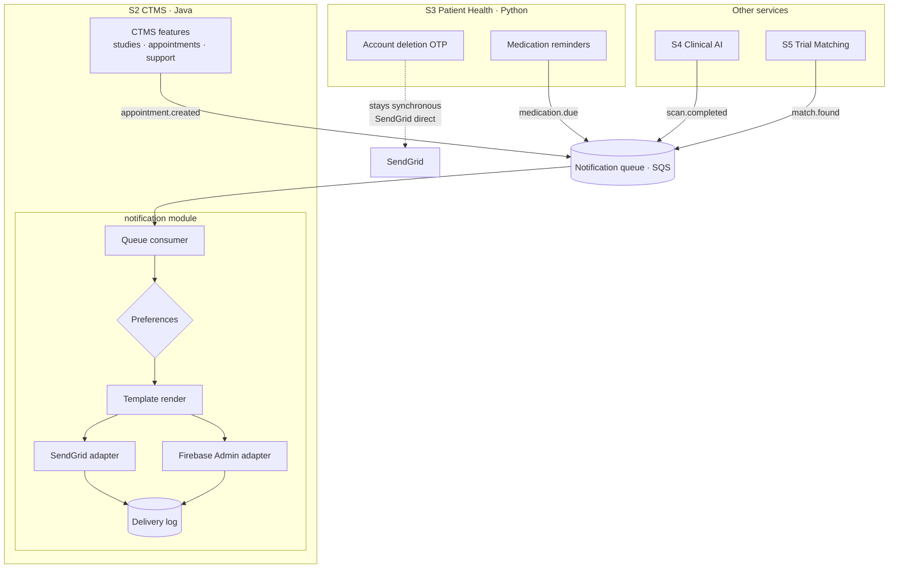

# Notification — one owner, not one container

> **Decision: do NOT deploy notification as a separate microservice.**
>
> It becomes a **module inside S2 (CTMS, Java)** with a queue in front of it.
> Deployable count stays at **6**.
>
> The queue boundary means promoting it to its own service later is a deployment
> change, not a rewrite.

---

## 1. The two questions, separated

I previously conflated these. They have different answers.

| Question | Answer |
|----------|--------|
| Does notification need **one owner**? | **Yes.** Two divergent SendGrid and Firebase integrations is a real defect. |
| Does notification need **one container**? | **No.** Nothing about it is big enough or independent enough to pay for that. |

Consolidating ownership fixes the actual problem. Adding a deployable does not.

---

## 2. Why not a separate deployable

| Test | Verdict |
|------|---------|
| Is it large? | ~2,000 lines, almost all provider adapter code |
| Does it scale differently? | Bursty, but trivially absorbed — a few hundred thousand sends/day is not load |
| Independent failure domain? | **Already achieved by the queue**, not by the container |
| Separately sellable? | No — SendGrid and Twilio own that market |
| Separate team? | You have 2–3 engineers |

### The cost of being wrong

| | 6 deployables | 7 deployables |
|---|---|---|
| Combined availability at 99.9% each | 99.4% | 99.3% |
| Maintenance tax | — | +0.5 eng-week per quarter, forever |
| Infra | — | +~$150/mo |

For a module whose job is to call two SaaS APIs, that is a bad trade.

---

## 3. Where it lives

Java `hekma_api` already owns **~95%** of it — `SendGridEmailAdapter` (755 lines),
`EmailTemplateBuilder`, 19 `.st` templates, `FirebasePushService` (Firebase Admin SDK),
`UserDeviceTokenService`, `AppointmentReminderScheduler` (562 lines).

Python's entire notification surface is **three call sites**:

| Python file | Called by | Disposition |
|-------------|-----------|-------------|
| `services/medications/notification_service.py` | 2 endpoints in `medications_api.py` | **Delete** — publish events instead |
| `services/account_deletion/email_sender.py` | 1 call in `otp_service.py` | **Keep** — synchronous OTP, self-contained, works |

So "merging the two stacks" means changing three places in Python. That is the entire
duplication problem.

---

## 4. Architecture



**The queue is the architecture.** It gives you the failure isolation, the retry
behaviour, and the decoupling. A separate container would add none of that.

---

## 5. What changes

| Step | Work | Size |
|------|------|------|
| 1 | Consolidate Java's email and push into one `notification` package inside S2, behind a single entry point | Code move |
| 2 | Put an SQS consumer in front of it; add delivery log, preferences, retry, dead-letter | New code, contained |
| 3 | Java call sites publish events instead of calling senders directly | Many small edits |
| 4 | Python's 2 medication endpoints publish events; **delete `notification_service.py`** | Two call sites |
| 5 | Merge device token storage into one table | Data migration |

Python's OTP email stays exactly as it is. It is synchronous by necessity, self-contained,
has a working SMTP fallback, and has no duplicate anywhere.

---

## 6. ⚠️ Fix this independently of any refactor

The two stacks use **different Firebase APIs**:

| Stack | Mechanism | Status |
|-------|-----------|--------|
| Java | `FirebaseMessaging.getInstance().send()` — Admin SDK | Current |
| Python | `POST https://fcm.googleapis.com/fcm/send`, `Authorization: key=<server_key>` | **Legacy — retired by Google mid-2024** |

**Medication reminder push may be failing silently.** Verify whether `FCM_SERVER_KEY`
is set and what those calls actually return. Step 4 above fixes it, but the check is
worth doing now and does not depend on any of this design.

---

## 7. Build from scratch?

**No.** About 70% exists and is reusable as-is:

| Asset | Where | Reuse |
|-------|-------|-------|
| SendGrid integration | Java `SendGridEmailAdapter` (755 lines) | as-is |
| Template engine + 19 templates | Java `EmailTemplateBuilder`, `resources/templates/*.st` | as-is |
| Push via Admin SDK | Java `FirebasePushService` | as-is |
| Device tokens | Java `UserDeviceTokenService` | as-is, absorb Python's |
| Delivery logging | Python `medication_notification_repo` | extend to all channels |
| Scheduler | Java `AppointmentReminderScheduler` (562 lines) | generalise for medication doses |

Genuinely new: the queue consumer, the event schema, preferences, and retry/dead-letter.

---

## 8. Event contract

Producers state **what happened and who it concerns**. They never render content —
that is what lets you reword an email without redeploying four services.

```json
{
  "event_id": "uuid",
  "event_type": "medication.due",
  "recipient": { "user_id": "203022", "channels": ["push", "email"] },
  "template": "medication_reminder",
  "data": { "medication_name": "Metformin", "dose_time": "08:00" },
  "occurred_at": "2026-10-03T08:00:00Z"
}
```

`event_id` is the idempotency key — the consumer deduplicates on it.
`recipient.channels` is a request, not a guarantee; preferences override it.

**This contract is the real investment.** It is what makes the deployment question
reversible.

---

## 9. When to promote it to its own service

Revisit if any of these becomes true:

- Notification volume forces S2 to scale for reasons unrelated to CTMS load
- A third consumer appears that is neither Java nor the Python monolith
- An external customer's traffic shares the queue and could starve Hekma's
- The team passes roughly 6 engineers

Because producers already talk to a queue and never to the module directly, promotion
is a deployment change. Nothing above the queue has to be rewritten.

---

*Companion to [SERVICE_DECOMPOSITION.md](./SERVICE_DECOMPOSITION.md). October 2026.*
