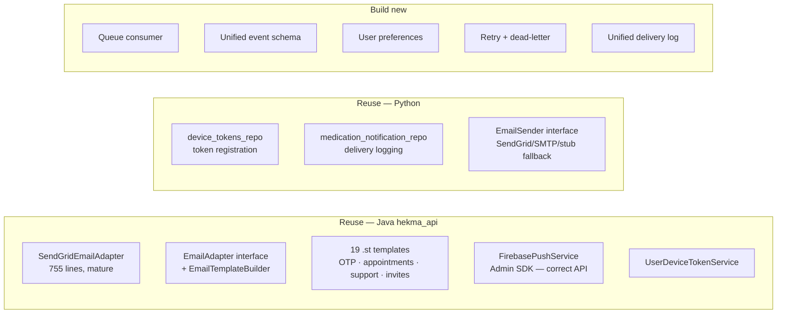
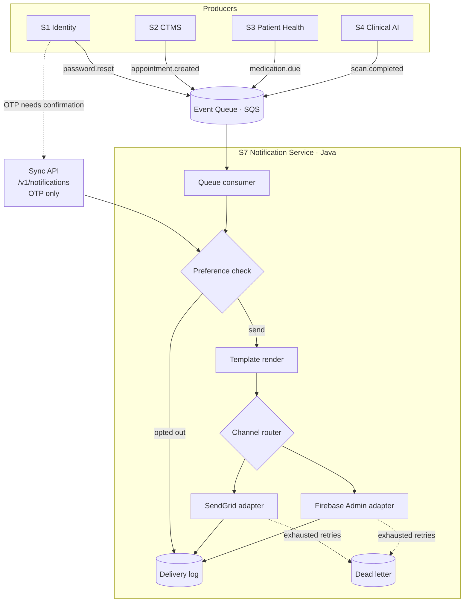
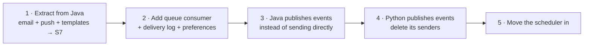

# S7 — Notification Service

> **Serves every Hekma service**, Java and Python alike.
>
> **Build from scratch?** No. Roughly 70% already exists in `hekma_api`. This is a
> consolidation, not a greenfield build.

---

## 1. Why it earns a service

Both stacks already send email and push **independently**:

| | Email | Push | Device tokens |
|---|---|---|---|
| **Java** `hekma_api` | SendGrid — `SendGridEmailAdapter` (755 lines) | Firebase Admin SDK — `FirebasePushService` | `UserDeviceTokenService` |
| **Python** `hekma_data_pipleline` | SendGrid + SMTP fallback — `email_sender.py` | Raw FCM HTTP — `notification_service.py` | `device_tokens_repo.py` |

Two SendGrid integrations, two Firebase integrations, two sets of credentials, two
retry behaviours, no shared delivery log, no shared preferences.

| Split test | Result |
|------------|--------|
| Different data ownership | Templates, preferences, device tokens, delivery log |
| Different failure domain | A SendGrid outage must not fail an API request |
| Needed by 2+ services | **Yes, today** |
| Different scaling profile | Bursty batches — reminders every minute; ~300k/day at 100k patients |

---

## 2. ⚠️ Found while surveying: the two stacks use different Firebase APIs

| Stack | Mechanism | Status |
|-------|-----------|--------|
| **Java** | `FirebaseMessaging.getInstance().send(message)` — Firebase Admin SDK | **Current and correct** |
| **Python** | `POST https://fcm.googleapis.com/fcm/send` with `Authorization: key=<server_key>` | **Legacy FCM HTTP API** |

The legacy FCM endpoint and server-key auth were deprecated by Google and retired in
mid-2024. **Medication reminder push may be failing silently in production.**

Worth verifying before anything else — check whether `FCM_SERVER_KEY` is set and
whether those requests are returning success. This consolidation fixes it either way,
since the unified service uses the Admin SDK path.

---

## 3. What already exists and can be reused



| Asset | Where | Reuse |
|-------|-------|-------|
| SendGrid integration | Java `SendGridEmailAdapter` | **As-is** — the mature implementation |
| Template engine + 19 templates | Java `EmailTemplateBuilder`, `resources/templates/*.st` | **As-is** |
| Push via Admin SDK | Java `FirebasePushService` | **As-is** |
| Device token storage | Java `UserDeviceTokenService`, Python `device_tokens_repo` | Merge into one store |
| Delivery logging | Python `medication_notification_repo` | Extend into a unified log |
| Provider fallback pattern | Python `email_sender.py` (SendGrid → SMTP → stub) | Good design — port the idea |
| Scheduled reminders | Java `AppointmentReminderScheduler` (562 lines) | Move in, generalise |

**Recommendation: build S7 in Java**, seeded from `hekma_api`'s email and push
packages. That is where the mature code, the templates, and the correct Firebase API
already live. Python's senders get deleted and replaced with event publishing.

---

## 4. Architecture



### Two entry paths

| Path | Use | Why |
|------|-----|-----|
| **Event queue** — default | Appointments, reminders, tickets, scan completion | Sender never blocks or fails on provider outage |
| **Sync API** — exception | OTP, password reset | Caller needs delivery confirmation before responding |

Everything that can be asynchronous must be. A notification failure should never fail
the business operation that triggered it.

---

## 5. What S7 owns

| Concern | Detail |
|---------|--------|
| **Templates** | The 19 `.st` files, plus new ones — versioned, one home |
| **Preferences** | Per-user, per-channel, per-category opt-in/out |
| **Device tokens** | Registration, platform, staleness pruning |
| **Delivery log** | Every attempt: channel, status, provider response, timestamp |
| **Retry policy** | Exponential backoff, bounded attempts, dead-letter queue |
| **Provider abstraction** | SendGrid, Firebase today; SMS or WhatsApp later without touching callers |
| **Scheduling** | Time-based sends — appointment reminders, medication doses |
| **Rate limiting** | Per-user caps so a bug cannot spam a patient |

---

## 6. Event contract

One schema for all producers:

```json
{
  "event_id": "uuid",
  "event_type": "medication.due",
  "recipient": { "user_id": "203022", "channels": ["push", "email"] },
  "template": "medication_reminder",
  "data": { "medication_name": "Metformin", "dose_time": "08:00" },
  "priority": "normal",
  "occurred_at": "2026-10-03T08:00:00Z"
}
```

| Field | Rule |
|-------|------|
| `event_id` | Idempotency key — the consumer must deduplicate |
| `recipient.channels` | A request, not a guarantee; preferences override |
| `template` | Resolved by S7; producers never build message bodies |
| `priority` | Routes to a fast or batch queue |

**Producers never render content.** They state what happened and who it concerns. That
is what lets you change wording without redeploying four services.

---

## 7. Migration



| Step | Work | Risk |
|------|------|------|
| 1 | New Java service seeded with `email/`, `FirebasePushService`, `UserDeviceTokenService`, templates | Low — a code move |
| 2 | SQS consumer, unified delivery log, preference table, retry and DLQ | Medium — new code |
| 3 | Replace direct sends in `hekma_api` with event publishing | Medium — many call sites |
| 4 | Replace Python's `email_sender.py` and `notification_service.py` with publishing; **fixes the legacy FCM issue** | Low — only two files |
| 5 | Move `AppointmentReminderScheduler` into S7 and generalise for medication reminders | Medium |

Step 4 is worth doing early and independently — it is small and it resolves the
possibly-dead push path.

---

## 8. Build or extend?

| | Verdict |
|---|---------|
| Build from scratch | **No** |
| Already exists | ~70% — SendGrid adapter, template engine, 19 templates, Firebase Admin integration, device tokens, delivery logging |
| Genuinely new | Queue consumer, event schema, preferences, retry/DLQ, unified log |
| Language | **Java**, seeded from `hekma_api` — the mature code and correct Firebase API live there |
| Effort shape | Consolidation and plumbing, not algorithm work |

The main cost is not writing the service. It is **replacing every direct send call
across both stacks with an event publish**.

---

*Companion to [SERVICE_DECOMPOSITION.md](./SERVICE_DECOMPOSITION.md). October 2026.*
