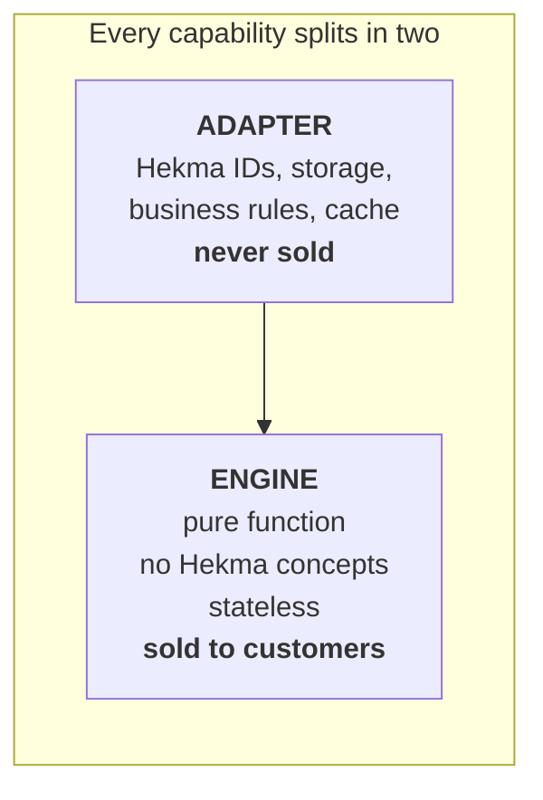
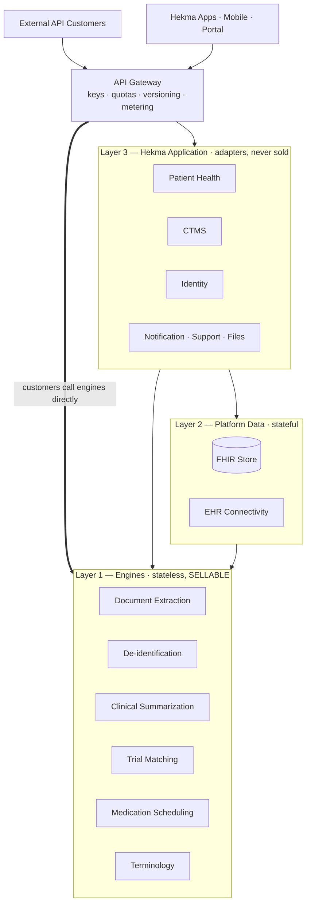
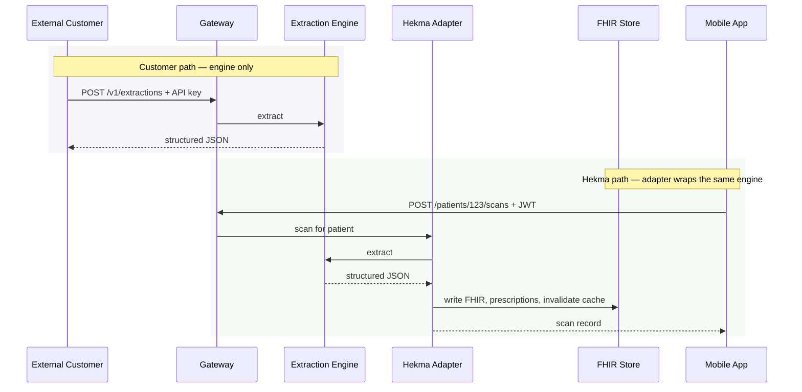
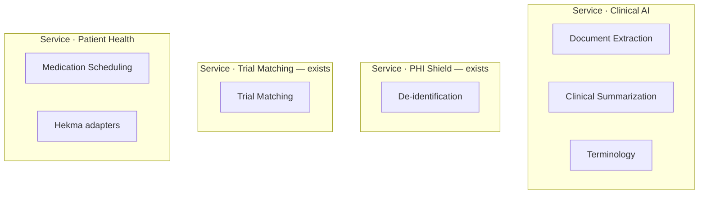
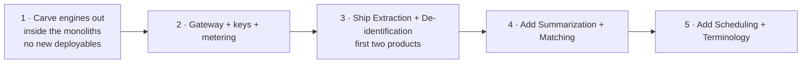

# Platform API Strategy — every capability as engine + adapter

> **Goal:** one architecture where Hekma uses a capability internally **and** the same
> capability is sold to external customers as an API.
>
> **Principle:** separate the **engine** (pure, sellable) from the **adapter**
> (Hekma-specific). Hekma becomes the first customer of its own engines.

---

## 1. The pattern

The test for an engine:

| Question | Engine must answer |
|----------|--------------------|
| Does it reference `patient_id`, `study_id`, or any Hekma identifier? | No |
| Does it write to a Hekma database? | No |
| Does it invalidate a Hekma cache? | No |
| Could a stranger call it with their own data and get value? | Yes |
| Is it a function — input in, result out? | Yes |

---

## 2. Capability inventory

Every feature in the platform, assessed honestly.

### Tier 1 — clean engines, genuinely sellable

| Engine | Input → Output | Today |
|--------|----------------|-------|
| **Document Extraction** | Document → structured clinical data | Tangled with Hekma stores — see [SELLABLE_API_DESIGN.md](./SELLABLE_API_DESIGN.md) |
| **De-identification** | Text → de-identified text + token map | **Already clean** — PHI-PII is the model |
| **Clinical Summarization** | FHIR bundle → narrative timeline | Coupled to Hekma cache/repo; core is pure |
| **Trial Matching** | Patient profile + criteria → ranked trials | Mostly separate already (TrialGPT) |
| **Medication Scheduling** | Frequency text → dose schedule + reminders | **Already pure** — `schedule_service.py` imports no storage |
| **Terminology Normalization** | Lab/vital name → LOINC code | Thin wrapper over reference data |

### Tier 2 — possible, but weak or constrained

| Capability | Why it is weaker |
|------------|------------------|
| **EHR Connectivity** | You would be reselling Fasten Health — check licensing before pricing it |
| **FHIR Store** | Commodity. AWS HealthLake and Medplum already do this; little differentiation |

### Tier 3 — not sellable as APIs

| Capability | Why not |
|------------|---------|
| Patient dashboard | Hekma's UX composition, not a reusable function |
| Medication adherence tracking | A Hekma app feature; the sellable part is the scheduling engine |
| Notification | Commodity — SendGrid and Twilio already own this |
| Files, Support, Auth, Marketplace | Internal plumbing or Hekma's own business |
| **CTMS** | Sellable — but as a **SaaS product**, not an API engine |

**Honest read:** you have six real API products. Attempting to sell notification or
file storage would compete with commodity vendors on their own ground.

---

## 3. Three-layer architecture

| Layer | Contains | State | Sold |
|-------|----------|-------|------|
| **1 · Engines** | Pure capabilities | None | **Yes — this is the product line** |
| **2 · Platform Data** | FHIR store, EHR connections | Heavy | Rarely |
| **3 · Application** | Hekma IDs, UX, business rules | Hekma's | No |

**The rule that makes it work:** Layer 1 never calls Layer 2 or 3. Dependencies point
downward only. An engine that reaches up into Hekma data is no longer sellable.

---

## 4. Hekma as its own customer

The same engine serves both, with only the adapter differing.

One implementation of extraction. Two products. No duplicated logic, and every
improvement to the engine benefits both immediately.

---

## 5. Engines are not deployables

Six engines does not mean six services. Group them by runtime and scaling profile.

| Deployable | Engines | Why grouped |
|------------|---------|-------------|
| **Clinical AI** | Extraction, Summarization, Terminology | All LLM/vision; same scaling and cost profile |
| **PHI Shield** | De-identification | Own ML model; already separate |
| **Trial Matching** | Matching | Vector DB; already separate |
| **Patient Health** | Medication Scheduling | Pure compute, tiny — no separate deployment warranted |

This stays consistent with the six services in
[SERVICE_DECOMPOSITION.md](./SERVICE_DECOMPOSITION.md). **A product gets its own
deployable only when its scaling, runtime, or failure profile demands it** — not
because it has a price.

---

## 6. One public API surface

Customers see a single coherent product line, regardless of what runs where.

| Product | Public endpoint |
|---------|-----------------|
| Document Extraction | `POST /v1/extractions` |
| Clinical Summarization | `POST /v1/summaries` |
| De-identification | `POST /v1/deidentify` |
| Trial Matching | `POST /v1/matches` |
| Medication Scheduling | `POST /v1/schedules` |
| Terminology | `GET /v1/terminology/resolve` |

Shared conventions across all of them:

| Convention | Rule |
|------------|------|
| Auth | API key per customer; JWT only for Hekma apps |
| Long-running work | Async job: `202` + `job_id`, poll or webhook |
| Fast work | Synchronous — scheduling and terminology return inline |
| Versioning | `/v1/` in the path; deprecation window published |
| Identifiers | Customers pass their own `reference_id`; never a Hekma ID |
| Retention | Results expire by default; you sell computation, not storage |
| Errors | Structured, documented, stable codes |

Internal Hekma endpoints stay on their current paths and are not part of the public
contract.

---

## 7. Sequence

### Step 1 — carve out engines, ship nothing new

For each Tier 1 capability, split the module into `engine/` and `adapter/`. The engine
imports nothing Hekma-specific; a CI import rule enforces it.

| Engine | Effort | Note |
|--------|--------|------|
| Medication Scheduling | **Trivial** | Already pure — just relocate |
| De-identification | **None** | Already clean |
| Terminology | Low | Separate lookup logic from CRUD |
| Document Extraction | Medium | Remove 5 Hekma imports |
| Clinical Summarization | Medium | Separate generation from cache/repo |
| Trial Matching | Medium | Already its own service; clean the contract |

This is the whole architectural change. Everything after it is packaging.

### Step 2 — the product layer

API keys, per-customer isolation, quotas, metering, versioned contracts, docs,
sandbox. Shared by all six products, built once. Overlaps directly with
[TENANCY_DESIGN.md](./TENANCY_DESIGN.md) — an API customer is a tenant.

### Steps 3–5 — launch in order of readiness

De-identification and Document Extraction first: one is already clean, the other is
the strongest commercial case.

---

## 8. What this gives you

| | Today | Target |
|---|-------|--------|
| Sellable API products | 0 | **6** |
| Deployable services | 4 | **6 + gateway** |
| Duplicated logic between internal and sold | — | **None** — one engine, two consumers |
| Hekma's own scalability | Scans block request threads | Engines scale independently |
| Cost of adding a product | Rewrite | Expose an existing engine |

**The core idea:** Hekma stops being an application that happens to contain
capabilities, and becomes a set of capabilities with Hekma as their first customer.

---

*Companion to [SERVICE_DECOMPOSITION.md](./SERVICE_DECOMPOSITION.md),
[SELLABLE_API_DESIGN.md](./SELLABLE_API_DESIGN.md), and
[ARCHITECTURE.md](./ARCHITECTURE.md). October 2026.*
