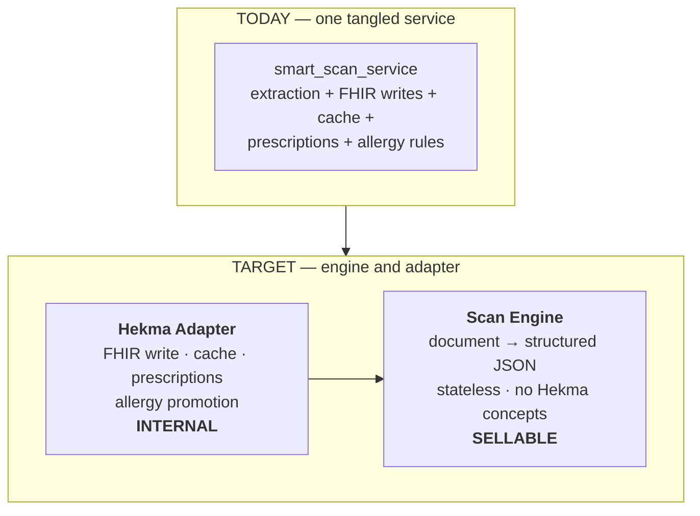
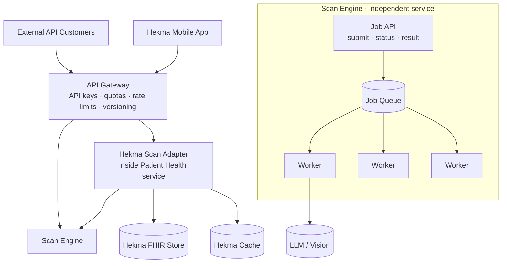
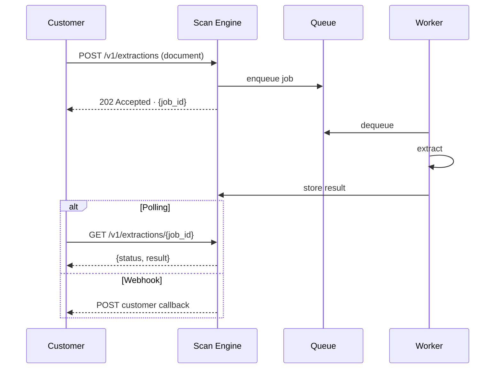
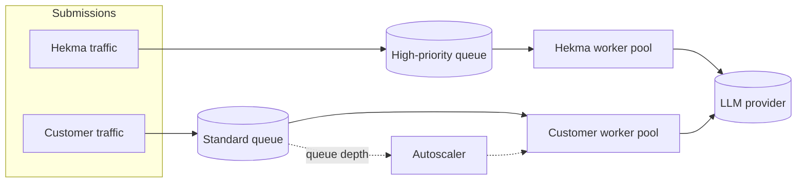
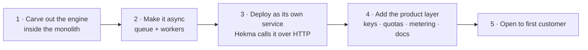
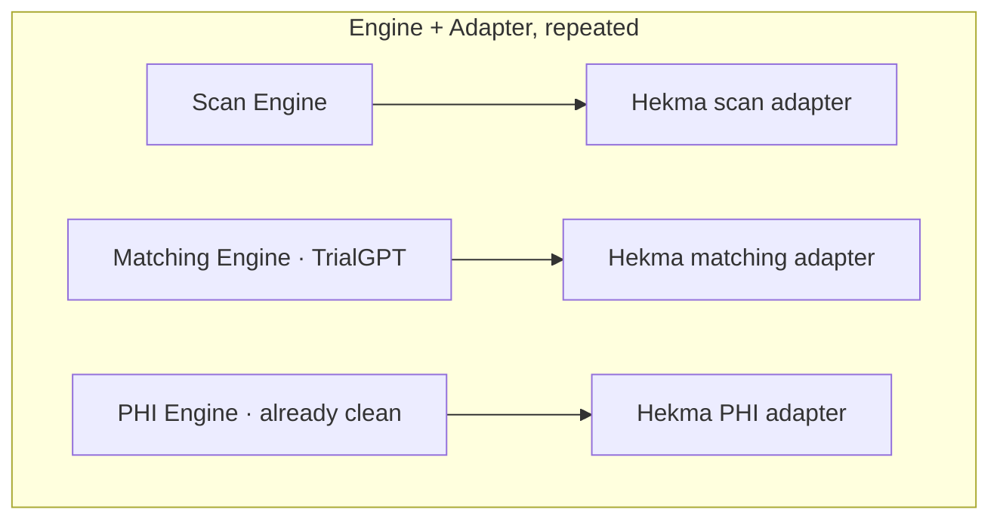

# Designing Scan AI as a Sellable API

> **Question:** to sell the scan API to external customers, do we need it as an
> independent microservice?
>
> **Answer:** yes — but extraction is the easy half. The service must first be split
> into a **sellable engine** and a **Hekma adapter**, because today it is wired
> directly into Hekma's database and business logic.

---

## 1. Why the current scanner cannot be sold

`services/clinical_scans/smart_scan_service.py` imports:

| Dependency | What it does | Why an external customer cannot have it |
|------------|--------------|------------------------------------------|
| `HekmaClinicalStore` | Writes FHIR into Hekma's Postgres | Their document would land in Hekma's patient database |
| `DashboardCacheInvalidator` | Clears Hekma dashboard cache | Meaningless to them |
| `PrescriptionService` | Creates Hekma medication records | Hekma business logic |
| `promote_allergy_like_conditions` | Hekma clinical rules | Hekma business logic |
| `clinical_scans_repo` | Hekma scan tables | Hekma storage |

The endpoint signature is also Hekma-shaped:

```
POST /api/patients/{patient_id}/clinical-scans/smart
```

**An external customer has no Hekma `patient_id`.** They have a document and they want
structured data back.

Two further blockers:

- **It is synchronous.** A multi-page PDF through OpenAI vision can take 30–60s+. Over
  public HTTP that means gateway timeouts, no retry semantics, and no backpressure.
- **It persists by default.** The product a customer buys is extraction, not storage
  in someone else's database.

---

## 2. The core move: separate the engine from the adapter



| | Scan Engine | Hekma Adapter |
|---|---|---|
| Input | A document | A Hekma patient + document |
| Output | Structured clinical JSON | FHIR rows, prescriptions, cache invalidation |
| Knows about | Nothing Hekma-specific | Everything Hekma-specific |
| State | Stateless | Owns Hekma scan tables |
| Scaling | Horizontal, unlimited | Follows Hekma load |
| Sold to | **Any customer** | Never sold |

**One engine, two consumers.** Hekma is simply its first customer. No duplicated
extraction logic.

---

## 3. Target architecture



External customers and Hekma call **the same engine**. Only Hekma's traffic continues
on to the adapter, which writes to Hekma's stores.

---

## 4. The public API shape

Asynchronous job model, not a blocking request.



| Endpoint | Purpose |
|----------|---------|
| `POST /v1/extractions` | Submit a document → `202` with `job_id` |
| `GET /v1/extractions/{job_id}` | Poll status and retrieve result |
| `DELETE /v1/extractions/{job_id}` | Delete result and source |
| `GET /v1/health` | Status |

**Design rules for the public contract:**

| Rule | Reason |
|------|--------|
| No `patient_id` in the path | A Hekma concept; customers supply their own `reference_id` |
| Results expire by default (e.g. 24h) | You are selling extraction, not storage |
| Version in the path (`/v1/`) | Breaking changes need a migration window |
| Webhook optional, polling always available | Not every customer can receive callbacks |
| Errors are structured and documented | Customers write code against your failures |

---

## 5. Scalability — for customers and for Hekma

A stateless engine behind a queue is what makes this scale, and it protects Hekma from
external load.



| Concern | Mechanism |
|---------|-----------|
| A large customer starving Hekma | Separate queues and worker pools; Hekma gets priority |
| Load spikes | Autoscale workers on queue depth, not CPU |
| Long documents | Async jobs — no HTTP timeout to hit |
| LLM provider throttling | Bounded concurrency with retry and backoff at the worker |
| Cost control | Per-tenant quotas enforced before enqueue |
| Noisy failure | Dead-letter queue, not a lost job |

**Key property:** the engine holds no state, so adding capacity is adding workers.
Hekma's own throughput improves as a side effect, since scans no longer block
request threads.

---

## 6. Extraction is not productization

Standing up the service is roughly a quarter of the work. These are what turn an
internal service into a product.

| Capability | Why it is required |
|------------|---------------------|
| **API keys** | External callers have no Hekma JWT |
| **Per-customer isolation** | One customer's documents and results are invisible to others |
| **Quotas and rate limits** | Protect cost and capacity |
| **Usage metering** | You cannot invoice what you do not measure |
| **Versioning and deprecation policy** | Customers build against your contract |
| **Published SLA** | Procurement will ask for it |
| **Sandbox environment** | Customers need somewhere to integrate before going live |
| **Documentation and SDK** | Integration effort determines adoption |
| **Status page** | Expected of any paid API |
| **BAA / data handling policy** | Mandatory for PHI in healthcare |

Several of these overlap with the tenancy work in
[TENANCY_DESIGN.md](./TENANCY_DESIGN.md) — an API customer *is* a tenant. Build the
customer model once and both efforts share it.

---

## 7. Migration path



| Step | Work | Risk |
|------|------|------|
| 1 | Split `smart_scan_service` into a pure extraction core and a Hekma adapter. Core imports nothing Hekma-specific. **Still one deployable.** | Low — internal refactor, tests in `hekma_test_suit` cover it |
| 2 | Move extraction behind a job queue; Hekma submits and polls | Medium — changes the mobile app's interaction |
| 3 | Deploy the engine separately; adapter calls it over HTTP | Medium |
| 4 | API keys, quotas, metering, versioned public contract, docs, sandbox | Medium |
| 5 | Onboard the first external customer | — |

**Step 1 is the one that matters.** Once the engine imports nothing Hekma-specific,
everything after it is mechanical. It is also worth doing on its own merits, since it
makes the scanner independently testable.

---

## 8. The same pattern applies to every product



| Product | Engine is sellable because | Adapter keeps |
|---------|---------------------------|---------------|
| **Scan AI** | Document in, data out — no Hekma concepts | FHIR writes, prescriptions, cache |
| **Trial Match** | Patient profile in, ranked trials out | Hekma patient resolution, enrolment |
| **PHI Shield** | Text in, de-identified text out — **already built this way** | — |

**PHI-PII is the model to copy.** It is already a clean engine with no Hekma coupling,
which is exactly why it is the easiest thing you own to sell today.

---

## 9. Answering the original question directly

| Question | Answer |
|----------|--------|
| Does selling Scan AI require its own service? | **Yes** — different scaling, different cost, different callers, different failure domain |
| Does that contradict "only 6 services"? | **No** — Document Intelligence is S4 in [SERVICE_DECOMPOSITION.md](./SERVICE_DECOMPOSITION.md) |
| Is extraction the hard part? | **No** — decoupling from Hekma internals is |
| Does every product need its own service? | **No** — only those that pass the split tests. Scan AI does. |
| What is the first step? | **Split the engine from the adapter, inside the monolith** |

---

*Companion to [SERVICE_DECOMPOSITION.md](./SERVICE_DECOMPOSITION.md) and
[ARCHITECTURE.md](./ARCHITECTURE.md). October 2026.*
