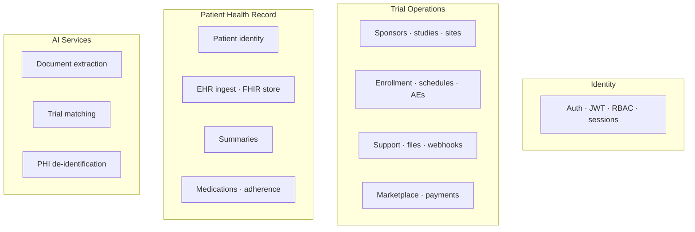
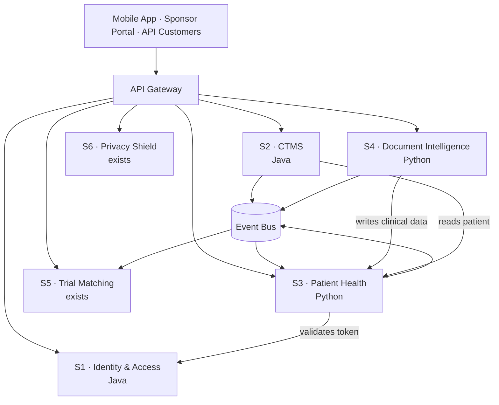
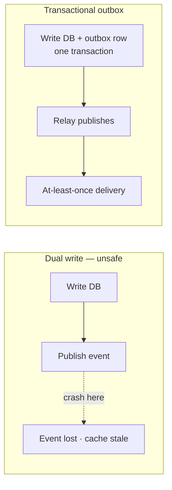
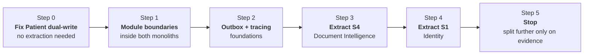

# Service Decomposition — how many services, and why

> Answers one question: **if we decompose this platform properly, what is the right
> number of services?**
>
> **Answer: 6 business services + 1 gateway.** You already run 4 of them.
>
> Tenancy, entitlements, and billing are deliberately out of scope here — see
> [TENANCY_DESIGN.md](./TENANCY_DESIGN.md).

---

## 1. Why 16 was the wrong number

The earlier plan proposed 16 services. The flaw was not the count itself — it was that
**no sizing principle produced it.** It listed the modules that exist in the code and
made each one a service. That is a refactor inventory, not an architecture.

A service boundary should be drawn where one of these is true:

| Reason to split | Test |
|-----------------|------|
| **Different scaling profile** | Does it need 10× the compute of its neighbour? |
| **Different failure domain** | Should its outage leave the rest running? |
| **Different runtime** | Does it need GPU, a different language, a different JVM? |
| **Different change rate** | Does it ship daily while the rest ships monthly? |
| **Different data ownership** | Does it own tables nobody else should touch? |
| **Different compliance boundary** | Must it run in a customer's VPC or on-prem? |

Apply those tests to the 16 and most fail. "Clinical FHIR Store", "Patient Profile",
and "EHR Summary" share a database, serve one screen, change together, and scale
together. They are one service wearing three names.

---

## 2. The bounded contexts that actually exist

Reading the code, these are the genuine domains:

Four clusters. Not sixteen.

---

## 3. Target: 6 services

| # | Service | Source | Owns |
|---|---------|--------|------|
| **S1** | Identity & Access | `hekma_api` | Login, JWT, OTP, sessions, RBAC, token blacklist |
| **S2** | CTMS | `hekma_api` | Studies, sites, sponsors, enrollment, schedules, AEs, support, files, webhooks, marketplace |
| **S3** | Patient Health | `hekma_data_pipleline` | Patient identity, EHR ingest, FHIR store, summaries, medications, HealthKit |
| **S4** | Document Intelligence | `hekma_data_pipleline` | Scanning, OCR, AI extraction |
| **S5** | Trial Matching | `TrialGPT` — exists | Patient↔trial matching, vectors |
| **S6** | Privacy Shield | `PHI-PII` — exists | Anonymization, tokenization |
| **S7** | Notification | `hekma_api` email/push | Email, push, templates, preferences, delivery log |

**Each monolith splits in two, plus a shared notification service. Three to build,
four already exist.**

---

## 4. Why each split earns its place

### S1 Identity, out of Java

| Test | Result |
|------|--------|
| Data ownership | Owns `AUTH_*`, sessions, token blacklist |
| Failure domain | Auth down means everything down — it needs its own availability target |
| Change rate | Very stable; CTMS changes weekly |
| Compliance | Separate audit requirements |

It is also the **current coupling point**: Java and Python share a JWT secret and the
same Redis blacklist keys. Extracting it removes that shared secret.

### S4 Document Intelligence, out of Python

| Test | Result |
|------|--------|
| Scaling | LLM/OCR workload is bursty and far heavier than CRUD |
| Failure domain | A stuck extraction job must not slow dashboard reads |
| Cost | Per-scan OpenAI spend needs isolated attribution |
| Change rate | Fastest-moving code in the platform |
| Sellability | The most viable standalone API product |

### What is *not* split, and why

| Kept together | Reason |
|---------------|--------|
| Patient + EHR + FHIR + Summaries | One database, one screen, change together. Splitting adds 3 network hops per dashboard load. |
| Medications inside Patient Health | Shares patient context; separate schema is enough isolation |
| Support, Files, Webhooks inside CTMS | Features of CTMS, not products |
| Marketplace inside CTMS | Shares study and patient data heavily |

> **Revised:** Notification was originally kept inside CTMS here. On inspection, Java
> and Python already run **separate** SendGrid and Firebase integrations, so it has two
> consumers today and meets the split tests. It is now **S7** — see
> [NOTIFICATION_SERVICE_DESIGN.md](./NOTIFICATION_SERVICE_DESIGN.md).

---

## 5. Gaps in v1.0 that have nothing to do with team size

Even designed for a large team, the 16-service plan was missing the hard parts.

### 5.1 The dual-write problem — no outbox

The scan flow writes clinical data to Postgres, then publishes `scan.completed`, then
invalidates Redis. If the process dies midway, state diverges silently.

The codebase sends SQS messages directly today (`awsutils/sqs_utils.py`). Across
service boundaries that becomes a correctness bug. **An outbox table and relay is
mandatory before events carry real state.**

### 5.2 Shared Redis breaks the ownership rule

v1.0 kept Redis shared for both cache and token blacklist while claiming "each service
owns its data." Those contradict. Redis keys are written from at least 8 places in the
Python code and from Java.

**Required:** the blacklist belongs to S1 and is reached through its API. Cache keys
are namespaced per service. No cross-service key writes.

### 5.3 No consistency model

The plan never states what is strongly consistent and what is eventual. Without that,
every cross-service read is a guess.

| Interaction | Model |
|-------------|-------|
| Scan writes clinical data | **Strong** — synchronous call to S3, fails loudly |
| Cache invalidation | **Eventual** — via event, stale reads tolerated briefly |
| CTMS reads patient demographics | **Eventual** — cached with a short TTL |
| Token validation | **Strong** — synchronous, or locally verified signature |

### 5.4 The GraphQL schema is the hardest problem and went unmentioned

**1,875 lines, ~190 operations, one file.** Splitting Identity out of Java means
splitting this schema. v1.0 said nothing about it.

Three options:

| Option | Fit |
|--------|-----|
| **Keep one schema in S2, S1 is REST-only** | Simplest. Auth is already REST. **Recommended.** |
| Federation (Apollo Router) | Correct at 4+ GraphQL services; overkill for 2 |
| Schema stitching in the gateway | Extra moving part, little gain |

### 5.5 The riskiest change was scheduled last

v1.0 put "break shared DB" in Phase 4. The `Patient` dual-write between Java and Python
is the **highest-severity defect in the platform** and gets more entangled every month.

**It should be first.** It is also valuable on its own — it does not require any
service to be extracted.

### 5.6 No contract testing

With services calling each other, "we deployed and it broke the other team" becomes
routine. Consumer-driven contract tests, or at minimum schema compatibility checks in
CI, are not optional.

### 5.7 No distributed tracing

v1.0 lists "centralized logging." Logs are insufficient once a request crosses three
services. Correlation IDs propagated through HTTP headers and event payloads, with
traces in one place.

---

## 6. Recommended sequence

Ordered by risk reduction, not by ease.

| Step | Work | Why here |
|------|------|----------|
| 0 | Give `Patient` and `AUTH_USER_DETAILS` a single owner; the other side calls an API | Highest-severity issue, no extraction required |
| 1 | Enforce module boundaries inside both monoliths; no cross-module imports or SQL | Makes every later extraction mechanical |
| 2 | Transactional outbox, correlation IDs, contract tests | Must exist *before* services talk |
| 3 | Extract Document Intelligence | Strongest standalone case |
| 4 | Extract Identity | Removes the shared JWT secret and Redis blacklist |
| 5 | Stop at 6 | Split further only when §1's tests pass for a specific module |

Steps 0–2 deliver most of the benefit with none of the distributed-systems cost.

---

## 7. Is the reference document correct?

| Aspect of v1.0 | Verdict |
|----------------|---------|
| Shared-MySQL coupling analysis | **Correct** — and the most valuable part |
| "Each service owns its tables" | **Correct in principle**, contradicted by shared Redis |
| Strangler-fig migration | **Correct approach** |
| Extract-easiest-first ordering | **Wrong priority** — extract highest-risk-reduction first |
| 16 services | **Wrong** — no sizing principle; most fail the split tests |
| Patient 360 split four ways | **Wrong** — one database, one screen, one change unit |
| Phase 4 for the shared DB fix | **Wrong** — belongs first |
| Outbox / consistency / tracing / contracts | **Missing entirely** |
| GraphQL decomposition | **Missing entirely** |

**Use it for the coupling analysis. Do not use it as the target architecture.**

---

## 8. Summary

| | v1.0 | This document |
|---|------|---------------|
| Services | 16 | **6 + gateway** |
| New services to build | 14 | **2** (S1, S4) |
| Sizing rationale | none | six explicit split tests |
| Event correctness | unaddressed | transactional outbox |
| Shared Redis | shared, contradicting ownership | owned per service |
| Consistency model | unstated | stated per interaction |
| GraphQL split | unaddressed | keep one schema, S1 is REST |
| First action | extract Support Center | **fix the `Patient` dual-write** |

---

*Companion to [ARCHITECTURE.md](./ARCHITECTURE.md). October 2026.*
