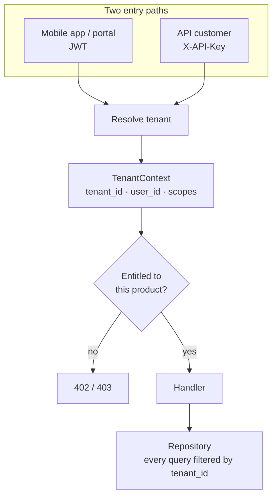
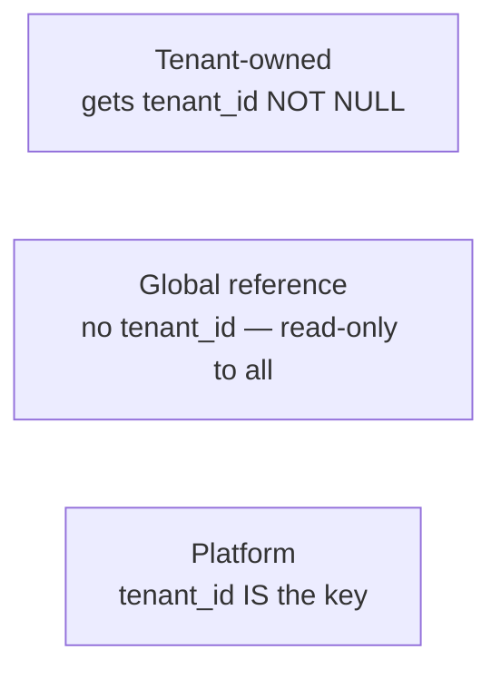
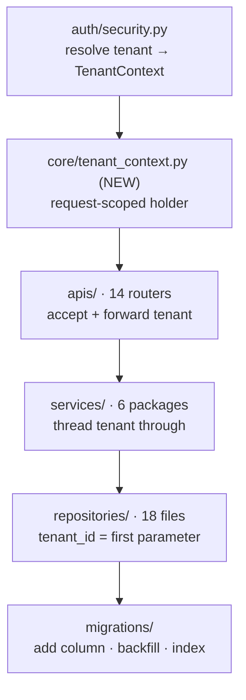
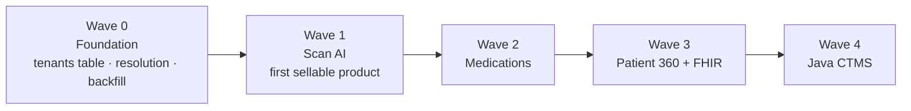

# Multi-Tenancy Design — adding `tenant_id`

> **Why this is first:** today the platform has exactly one customer (Hekma). Nothing
> in the code can answer "which customer does this row belong to?" Until it can, no
> feature can be sold to anyone else.
>
> **Approach:** row-level `tenant_id` scoping, extending the pattern already accepted
> in [ADR-001](../../Backend%20API%20Hekma/hekma_data_pipleline/docs/adr/ADR-001-advocacy-multitenancy.md)
> from the advocacy module to the whole platform.

---

## 1. What a tenant is

A **tenant is a customer organization that bought something from Hekma.**

| Example tenant | Buys |
|----------------|------|
| Memorial Health System | Patient 360, Scan AI |
| Pfizer Clinical Ops | CTMS, Trial Match |
| A health-tech vendor | PHI Shield API only |
| Hekma itself | everything — tenant #1, the existing data |

A patient belongs to a tenant. A study belongs to a tenant. A scan belongs to a tenant.

**Existing concept to reuse:** the Java side already has `Account` / `SponsorAccount`,
which is tenant-shaped. Rather than inventing a parallel idea, `Account` gets a
`tenant_id` and becomes a tenant's CTMS presence.

---

## 2. Where `tenant_id` comes from

Every request must resolve to exactly one tenant before any query runs.



**JWT path.** `auth/security.py:jwt_filter()` currently returns the decoded payload
from `jwt_util.validate(token)`. It must additionally resolve `tenant_id` and return
a `TenantContext` instead of a bare payload. Token issuance lives in the Java side,
so either add a `tenant_id` claim there, or look it up from `user_id` and cache it in
Redis (the ADR-001 approach — 300s TTL).

**API key path.** New. Keys are hashed at rest, map to one tenant, and carry product
scopes. This is what external API customers use.

---

## 3. Table classification

Every table falls into exactly one bucket.



### Bucket A — tenant-owned (PostgreSQL, Python)

These hold customer data. All get `tenant_id BIGINT NOT NULL`.

| Table | Domain |
|-------|--------|
| `patient` | Patient registry |
| `fasten_controller` | EHR connections |
| `fastenhealth_*` | FHIR resources — **created dynamically**, see §6 |
| `fastenhealth_bmi_data` | Derived vitals |
| `hekma_fhir_link` | MySQL ↔ FHIR identity bridge |
| `ehr_summary_cache` | AI summaries |
| `clinical_document_scans` | Scan AI records |
| `allergy_scans` | Scan-derived allergies |
| `prescriptions` | Scanned prescriptions |
| `medications` | Patient medications |
| `medication_reminders` | Reminder schedules |
| `medication_history` | Dose log |
| `medication_daily_counts` | Pill counts |
| `medication_notification_log` | Delivery log |
| `medication_order` | Legacy FHIR meds |
| `patient_device_tokens` | Push tokens |
| `account_deletion_archive` | Deletion ledger |
| `healthkit` | Wearables |
| `condition`, `allergy`, `immunization`, `observation`, `procedure` | Legacy FHIR tables |

### Bucket B — global reference (no `tenant_id`)

Shared across all tenants, read-only.

| Table | Why global |
|-------|-----------|
| `standard_lab_catalog` | LOINC reference data |
| `clinical_trials` | Public trials corpus |
| `SRC_COUNTRY`, `SRC_STATE`, `LOVs` (MySQL) | Reference lists |
| `EMAIL_TEMPLATE` (MySQL) | Platform templates |

### Bucket C — platform tables (new)

`tenant_id` is the primary dimension. These live in the commerce module.

| Table | Purpose |
|-------|---------|
| `tenants` | id, name, slug, plan_tier, status |
| `tenant_api_keys` | hashed key, scopes, expiry, rotation |
| `product_entitlements` | tenant × product × tier × expires_at |
| `usage_events` | tenant × product × metric × quantity × ts |
| `usage_rollups` | pre-aggregated for billing |

### Bucket A (MySQL, Java)

| Table | Note |
|-------|------|
| `Account`, `AccountContactRel` | Becomes the tenant's CTMS presence |
| `Patient`, `PatientContact` | Highest-value tenant data |
| `AUTH_USER_DETAILS` | A user belongs to a tenant |
| `Study`, `StudySite*`, `STUDY_SCHEDULE*` | Trial operations |
| `APPOINTMENTS`, `APPOINTMENT_REQUEST` | Scheduling |
| `Allergies`, `LabReports`, `Immunization`, `Procedures`, `MedicalCondition`, `Medication` | Legacy clinical tiles |
| `OPEN_SQUARE_*` | Marketplace |
| `support_*` | Support tickets |
| `AuditLog` | Audit trail |

---

## 4. Code to touch

### Python — `hekma_data_pipleline`



| Layer | Files | What changes |
|-------|-------|--------------|
| Auth | `auth/security.py`, `auth/jwt_util.py` | `jwt_filter` returns `TenantContext`, not a raw payload |
| Context | `core/tenant_context.py` — **new** | Request-scoped tenant holder |
| API | `apis/*.py` — 14 routers | Depend on `TenantContext`, forward to services |
| Services | `services/medications/`, `clinical_scans/`, `clinical_fhir/`, `account_deletion/`, `lab_catalog/`, `fasten_health/` | Accept and pass `tenant_id` |
| Repositories | `repositories/*.py` — 18 files, ~75 functions | `tenant_id` first positional parameter; every WHERE includes it |
| Schema | `migrations/`, `repositories/core_schema.py`, `medication_schema.py` | Column, backfill, composite indexes |
| FHIR store | `services/clinical_fhir/store.py` | Dynamic `fastenhealth_*` DDL — see §6 |

Repository files ranked by work required:

| Functions | File |
|-----------|------|
| 23 | `ctms_clinical_repo.py` |
| 10 | `clinical_scans_repo.py` |
| 7 | `medication_repo.py` |
| 6 | `prescriptions_repo.py` |
| 5 each | `medication_history_repo.py`, `compliance_repo.py`, `medication_schema.py` |
| 4 | `lab_catalog_repo.py` — Bucket B, mostly unaffected |
| 1–3 each | reminders, timezone, device tokens, notification |
| class-based | `account_deletion_repo.py`, `hekma_fhir_link_repo.py`, `clinical_record_repo.py`, `medication_daily_count_repo.py` |

### Java — `hekma_api`

| Layer | What changes |
|-------|--------------|
| `security/JWTTokenFilter`, `JwtUtil` | Add `tenant_id` claim on issue; expose on validate |
| `datalayer/*Persist` — 18 JDBC classes | Every hand-written SQL gets a `tenant_id` predicate |
| `graphql/Query.java`, `Mutation.java` | Resolve tenant from context, pass to persist layer |
| `entity/` + `repository/` (JPA, support) | `tenant_id` field + derived queries |
| Flyway `V36__add_tenant_id.sql` | Column, backfill, indexes |

---

## 5. The highest-risk code: lookups by surrogate ID

**15 repository functions take only a surrogate ID and no patient or tenant scope.**
These are the cross-tenant leak vectors — they trust that the caller already checked,
and nothing in the query prevents reading another tenant's row.

```python
# Today — nothing stops tenant A reading tenant B's scan
def get_clinical_scan(scan_id: int)
def update_clinical_scan(scan_id: int, data: dict)
def soft_delete_clinical_scan(scan_id: int)
def update_medication(medication_id, data)
def delete_medication(medication_id)
def set_medication_hekma_id(medication_id, hekma_id)
def get_reminders_by_medication(medication_id)
def delete_reminders_by_medication(medication_id)
# ...and 7 more
```

```python
# Required — tenant is part of the predicate, not an assumption
def get_clinical_scan(tenant_id: int, scan_id: int)
    ...WHERE tenant_id = %s AND id = %s
```

**Fix these first.** A missed `WHERE tenant_id` on a patient-scoped list is a bug;
a missed one here is a direct object reference across customers.

---

## 6. The `fastenhealth_*` special case

`services/clinical_fhir/store.py` builds table names at runtime:

```python
table = f"fastenhealth_{resource_type.lower()}"
```

Tables are created on demand per FHIR resource type, so there is no fixed migration
file listing them. The tenant column must be added in three places:

1. The DDL template that creates a new `fastenhealth_*` table
2. A migration that loops existing `fastenhealth_*` tables and adds the column
3. Every read and write path in `store.py` and `hekma_clinical_store.py`

---

## 7. Rollout

Ship in waves. Each wave is independently deployable and reversible.



### Wave 0 — foundation

| Step | Detail |
|------|--------|
| Create `tenants` and seed | Hekma becomes `tenant_id = 1` |
| Tenant resolution | `TenantContext`, JWT claim or Redis-cached lookup |
| Add columns **nullable** | No behaviour change yet |
| Backfill | `UPDATE … SET tenant_id = 1` across all Bucket A tables |
| Add indexes | Composite, `tenant_id` leading |
| Flip to `NOT NULL` | Once backfill verifies |

All existing data becomes tenant 1. Nothing breaks, nothing is visible to users.

### Wave 1 — Scan AI

Smallest surface, and the product you want to sell first. Covers
`clinical_scans_repo.py`, `allergy_scans`, and `services/clinical_scans/`. Fix the
surrogate-ID functions here.

### Wave 2 — Medications

`medication_*` and `prescriptions` repositories — self-contained schema, no FHIR
coupling.

### Wave 3 — Patient 360 and FHIR

Largest Python wave: `patient`, `fasten_controller`, the dynamic `fastenhealth_*`
tables, `hekma_fhir_link`, `ehr_summary_cache`.

### Wave 4 — Java CTMS

18 JDBC persist classes with hand-written SQL. Slowest and least urgent, since CTMS
is not the first product you intend to sell standalone.

---

## 8. Enforcement and verification

Discipline is the only thing holding row-level isolation together. ADR-001 names this
as the main drawback. Three mitigations, all cheap:

| Control | How |
|---------|-----|
| **Convention** | `tenant_id` is always the first positional parameter. PR review blocker. |
| **Isolation test** | Two seeded tenants; every list endpoint asserted to return zero rows from the other. Runs in CI. |
| **Postgres RLS** | Phase 2 defence in depth: `SET LOCAL app.current_tenant_id` inside `pg_transaction()`. No table changes needed — ADR-001 already identifies this path. |

The isolation test matters more than it sounds. It is the only thing that catches a
forgotten `WHERE` clause before a customer does.

---

## 9. Scope boundaries

**In scope:** `tenant_id` on Bucket A tables, tenant resolution, repository signature
change, isolation testing.

**Explicitly not in scope:**

| Not doing | Why |
|-----------|-----|
| Schema-per-tenant | ADR-001 rejected it — pooled connections and `search_path` are unsafe without ORM guardrails |
| Database-per-tenant | Operational cost; kills cross-tenant analytics |
| Splitting any service | Unrelated to tenancy, and not needed to sell |
| Changing JWT issuance | Prefer a Redis-cached lookup over touching Java auth first |

---

## 10. Definition of done

- [ ] `tenants` table exists; Hekma is tenant 1
- [ ] Every request resolves to exactly one tenant before any query
- [ ] Every Bucket A table has `tenant_id NOT NULL` with a leading composite index
- [ ] Every repository function takes `tenant_id` first
- [ ] All 15 surrogate-ID functions are tenant-scoped
- [ ] Dynamic `fastenhealth_*` DDL emits `tenant_id`
- [ ] Two-tenant isolation test green in CI
- [ ] A second tenant can be created and sees none of tenant 1's data

When this list is complete, **adding the commerce layer is small** — and Scan AI
becomes sellable without extracting a single service.

---

*Companion to [ARCHITECTURE.md](./ARCHITECTURE.md). October 2026.*
