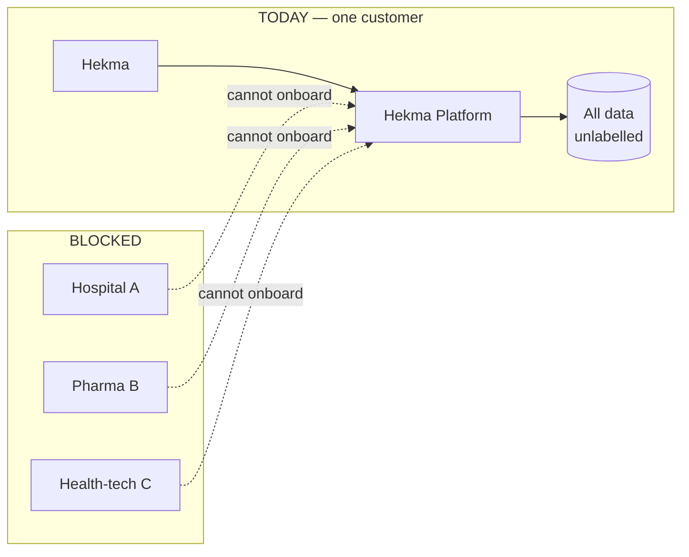
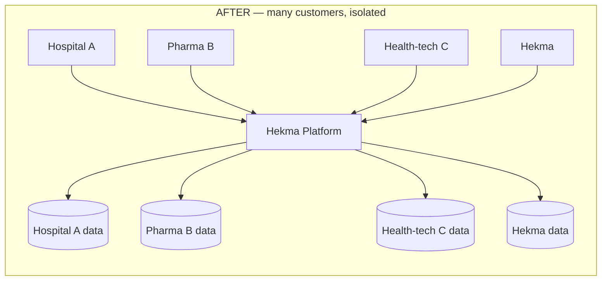
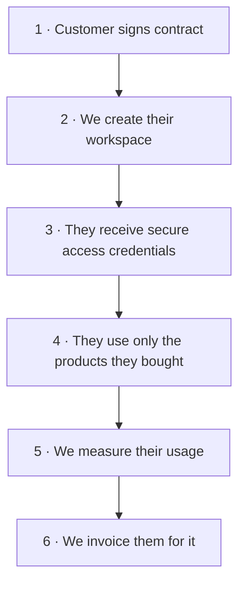
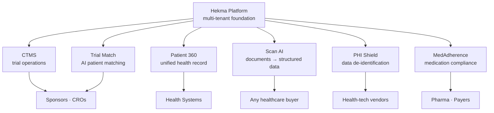
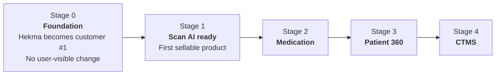

# Multi-Tenancy — Leadership Overview

**One-line summary:** our platform can serve exactly one customer today. This project
makes it able to serve many, each fully isolated from the others. It is the
prerequisite for selling any Hekma product to an external customer.

---

## 1. The problem

Every patient record, document scan, and clinical study in our system implicitly
belongs to Hekma. There is no concept of "which customer owns this."

If we onboarded a hospital tomorrow, their patient data and ours would sit in the
same tables with nothing distinguishing them. That is a commercial blocker and a
compliance risk.

---

## 2. The solution

Every record gets an owner label. Every request is checked against it.

Each customer sees only their own data. They cannot see — or even address — another
customer's records. One platform, many isolated workspaces.

---

## 3. What a customer experiences

Three capabilities are created by this work, and none of them exist today:

| Capability | Meaning |
|------------|---------|
| **Isolation** | Customers never see each other's data |
| **Entitlement** | Customers access only the products they purchased |
| **Metering** | We can measure and bill actual usage |

---

## 4. What this unlocks commercially

Once isolation exists, each capability becomes a separately sellable product with its
own price and its own buyer.

**Scan AI is the first product to take to market** — it is a self-contained API, its
value is immediately measurable, and it has the widest set of potential buyers.

---

## 5. Why this is also a compliance requirement

Tenant isolation is not only a commercial feature. Enterprise healthcare buyers will
not sign without it.

| Requirement | Why isolation is required |
|-------------|---------------------------|
| **HIPAA / BAA** | Each customer's PHI must be demonstrably separated |
| **Procurement review** | Hospitals audit data separation before signing |
| **Breach containment** | An incident is scoped to one customer, not all |
| **Right to deletion** | We must be able to remove one customer's data completely |

Without this work, we cannot credibly answer a hospital's security questionnaire.

---

## 6. Delivery plan

The work ships in stages. **Existing users see no change at any point** — Hekma simply
becomes the first customer in the new model.

| Stage | Outcome | Commercial milestone |
|-------|---------|---------------------|
| 0 | Customer model exists; all current data assigned to Hekma | — |
| 1 | Scan AI isolated, entitled, metered | **First external customer can be onboarded** |
| 2 | Medication products isolated | Pharma / payer deals become possible |
| 3 | Patient 360 isolated | Health-system deals become possible |
| 4 | CTMS isolated | Sponsor / CRO deals become possible |

Each stage is independently deliverable and reversible. Revenue can begin at Stage 1
without waiting for the rest.

---

## 7. Investment and risk

| Dimension | Assessment |
|-----------|------------|
| **Nature of work** | Foundational — touches most of the platform's data layer |
| **Customer-visible disruption** | None; current users are unaffected throughout |
| **Cost of delay** | Rises every month — the change grows with the codebase |
| **Infrastructure cost** | Negligible; no new systems, one shared platform |
| **Primary risk** | A missed isolation check leaking data across customers |
| **Risk control** | Automated isolation testing on every release, plus database-level enforcement as a second layer |

### Why now rather than later

This is the cheapest it will ever be. Every feature we build before it is another
place that must be retrofitted afterwards — at higher cost and higher risk.

It is also the **only** blocker to first external revenue. No amount of additional
product work makes the platform sellable without it.

---

## 8. The decision

| | Without this work | With this work |
|---|---|---|
| Customers we can serve | 1 | Many |
| Products we can sell | 0 | 6 |
| Enterprise procurement | Fails | Passes |
| Usage-based billing | Not possible | Supported |
| Time to first external customer | Never | End of Stage 1 |

**Recommendation:** approve Stages 0 and 1 now. They convert the platform from an
internal system into a sellable product, and Stage 1 ends with the first customer
able to go live.

---

*Companion documents: [ARCHITECTURE.md](./ARCHITECTURE.md) (technical architecture),
[TENANCY_DESIGN.md](./TENANCY_DESIGN.md) (engineering detail).*
