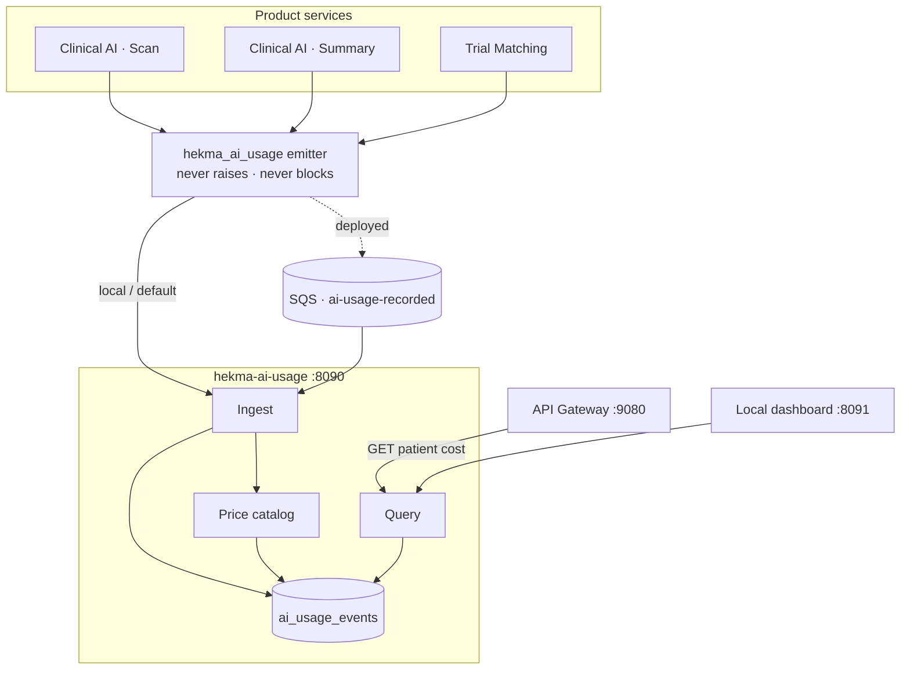
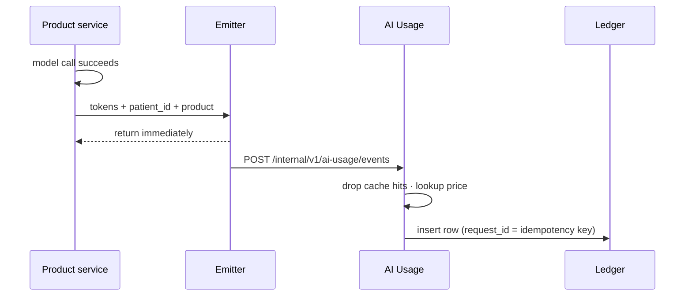
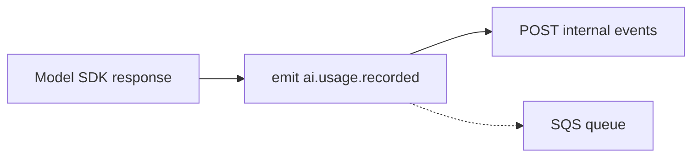
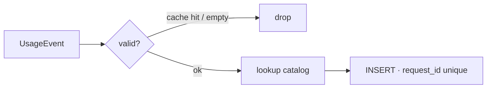
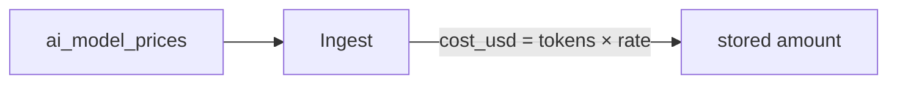
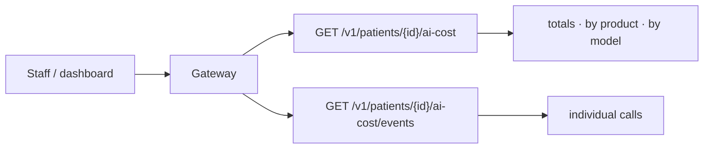
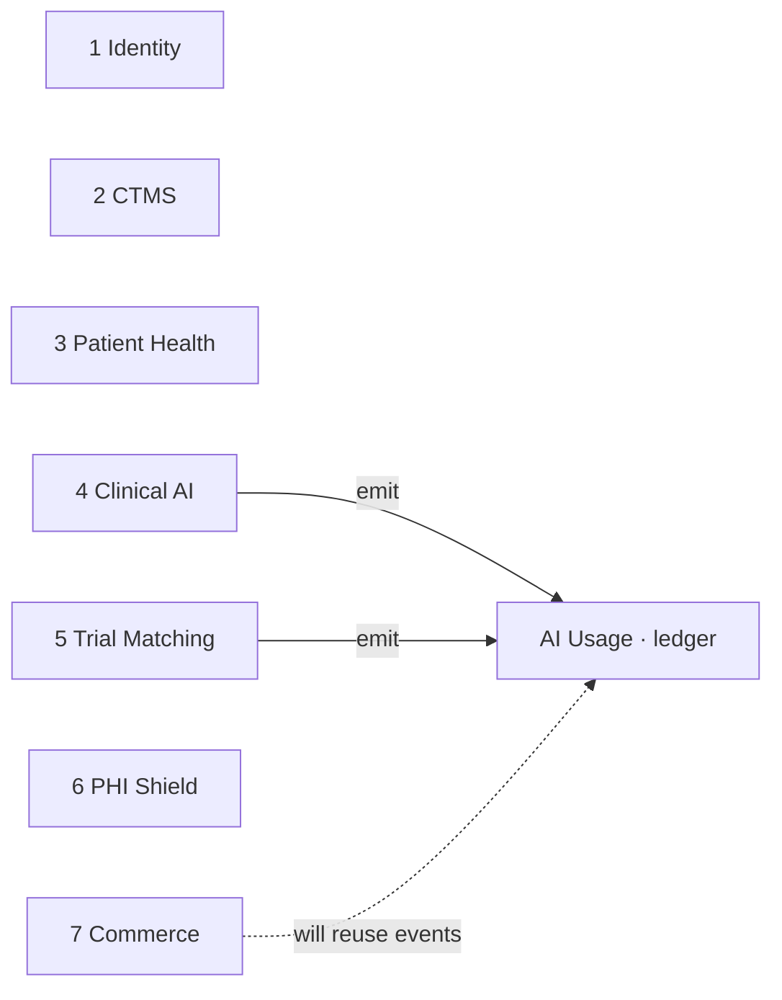

# AI Usage Service

**Service:** `hekma-ai-usage` · **Port:** 8090 · **Role:** ledger next to the gateway

This is the patient-level record of AI token use and USD cost. Scan AI, Health
Summary, Trial Match, and later services emit **one event per successful model
call**. This service prices it once and answers “what did this patient cost?”

It does **not** call models. It does **not** store prompts or clinical text.
Invoices and subscriptions belong to Commerce; they should reuse these events.

---

## What it supports

| Component | What it does | Owns |
|-----------|--------------|------|
| **1 · Emitter (library)** | Product services send an event after a model call | Nothing — copied into each caller |
| **2 · Ingest** | Validate, price, store one row | `ai_usage_events` |
| **3 · Price catalog** | USD per 1M input / output tokens | `ai_model_prices` |
| **4 · Query** | Totals and event list for a patient | Read of the ledger |
| **5 · Local dashboard** | Laptop UI to inspect one patient | Nothing — not deployed |

---

## High-level architecture



**Rule:** the patient request never waits on this service. If the ledger is
down, the scan still succeeds. The event is dropped or queued.

---

## How a model call becomes a cost



Cost is **frozen at ingest**. A later catalog change does not rewrite history.
Unknown models are stored as unpriced `$0` so the call is not lost.

`patient_id` is the Hekma / MySQL patient id — the same id the patient app
uses. Trial Match must not send its internal subject id.

---

## 1 · Emitter (library)

Not an HTTP API on this service. Other services copy `shared/hekma_ai_usage`
and call it after a successful model response.



| Field the caller must send | Why |
|----------------------------|-----|
| `patient_id` | One query can cover scan + summary + match |
| `product` / `feature` | Scan AI vs Health Summary vs Trial Match |
| `provider` / `model` | Which invoice line this is |
| `input_tokens` / `output_tokens` | What we were charged for |
| `request_id` | Deduplicate retries |

The emitter never raises. Failed calls and cache hits are not billed.

---

## 2 · Ingest

Turns an event into a priced ledger row.



| API | Purpose |
|-----|---------|
| `POST /internal/v1/ai-usage/events` | One event. Service-to-service. Not on the gateway |
| `POST /internal/v1/ai-usage/events:batch` | Same, many events |

Implementation: `service/ingest.py`. The gateway **does not** publish these
paths — product services call `:8090` directly or send SQS
`ai-usage-recorded`.

Needs `X-API-Key` when `AI_COST_API_KEY` is set.

---

## 3 · Price catalog

Versioned USD per million input and output tokens. New rows apply to **new**
events only.



| API | Purpose |
|-----|---------|
| `GET /v1/ai-cost/prices` | Current catalog (dashboard / ops) |

Implementation: `service/pricing.py` plus seed rows in the repository.
OpenAI, Anthropic, Gemini, Groq are the providers Hekma uses today.

---

## 4 · Query

Sums **stored** dollars. It does not re-price.



| API | Purpose |
|-----|---------|
| `GET /v1/patients/{id}/ai-cost` | Totals, optional `product`, `from`, `to` |
| `GET /v1/patients/{id}/ai-cost/events` | The list of calls behind that total |
| `GET /health` · `GET /v1/ai-cost/health` | Process + database ping |

Implementation: `service/query.py` (`assemble_patient_cost`). The gateway
publishes `/v1/patients/` and `/v1/ai-cost/` only.

---

## 5 · Local dashboard

Read-only UI on a laptop (`frontend/`, port 8091). Not part of the Docker
image. Point `AI_COST_BASE_URL` at the ledger you want (local, dev, or QA).

---

## Where it sits on the platform



| This service does | Another service does |
|-------------------|----------------------|
| Price and store token events | Clinical AI / Trial Match: call the model |
| Answer cost per patient | Commerce: subscriptions, entitlements, invoices |
| | Patient Health: the chart itself |

It is a **platform ledger**, not an eighth business domain. Billing should
read these rows instead of inventing a second usage table.

---

## Data stores

| Store | Used for |
|-------|----------|
| PostgreSQL (compose / deployed) | `ai_usage_events`, `ai_model_prices` |
| SQLite | Laptop only, when Docker is not running |
| SQS | Optional ingest path so a ledger outage cannot fail a scan |

One ledger **per environment**. The laptop database is not dev or QA.

---

## What it does not record

- Failed model calls and cache hits
- Prompts, completions, or documents
- PHI Shield
- Jobs with no patient id (corpus ingest, some trial summaries)
- Spend from before this service existed

---

## Run

```bash
cd hekma-platform
./scripts/local-dev.sh up          # API at http://localhost:8090
cd hekma-ai-usage/frontend && python3 server.py   # dashboard :8091
cd hekma-ai-usage && pytest
```

Set `AI_COST_API_KEY` in any shared environment. Leave it empty only on a
laptop.

More detail: [AI_USAGE_OVERVIEW.md](./AI_USAGE_OVERVIEW.md) ·
[AI_USAGE_HLD.md](./AI_USAGE_HLD.md) · [AI_COST_ANALYTICS.md](./AI_COST_ANALYTICS.md)
