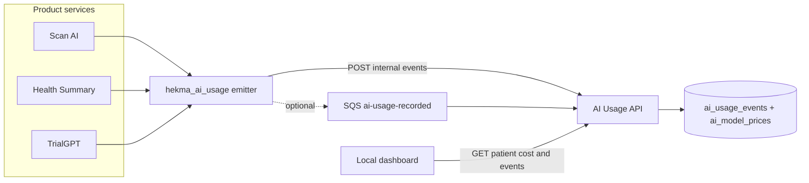

# AI Usage — high-level design

Developer view of what is built, how a model call becomes a patient cost, and which APIs to call.

Code: [`hekma-ai-usage/`](../README.md). The contract is [openapi.yaml](../openapi.yaml). Detail also lives in [AI_COST_ANALYTICS.md](./AI_COST_ANALYTICS.md).

---

## 1. What this service is

AI Usage is the ledger for patient-level LLM spend. Product services do not price tokens and do not keep their own cost tables. After a successful model call they emit one event. This service prices it once and answers “what did this patient cost?”

It runs inside **hekma-platform**, next to the API gateway. It is not a sixth deployable.

```
hekma-platform/hekma-ai-usage/
├── Dockerfile
├── openapi.yaml
├── src/
│   ├── main.py
│   ├── api/            HTTP routes
│   ├── service/        pricing, ingest, query
│   └── repository/     Postgres and SQLite
├── migrations/
├── tests/
├── frontend/           local monitoring dashboard (not deployed)
└── docs/
```

The emitter other services copy lives in `shared/hekma_ai_usage`, not inside this service tree.

| Runtime | Store | Who writes | Who reads |
|---------|--------|------------|-----------|
| `hekma-ai-usage`, port `8090` | Postgres in dev/QA/prod. SQLite only on a laptop without Docker | Scan AI, Health Summary, TrialGPT, later services | Dashboard, future billing, staff APIs |
| `hekma-ai-usage` frontend, port `8091` | None | Nobody | A developer pointing it at a ledger |

One database per environment. The laptop ledger does not contain dev or QA traffic.

---

## 2. Components



| Piece | Responsibility |
|-------|----------------|
| Emitter `hekma_ai_usage` | Build `ai.usage.recorded` v1 and send it. Never raises. Never blocks the patient request. Canonical copy: `shared/hekma_ai_usage`. Vendored into the data pipeline and TrialGPT. |
| Ingest | Validate the event, drop cache hits, look up the price, insert one row. `request_id` is the idempotency key. |
| Price catalog | Versioned USD per 1M input and output tokens. Cost is calculated here, not in the product service. |
| Query | Sum stored tokens and `cost_usd`. It does not re-price history. |
| Gateway | Routes `/v1/patients/`, `/v1/ai-cost/`, and `/internal/v1/ai-usage/` to this API. |
| Dashboard | Read-only view: totals, service split, each call, and a separate price-catalog page. |

---

## 3. What one model call does

1. The product code binds a `patient_id` (MySQL id, the same id the rest of Hekma uses). TrialGPT must not send its internal `subject_id`.
2. The provider HTTP call succeeds and returns `usage`.
3. The emitter sends token counts, product, feature, provider, and model. It does not send prompts, completions, or chart text.
4. Ingest matches a catalog row and writes `cost_usd`.
5. `GET /v1/patients/{id}/ai-cost` sums those rows.

Failed calls emit nothing. Cache hits emit nothing (ingest also drops `cached: true` if one arrives). A patient request is not failed when the ledger is down: the emitter is fire-and-forget.

---

## 4. APIs

Base URL: the AI Usage process on `:8090`, or the gateway on `:9080`. If `AI_COST_API_KEY` is set, send `X-API-Key`.

| Method | Path | Caller | Result |
|--------|------|--------|--------|
| `GET` | `/health` and `/v1/ai-cost/health` | Ops | `status`, `database`, `sqs` |
| `POST` | `/internal/v1/ai-usage/events` | Product services | One event priced and stored |
| `POST` | `/internal/v1/ai-usage/events:batch` | Product services | Same, as a list |
| `GET` | `/v1/patients/{patient_id}/ai-cost` | Dashboard, billing | Totals, by product, by provider and model |
| `GET` | `/v1/patients/{patient_id}/ai-cost/events` | Dashboard | One row per model call |
| `GET` | `/v1/ai-cost/prices` | Dashboard price page | Active catalog |

### Query parameters

On the two patient routes:

| Param | Meaning |
|-------|---------|
| `from` | Period start, inclusive. Default `1970-01-01`. |
| `to` | Period end, exclusive. Default now. An event at exactly `to` is excluded. |
| `product` | `scan_ai`, `patient_summary`, or `trial_match` |
| `tenant_id` | Default `1` until multi-org tenancy is on |
| `limit`, `offset` | Events only. `limit` 1–500, default 100 |

`to` must be after `from`, or the API returns 400.

### Patient cost response

```json
{
  "patient_id": "203664",
  "tenant_id": 1,
  "currency": "USD",
  "period": { "from": "1970-01-01T00:00:00Z", "to": "2026-10-09T13:00:00Z" },
  "totals": {
    "llm_calls": 7,
    "prompt_tokens": 262,
    "completion_tokens": 100,
    "total_tokens": 362,
    "cost_usd": 0.001917,
    "unpriced_calls": 0
  },
  "by_product": [
    { "product": "scan_ai", "llm_calls": 3, "total_tokens": 178, "cost_usd": 0.00061 }
  ],
  "by_provider": [
    {
      "provider": "openai",
      "llm_calls": 5,
      "cost_usd": 0.001065,
      "models": [{ "model": "gpt-4o", "llm_calls": 5, "cost_usd": 0.001065 }]
    }
  ]
}
```

Each bucket has the same counters: `llm_calls`, `prompt_tokens`, `completion_tokens`, `total_tokens`, `cost_usd`, `unpriced_calls`.

### Event row

`request_id`, `occurred_at`, `product`, `feature`, `provider`, `model`, `prompt_tokens`, `completion_tokens`, `total_tokens`, `cost_usd`, `pricing_status` (`priced` or `unpriced`), `job_id`, `source_service`.

### Ingest body

Schema: [event-schemas/ai.usage.recorded.v1.json](../../event-schemas/ai.usage.recorded.v1.json).

Required: `schema_version` (1), `occurred_at`, `patient_id`, `product`, `provider`, `model`, `prompt_tokens`, `completion_tokens`.

`request_id` defaults to a new UUID. Sending the same id again returns `duplicate: true` and does not insert a second row.

Ingest result: `accepted`, `duplicate`, `request_id`, `pricing_status`, `cost_usd`.

A cached event returns `accepted: false` and is not stored.

---

## 5. Pricing

```
cost_usd = (prompt_tokens / 1_000_000) * input_usd_per_1m
         + (completion_tokens / 1_000_000) * output_usd_per_1m
```

Lookup order at `occurred_at`:

1. Exact `(provider, model)` whose `effective_from` / `effective_to` covers that time.
2. Longest catalog key that is a prefix of the model, split on `-`, `.`, or `/`. `gpt-4o-mini` does not match `gpt-4o`. `gpt-4o-2024-08-06` does. `claude-sonnet-4-6` matches `claude-sonnet-4`.

Provider aliases normalize before lookup: `claude` → `anthropic`, `gemini` → `google`, `azure_openai` → `openai`.

Unknown models are stored with `pricing_status=unpriced` and `cost_usd=0`. Adding a catalog row prices later events. It does not rewrite old rows.

The query API sums the stored `cost_usd`. It does not look at the catalog again.

---

## 6. Products already instrumented

| `product` | Where the call happens | `feature` examples |
|-----------|------------------------|--------------------|
| `scan_ai` | Data pipeline vision and prescription extractors | `smart_scan.{module}`, `smart_scan.gap_fill`, `prescription_scan` |
| `patient_summary` | Data pipeline EHR summary, on generation only; TrialGPT MIMIC summary and summary validation | `patient_summary.narrative_batch`, `patient_summary.overview`, `patient_summary.mimic`, `patient_summary.validation` |
| `trial_match` | TrialGPT chart ingest, keywords, matching, aggregation, and embeddings inside a patient job | `trial_match.ehr_ingest`, `trial_match.keywords`, `trial_match.matching`, `trial_match.aggregation`, `trial_match.embedding` |

A new service adds a product only by extending the allowed set in the schema and ingest validator, then emitting with that name. Until then, unknown product values are rejected.

### How a service emits

```python
from hekma_ai_usage import emit_llm_usage, llm_usage_scope

with llm_usage_scope(patient_id=patient_id, product="scan_ai", feature="smart_scan.labs", source_service="hekma-core"):
    response = call_model(...)
emit_llm_usage(response.usage, model=response.model, provider="openai")
```

Environment on the producer:

```
AI_USAGE_ENABLED=true
AI_USAGE_INGEST_URL=http://<ai-usage-host>/internal/v1/ai-usage/events
```

In a deployed environment, prefer SQS queue `ai-usage-recorded`. The API long-polls it when `AI_USAGE_SQS_ENABLED=true`. HTTP ingest remains for local development.

Worker threads must run inside a copied context (`copy_context().run`) or the patient id is lost. Matching and aggregation already do this.

`emit_llm_usage` returns immediately when there is no patient id, no product, both token counts are 0, or `AI_USAGE_ENABLED` is false. A call with no patient is not stored. The Groq study summary is one of those calls: it is cached per trial, so it does not land on a patient. Embeddings record only when a patient job already set the scope.

---

## 7. Backend modules

| Module | Function |
|--------|----------|
| `src/main.py` | Process entry. Builds the app and starts the optional queue worker |
| `src/api/routes.py` | HTTP routes |
| `src/api/schemas.py` | Event, cost, and price models. Products: `scan_ai`, `patient_summary`, `trial_match` |
| `src/service/ingest.py` | Validate, drop cache, price, insert |
| `src/service/pricing.py` | Alias, prefix match, cost formula |
| `src/service/query.py` | Assemble totals, by product, by provider/model |
| `src/repository/store.py` | Postgres store |
| `src/repository/sqlite.py` | Laptop store. Same interface |
| `src/service/sqs_worker.py` | Optional queue consumer |
| `shared/hekma_ai_usage/client.py` | Emitter used by product repos |
| `openapi.yaml` | API contract |

Tables: `ai_usage_events` (one row per successful call, unique `request_id`) and `ai_model_prices` (versioned list price).

---

## 8. Dashboard

Local only. `frontend/server.py` proxies:

| UI route | Upstream |
|----------|----------|
| `GET /api/cost` | `GET /v1/patients/{id}/ai-cost` |
| `GET /api/events` | `GET /v1/patients/{id}/ai-cost/events` |
| `GET /api/prices` | `GET /v1/ai-cost/prices` |

`AI_COST_BASE_URL` selects the ledger (default `http://127.0.0.1:8090`). Point it at the dev or QA API to monitor that environment without deploying the UI.

The main page is patient cost, service rings, provider bars, and the call list. **Price catalog** in the sidebar is a separate page.

---

## 9. Not in this version

- Backfill of scans and matches from before instrumentation. Those token counts were never stored.
- PHI Shield.
- Trial corpus generation (`trial_llm_service`). It rewrites a trial and has no patient id.
- Groq study summaries on a patient. The emit hook runs, then drops the event because the call has no patient id.
- Embeddings outside a patient job (corpus ingest and the Qdrant ping). Patient-job embeddings are recorded as `trial_match.embedding`.
- Offline scripts: `structuring.py`, `batched_structuring.py`, `synthea_patients_400.py`, `mimic_patients_400.py`, and `TrialGPT_RAG/`.
- Invoices, plans, and quotas. Those are later commerce work on the same events.
- The dashboard as a deployed website.
