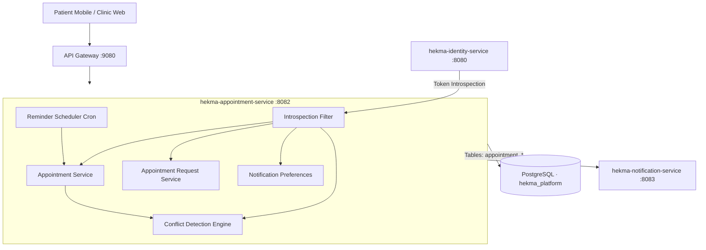
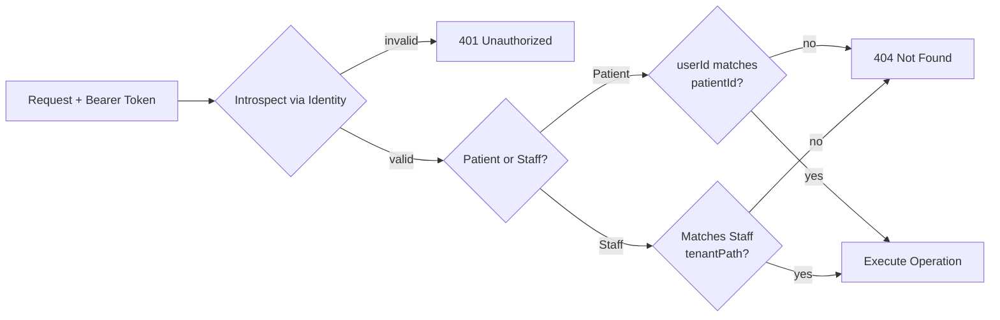
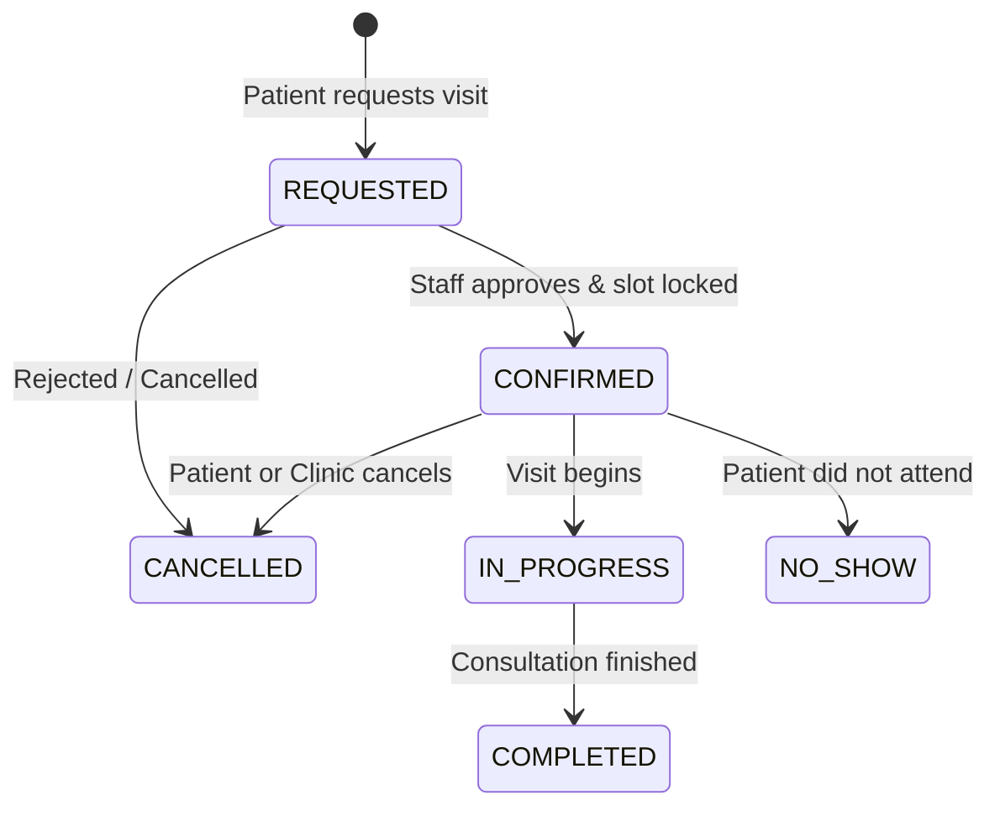
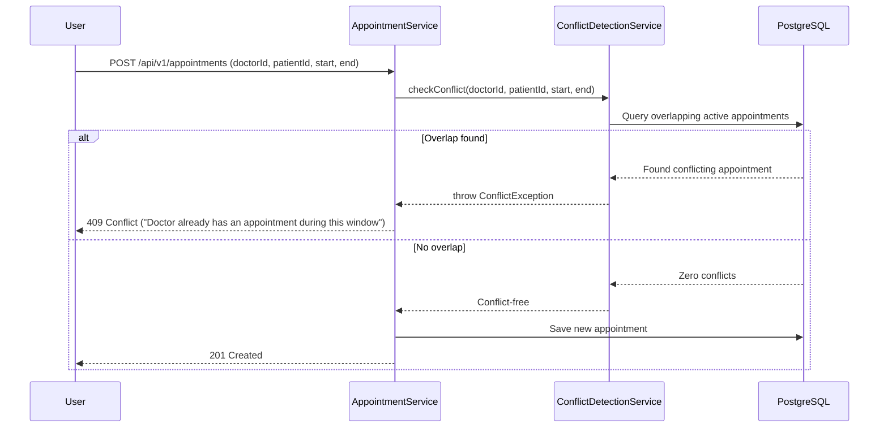
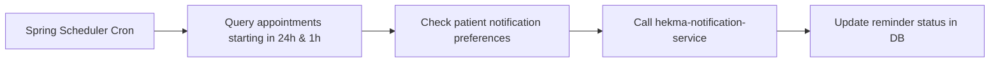
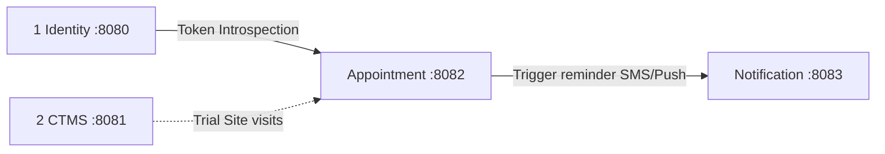

# Appointment Service

**Service:** `hekma-appointment-service` · **Port:** 8082 · **Role:** Clinical Visit Scheduling & Consultation Lifecycle

This is the scheduling and calendar management service for patient visits, investigator meetings, and doctor consultations across clinics and clinical trial sites.

It is **not** Identity (does not authenticate passwords), **not** CTMS (does not design trial protocols), and **not** Notification (does not own raw SMS/Email dispatch pipelines).

---

## What it supports

| Component | What the user sees | Owns |
|-----------|--------------------|------|
| **1 · Clinical Visits & Video Calls** | Booked visits, video call links, clinic dates | Booking lifecycle, consultation modes (In-person, Video, Phone) |
| **2 · Conflict Detection Engine** | "Doctor is busy at this time" | Double-booking prevention for physicians and patients |
| **3 · Appointment Requests & Approvals** | "Request an appointment" | Patient self-booking, coordinator review & approval workflow |
| **4 · Automated Reminders** | SMS/Push reminders 24 hours & 1 hour prior | Background cron schedulers, delivery tracking via Notification Service |
| **5 · Patient Notification Preferences** | "Remind me via SMS / Email" | Per-patient communication preferences |

---

## High-level architecture



**Rule:** An appointment cannot be confirmed if either the doctor or the patient already has an overlapping active appointment.

---

## Request path (every call)



Patients are restricted strictly to their own appointments. Staff members (doctors, coordinators) are bounded by their hospital site tenant path.

---

## 1 · Visit Scheduling & Status Lifecycle

Manages consultation bookings, modalities (In-person, Video Call, Phone), and status transitions.



| API | Purpose |
|-----|---------|
| `POST /api/v1/appointments` | Book and confirm an appointment directly |
| `GET /api/v1/appointments/{id}` | Get appointment details and consultation link |
| `PUT /api/v1/appointments/{id}/status` | Transition status (`CONFIRMED`, `CANCELLED`, `COMPLETED`) |
| `GET /api/v1/appointments/doctor/{doctorId}` | Fetch schedule for a specific clinician |
| `GET /api/v1/appointments/patient/{patientId}` | Fetch upcoming and past visits for a patient |

---

## 2 · Conflict Detection Engine

Checks both doctor and patient calendars before confirming any booking to guarantee zero double-bookings.



| API | Purpose |
|-----|---------|
| `POST /api/v1/appointments/check-conflicts` | Dry-run check for time slot availability |

---

## 3 · Appointment Requests & Approvals

Allows patients to request appointment slots that trial coordinators or clinic receptionists can review and accept.

| API | Purpose |
|-----|---------|
| `POST /api/v1/appointment-requests` | Patient submits a request for a consultation |
| `GET /api/v1/appointment-requests` | Clinic staff review pending requests |
| `POST /api/v1/appointment-requests/{id}/approve` | Approve request $\rightarrow$ auto-generates confirmed appointment |
| `POST /api/v1/appointment-requests/{id}/reject` | Decline request with reason message |

---

## 4 · Automated Background Reminders

Runs periodic cron tasks to identify upcoming appointments and dispatch automated reminders to patients.



---

## Where it sits on the platform



| This service does | Another service does |
|-------------------|----------------------|
| Visit bookings, video call links | Identity: Auth, login, user accounts |
| Schedule conflicts & double-booking checks | CTMS: Protocol design, trial sites, criteria |
| Appointment reminders scheduler | Notification: Direct SMS/Email dispatch |

---

## Data stores

| Store | Used for |
|-------|----------|
| PostgreSQL (`hekma_platform`) | `appointment_appointments`, `appointment_requests`, `appointment_reminders`, `appointment_notification_preferences` |

---

## Run & Test

```powershell
cd hekma-appointment-service
$env:JAVA_HOME="C:\Users\Acer_PTS\.jdks\graalvm-jdk-25"; $env:Path="$env:JAVA_HOME\bin;" + $env:Path
.\mvnw.cmd test
.\mvnw.cmd spring-boot:run
```
