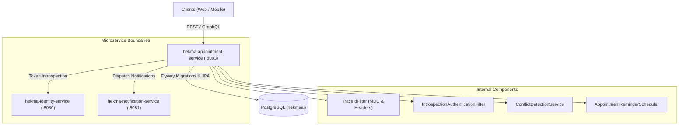

# System Architecture - Appointment Service (`hekma-appointment-service`)

## 1. System Overview

`hekma-appointment-service` is the dedicated scheduling and reminder microservice in the Hekma Platform.



## 2. Component Structure

- **`config`**: Security, OpenAPI, CORS, JPA auditing, and `TraceIdFilter`.
- **`security`**: `IntrospectionAuthenticationFilter`, `AppointmentPrincipal`, `IdentityServiceClient`.
- **`domain`**: JPA entities extending `BaseAuditEntity` (`AppointmentEntity`, `AppointmentRequestEntity`, `NotificationPreferenceEntity`, `WebNotificationEntity`).
- **`repository`**: Spring Data JPA repositories with conflict interval queries and reminder range lookups.
- **`service`**: Business domain services (`AppointmentService`, `AppointmentRequestService`, `ConflictDetectionService`, `NotificationPreferenceService`, `WebNotificationService`).
- **`notification`**: HTTP client `NotificationServiceClient` integrating with `hekma-notification-service`.
- **`scheduler`**: `AppointmentReminderScheduler` running on a fixed delay to trigger reminder sweeps.
- **`controller`**: REST controllers and Spring for GraphQL controller (`AppointmentGraphQlController`).
- **`dto`**: Transfer objects conforming to the unified response contract (`ApiResponse`, `ApiErrorResponse`).

## 3. Conflict Detection Mechanism

Conflict detection prevents concurrent bookings on the same resource (doctor, patient, or site).

$$\text{Conflict Condition: } (\text{existing.startTime} < \text{new.endTime}) \land (\text{existing.endTime} > \text{new.startTime})$$

The SQL query checks:
```sql
SELECT a FROM AppointmentEntity a
WHERE a.status NOT IN ('CANCELLED', 'RESCHEDULED')
  AND a.startTime < :endTime
  AND a.endTime > :startTime
  AND (:doctorId IS NULL OR a.doctorId = :doctorId
       OR :patientId IS NULL OR a.patientId = :patientId
       OR :siteId IS NULL OR a.siteId = :siteId)
```

## 4. Reminder Cadences & State Machine

The scheduled task queries appointments within upcoming temporal windows:
- **7 Days Prior**: Appointments where `startTime` is between $now + 7\text{d}$ and $now + 7\text{d} + \Delta$, and `reminder7DaysSent == false`.
- **1 Day Prior**: Appointments where `startTime` is between $now + 24\text{h}$ and $now + 24\text{h} + \Delta$, and `reminder1DaySent == false`.
- **1 Hour Prior**: Appointments where `startTime` is between $now + 1\text{h}$ and $now + 1\text{h} + \Delta$, and `reminder1HourSent == false`.
