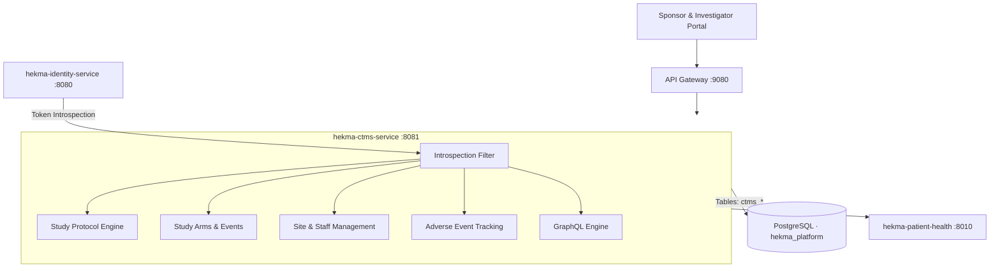
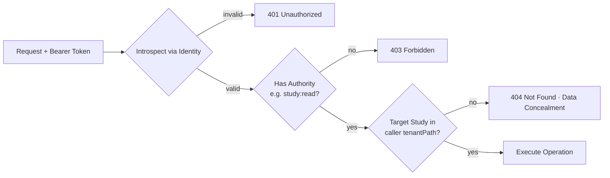
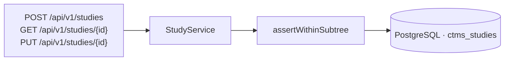
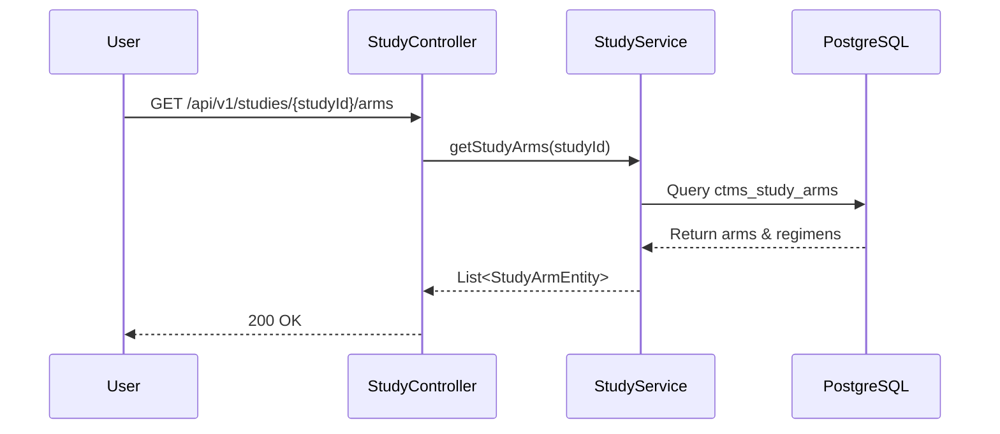
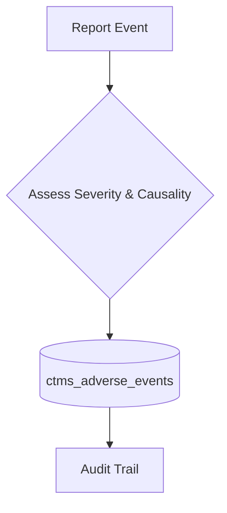
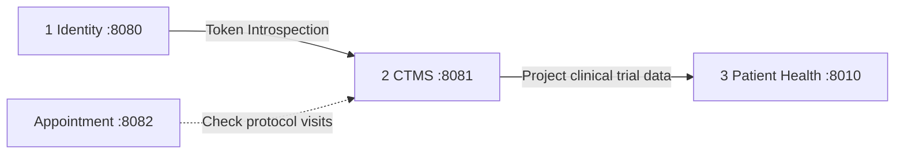

# CTMS Service

**Service:** `hekma-ctms-service` · **Port:** 8081 · **Role:** S2 in the platform (Clinical Trial Management System)

This is the central operational engine for clinical trial sponsors, contract research organizations (CROs), and hospital research sites. It owns clinical study protocols, study arms, trial events, site enrollments, and safety reporting (adverse events).

It is **not** Identity (does not manage logins or passwords), **not** Appointments (does not manage clinical visits/scheduling), and **not** Patient Health (does not store raw FHIR/EHR records).

---

## What it supports

| Component | What the user sees | Owns |
|-----------|--------------------|------|
| **1 · Study Protocols & Arms** | Protocol title, phase, study arms, dosage | Protocol design, study phases (I-IV), arms & dosage rules |
| **2 · Criteria & Study Events** | Schedule of assessments, inclusion/exclusion | Milestone criteria, planned assessments, visit schedules |
| **3 · Study Sites & Staff** | Participating hospitals, PI & coordinator contacts | Trial site allocations, site statuses, investigator assignments |
| **4 · Adverse Events (Safety)** | Safety alerts, severity grading, causality reports | Protocol safety tracking, adverse event audit logs |
| **5 · Multi-Tenant Subtree Isolation** | Only studies for caller's organization | Subtree validation (`isWithinSubtree`), 404 concealment |

---

## High-level architecture



**Rule:** Every study entity is stamped with `tenantId` and `tenantPath`. A caller can only see or update studies that belong to their own organization's subtree.

---

## Request path (every call)



Mismatch in tenant hierarchy returns **404 Not Found** (never 403) so users from rival sponsors cannot verify whether a study ID exists. Platform Admins (`SYSTEM_ADMIN`, `ADMIN`) bypass subtree checks.

---

## 1 · Study Protocols & Metadata

Manages the core lifecycle of a clinical trial from draft to active and closed.



| API | Purpose |
|-----|---------|
| `POST /api/v1/studies` | Create a new study protocol (`study:create`) |
| `GET /api/v1/studies` | List studies visible to caller's tenant subtree (`study:read`) |
| `GET /api/v1/studies/{studyId}` | Get complete study details by ID or study number |
| `PUT /api/v1/studies/{studyId}` | Update protocol details and status (`study:update`) |

---

## 2 · Study Arms, Details & Schedule Events

Configures trial cohorts, treatment arms, regimens, and inclusion/exclusion milestones.



| API | Purpose |
|-----|---------|
| `GET /api/v1/studies/{studyId}/arms` | List cohort arms for a study |
| `GET /api/v1/studies/arms/{armNum}/details` | Get regimen details, dosage, and route |
| `GET /api/v1/studies/{studyId}/events` | Get study milestone events and inclusion criteria |
| `GET /api/v1/studies/{studyId}/contacts` | List sponsor and site contact personnel |

---

## 3 · Study Sites & Investigator Management

Tracks hospitals and clinical facilities participating in a protocol, their recruitment progress, and assigned Principal Investigators.

| API | Purpose |
|-----|---------|
| `GET /api/v1/study-sites` | List trial sites across caller's organization |
| `POST /api/v1/study-sites` | Onboard a hospital site to a protocol (`study:update`) |
| `GET /api/v1/study-sites/{siteId}` | Retrieve site performance, targets, and investigators |

---

## 4 · Adverse Events (Safety Reporting)

Tracks unexpected medical occurrences and adverse drug reactions during trial execution.



| API | Purpose |
|-----|---------|
| `POST /api/v1/adverse-events` | Log a clinical adverse event for a patient |
| `GET /api/v1/adverse-events/study/{studyId}` | View safety summary and adverse events for a study |

---

## 5 · GraphQL Query Engine

Provides high-performance, single-roundtrip queries for dashboards and protocol viewers.

| Query / Mutation | Purpose |
|------------------|---------|
| `query { study(id: "...") { arms { details } events } }` | Deep nested study structure in one call |
| `query { studies(search: "oncology") { id title status } }` | Fast search and filtering |

---

## Where it sits on the platform



| This service does | Another service does |
|-------------------|----------------------|
| Clinical protocols, arms, trial phases | Identity: User credentials, roles, custom roles |
| Study sites, investigators, safety events | Appointment: Visit calendar, double-booking prevention |
| Trial event schedules | Patient Health: EHR storage, medication adherence |

---

## Data stores

| Store | Used for |
|-------|----------|
| PostgreSQL (`hekma_platform`) | `ctms_studies`, `ctms_study_arms`, `ctms_study_events`, `ctms_study_sites`, `ctms_adverse_events` |

---

## Run & Test

```powershell
cd hekma-ctms-service
$env:JAVA_HOME="C:\Users\Acer_PTS\.jdks\graalvm-jdk-25"; $env:Path="$env:JAVA_HOME\bin;" + $env:Path
.\mvnw.cmd test
.\mvnw.cmd spring-boot:run
```
