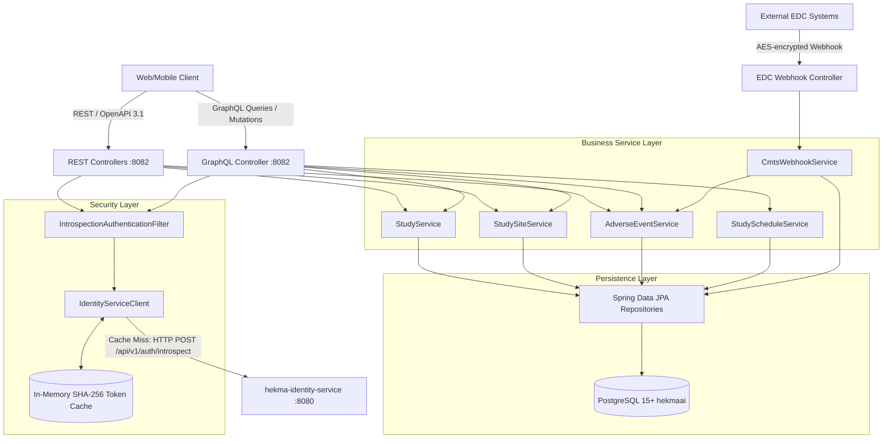

# System Architecture (`hekma-ctms-service`)

## 1. High-Level Component Topology



---

## 2. External Integration Contracts

### `hekma-identity-service` Token Introspection
- **Request**:
  `POST http://localhost:8080/api/v1/auth/introspect`
  ```json
  { "token": "<bearer_token>" }
  ```
- **Response**:
  ```json
  {
    "active": true,
    "userId": "3fa85f64-5717-4562-b3fc-2c963f66afa6",
    "email": "sponsor.admin@domain.com",
    "role": "SPONSOR",
    "tenantId": "1fa85f64-5717-4562-b3fc-2c963f66afa6",
    "tenantPath": "/sponsor-alpha/",
    "authorities": ["study:create", "study:read", "site:manage"],
    "roles": ["Sponsor Admin"]
  }
  ```
- **Security Context**: Transformed into `CtmsPrincipal` and set into Spring Security `SecurityContextHolder`.
