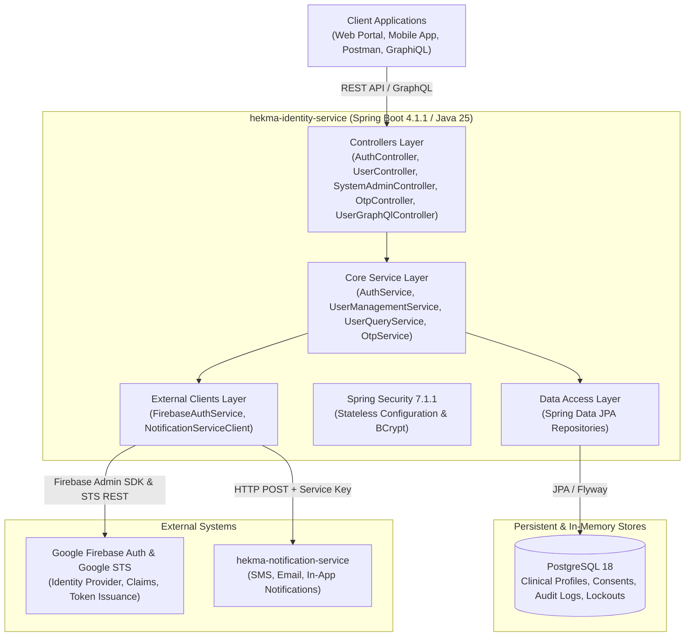
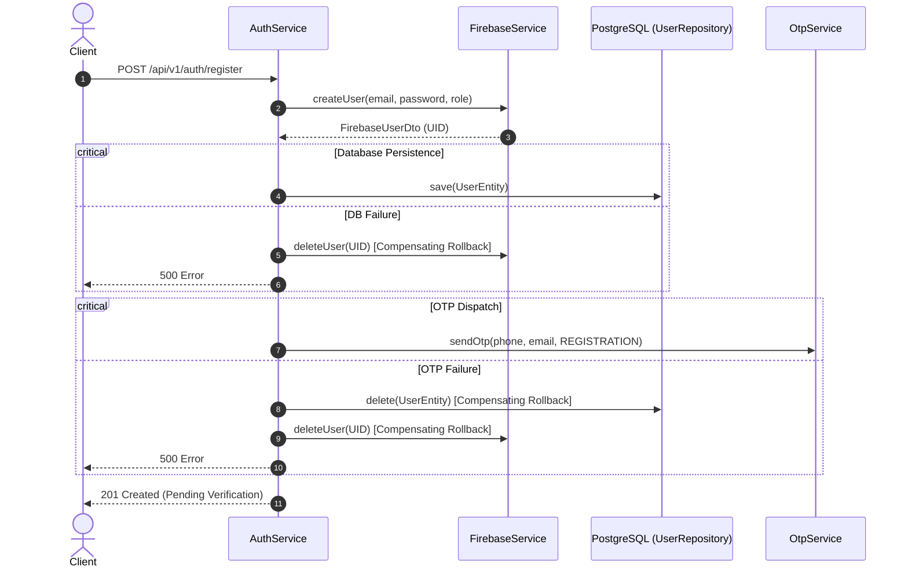
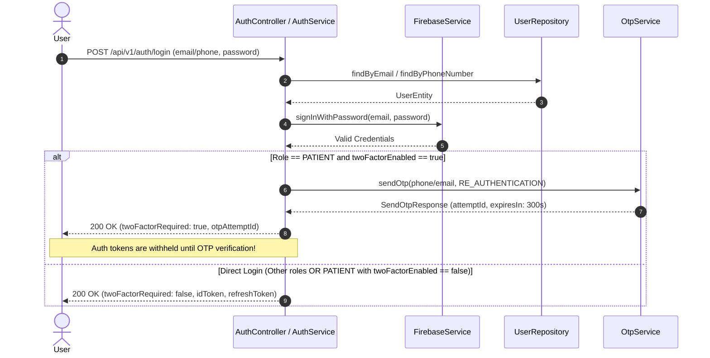

# System Architecture: Hekma Identity Service (`hekma-identity-service`)

## 1. High-Level Architectural Overview

The **Hekma Identity Service** implements a **hybrid identity architecture** designed for high security, clinical research compliance, and decoupled operational scalability:

---

## 2. Component & Service Responsibilities

### 2.1 Web & Presentation Layer

- **[AuthController.java](file:///D:/coding/hekma/hekma-identity-service/src/main/java/com/hekma/identity/controller/AuthController.java)**:
  - Exposes `/api/v1/auth/register`: Public registration endpoint with input validation and dual-write.
  - Exposes `/api/v1/auth/login`: Authentication with conditional 2FA challenge.
  - Exposes `/api/v1/auth/refresh-token`: OAuth2 refresh token exchange against Google STS.
- **[OtpController.java](file:///D:/coding/hekma/hekma-identity-service/src/main/java/com/hekma/identity/controller/OtpController.java)**:
  - Exposes `/api/v1/auth/otp/send`: Generates numeric OTP with 5-minute expiry and lockout check.
  - Exposes `/api/v1/auth/otp/resend`: Resends OTP (max 3 resends per attempt).
  - Exposes `/api/v1/auth/otp/verify`: Verifies submitted OTP, updates verification flags, and activates account.
- **[SystemAdminController.java](file:///D:/coding/hekma/hekma-identity-service/src/main/java/com/hekma/identity/controller/SystemAdminController.java)**:
  - Exposes `/api/v1/system-admin/invite-admin`: Dedicated administrative endpoint for onboarding `ADMIN` users.
- **[UserController.java](file:///D:/coding/hekma/hekma-identity-service/src/main/java/com/hekma/identity/controller/UserController.java)**:
  - Exposes `PATCH /api/v1/users/{userId}/status`: Toggles `isActive` flag with role hierarchy enforcement.
  - Exposes `PATCH /api/v1/users/{userId}/2fa`: Updates two-factor authentication configuration.
  - Exposes `DELETE /api/v1/users/{userId}`: Executes audit-compliant soft-deletion.
  - Exposes `GET /api/v1/users/{userId}`: Retrieves active profile.
- **[UserGraphQlController.java](file:///D:/coding/hekma/hekma-identity-service/src/main/java/com/hekma/identity/controller/UserGraphQlController.java)**:
  - Provides queries: `users(role: Role)`, `userById(id: ID!)`, `userByEmail(email: String!)`, `userCount(role: Role)`.
  - Provides mutations: `updateUserActiveStatus`, `softDeleteUser`, `updateUserTwoFactor`.
  - Uses `@BatchMapping` to resolve `patientDetails` in batch, completely eliminating N+1 query overhead.

### 2.2 Domain & Core Services Layer

- **[AuthService.java](file:///D:/coding/hekma/hekma-identity-service/src/main/java/com/hekma/identity/service/AuthService.java)**:
  - Coordinates identity synchronization between Firebase Auth and PostgreSQL.
  - Orchestrates compensating rollbacks if any step of registration fails.
  - Implements System Administrator startup bootstrapping with secure random password generation.
- **[OtpService.java](file:///D:/coding/hekma/hekma-identity-service/src/main/java/com/hekma/identity/service/OtpService.java)**:
  - Implements the OTP security lifecycle (cryptographic generation, BCrypt hash storage, expiry tracking).
  - Manages lockout states (`OtpLockoutEntity`) and security audit trails (`OtpAuditLogEntity`).
- **[UserManagementService.java](file:///D:/coding/hekma/hekma-identity-service/src/main/java/com/hekma/identity/service/UserManagementService.java)**:
  - Enforces the platform role hierarchy rules in `validateHierarchy(operator, target)`.
  - Performs soft deletion and status updates within database transactions.
- **[UserQueryService.java](file:///D:/coding/hekma/hekma-identity-service/src/main/java/com/hekma/identity/service/UserQueryService.java)**:
  - Read-only transactional queries for user retrieval, role filtering, and batch fetching.

---

## 3. Communication Patterns & External Integrations

### 3.1 Google Firebase Authentication & Google STS
- **Admin SDK**: Initialized in [FirebaseConfig.java](file:///D:/coding/hekma/hekma-identity-service/src/main/java/com/hekma/identity/firebase/FirebaseConfig.java) using credentials provided via `firebase.credentials-path` or environment variable `FIREBASE_CREDENTIALS_PATH`.
- **Custom Claims**: Roles (`role: SYSTEM_ADMIN | ADMIN | SPONSOR | SITE | PATIENT`) are embedded directly into Firebase JWT claims, accessible in client ID tokens.
- **Google Identity Toolkit & STS API**:
  - `https://identitytoolkit.googleapis.com/v1/accounts:signInWithPassword`: Direct credential validation when `firebase.web-api-key` is configured.
  - `https://securetoken.googleapis.com/v1/token`: OAuth2 token refresh via grant type `refresh_token`.
- **Mock Mode**: When `firebase.mock-mode=true` or when credentials are not detected, [MockFirebaseService.java](file:///D:/coding/hekma/hekma-identity-service/src/main/java/com/hekma/identity/firebase/MockFirebaseService.java) enables fully functional local execution and testing without external cloud network dependencies.

### 3.2 Notification Service Integration (`hekma-notification-service`)
- Communicates via HTTP REST client [NotificationServiceClient.java](file:///D:/coding/hekma/hekma-identity-service/src/main/java/com/hekma/identity/notification/NotificationServiceClient.java).
- Authenticated via internal shared secret header: `X-Hekma-Service-Key: ${NOTIFICATION_SERVICE_KEY}`.
- Payload includes `channel` (`SMS`, `EMAIL`, `IN_APP`), `idempotencyKey`, `recipient`, `priority`, and dynamic template parameters.
- Built-in resilience: If the notification service is temporarily unreachable, outbound dispatch errors are logged without aborting downstream operations, allowing offline testing and development.

---

## 4. Key Architectural Patterns

### 4.1 Dual-Write Pattern with Compensating Rollback (Lightweight Saga)

Because user data spans two separate persistent storage systems (Google Firebase Auth and relational PostgreSQL), traditional ACID two-phase commits across both systems are impossible. The service employs compensating rollbacks:

### 4.2 Conditional 2FA Login Pattern

### 4.2a Request Authentication & Password Management (RBAC Phase 1)

- **Every protected request** carries `Authorization: Bearer <Firebase ID token>`. `FirebaseAuthenticationFilter` verifies it with the Admin SDK (`verifyIdToken(token, checkRevoked=true)`), loads the user and tenant from PostgreSQL, rejects inactive users/tenants, and sets `HekmaPrincipal`. `TenantFilter` then derives the tenant context from the principal; `@PreAuthorize` rules on each handler decide access. Only an explicit list of `POST` endpoints is public (`SecurityConfig`).
- **Passwords** live only in Firebase and are handled only by this API: created via the Admin SDK (`register`, admin invitation, invitation acceptance), validated via Identity Toolkit `signInWithPassword` (`login`, `change-password`), and replaced via the Admin SDK (`reset-password` after OTP, `change-password`). Phone-only accounts use a synthetic Firebase login email (`identity_users.auth_email`).
- **Sessions** are revoked (`revokeRefreshTokens`) on deactivation, soft deletion, password reset and password change.
- Details and decisions: [DECISIONS.md](DECISIONS.md) ADR-009/ADR-010, [RBAC_PLAN.md](RBAC_PLAN.md).

### 4.3 Soft Deletion with Hibernate `@SQLRestriction`

To guarantee compliance with clinical research audit trails, user records are never permanently purged via `SQL DELETE`:
- [UserEntity.java](file:///D:/coding/hekma/hekma-identity-service/src/main/java/com/hekma/identity/domain/UserEntity.java) is annotated with `@SQLRestriction("is_deleted = false")`.
- When soft-deleted:
  - `isDeleted` = `true`
  - `isActive` = `false`
  - `status` = `UserStatus.INACTIVE`
- Hibernate automatically appends `AND is_deleted = false` to all SELECT queries, relationships, and foreign key traversals, preventing phantom lookups while preserving database referential integrity for regulatory audits.
