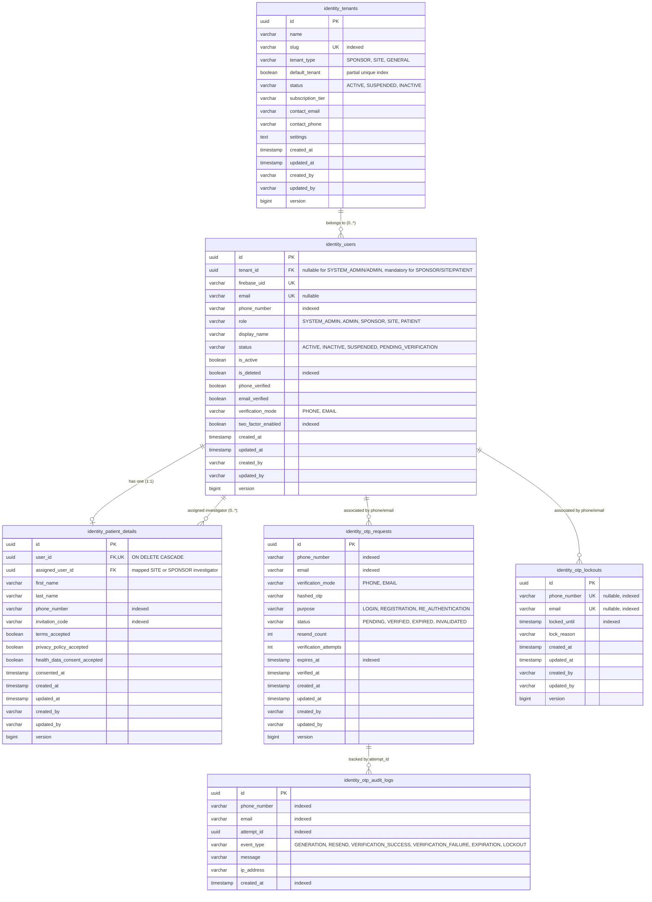

# Database Architecture & Schema: Hekma Identity Service (`hekma-identity-service`)

## 1. Overview & Technology Stack

The **Hekma Identity Service** utilizes a relational database architecture optimized for clinical user metadata, regulatory auditability, and rate-limiting security states:

- **Primary Database**: PostgreSQL (version 18 compatible).
- **Test Database**: H2 In-Memory Engine running in PostgreSQL emulation mode (`MODE=PostgreSQL`).
- **ORM / Persistence**: Spring Data JPA with Hibernate 6.x / Spring Boot 4.1.1.
- **Auditing**: Base audit mapped superclass ([BaseAuditEntity.java](file:///D:/coding/hekma/hekma-identity-service/src/main/java/com/hekma/identity/domain/BaseAuditEntity.java)) integrating Spring Data JPA Auditing (`AuditingEntityListener`).
- **Concurrency Control**: Optimistic locking enabled on all entities via `@Version private Long version;`.
- **Soft Deletion**: Automatic query filtering via Hibernate `@SQLRestriction("is_deleted = false")`.
- **Database Migrations**: Versioned, immutable schema management powered by **Flyway** (`flyway-database-postgresql` 12.4.0) with dedicated schema history table `identity_flyway_schema_history` (`spring.flyway.table`) to safely co-locate on the shared `hekmaai` database with `hekma-notification-service`.

---

## 2. Entity-Relationship Diagram (ERD)

---

## 3. Flyway Migration History

All database schema evolutions are managed strictly through Flyway scripts in [src/main/resources/db/migration](file:///D:/coding/hekma/hekma-identity-service/src/main/resources/db/migration):

| Migration Script | Description | Changes Applied |
| :--- | :--- | :--- |
| **`V1__init_identity_schema.sql`** | Consolidated Identity Service Baseline Schema | Fresh DB initialization creating all 5 core tables with `identity_` prefix (`identity_users`, `identity_patient_details`, `identity_otp_requests`, `identity_otp_lockouts`, `identity_otp_audit_logs`) along with all indexes, constraints, and audit fields. |
| **`V2__create_tenants_and_multitenancy.sql`** | Multi-Tenancy Foundation & Patient Mapping | Creates `identity_tenants` table with partial unique index on `default_tenant = TRUE`, seeds default tenant (`00000000-0000-0000-0000-000000000001`, `default-tenant`), adds `tenant_id` to `identity_users`, enforces check constraint `identity_chk_users_tenant_role`, and adds `assigned_user_id` to `identity_patient_details`. |
| **`V5__authorities.sql`** | Authority Catalogue | Creates `identity_authorities` (12 seeded keys) and `identity_user_authorities` (`user_id`, `authority_key`, `granted_by`, audit columns; unique `(user_id, authority_key)`). |
| **`V6__authority_backfill.sql`** | Owner-Bundle Backfill | Grants every authority to each existing non-deleted SPONSOR/SITE user (OD-2). |
| **`V7__single_system_admin_and_invitations.sql`** | Single Root Admin & Invitations | Partial unique index `identity_uq_users_single_system_admin` (one non-deleted `SYSTEM_ADMIN`); `identity_patient_details.invitation_expires_at` / `invitation_used_at`; `identity_user_invitations` (single-use staff invitations, token hash only, 72 h). |
| **`V8__authz_audit.sql`** | Privileged-Action Audit | Creates append-only `identity_authz_audit_log` (`occurred_at`, `actor_id`, `action`, `target_type`, `target_id`, `tenant_id`, `before_value`, `after_value`, `reason`) with indexes on target, actor, tenant and time. |
| **`V4__tenant_hierarchy.sql`** | Tenant Hierarchy | Adds `identity_tenants.parent_tenant_id` (FK to `identity_tenants`), `path` (materialized path of tenant IDs, `NOT NULL`, backfilled to `/<id>/`) and `depth`; indexes `identity_idx_tenants_parent` and `identity_idx_tenants_path` (`varchar_pattern_ops` for prefix lookups). |
| **`V3__add_user_auth_email.sql`** | Firebase Login Email | Adds `identity_users.auth_email` (unique index `identity_uq_users_auth_email`) and backfills it from `email`. Phone-only accounts get a synthetic internal login email (`phone-<uuid>@phone.hekma.internal`) so that Firebase can validate their password; legacy phone-only rows stay `NULL` until the user completes a password reset. |

---

## 4. Table Schema & Column Specifications

### 4.0 `identity_tenants` Table
Stores tenant organization metadata (`SPONSOR` and `SITE` organizations, plus platform default organization).

| Column | Type | Nullable | Default | Description |
| :--- | :--- | :--- | :--- | :--- |
| `id` | `UUID` | No | assigned by the application | Primary Key |
| `parent_tenant_id` | `UUID` | Yes | - | FK to `identity_tenants(id)`; `NULL` for a top-level tenant (V4) |
| `path` | `VARCHAR(2048)` | No | - | Materialized path `/<root-id>/.../<id>/`; a subtree = all tenants whose path starts with this path. Immutable (V4) |
| `depth` | `INT` | No | `0` | Depth in the tree, 0 = top-level (V4) |
| `name` | `VARCHAR(255)` | No | - | Full organization name |
| `slug` | `VARCHAR(100)` | No | - | Unique URL/domain slug (lowercase alphanumeric with hyphens) |
| `tenant_type` | `VARCHAR(50)` | No | `'SPONSOR'` | `SPONSOR`, `SITE`, `GENERAL` |
| `default_tenant` | `BOOLEAN` | No | `FALSE` | Designates Default Platform Organization (`identity_uq_tenants_default_true`) |
| `status` | `VARCHAR(50)` | No | `'ACTIVE'` | `PENDING_VERIFICATION` (self-registered, awaiting owner OTP), `ACTIVE`, `SUSPENDED`, `INACTIVE` |
| `subscription_tier` | `VARCHAR(50)` | Yes | `'STANDARD'` | Subscription level (`STANDARD`, `ENTERPRISE`, `PILOT`) |
| `contact_email` | `VARCHAR(255)` | Yes | - | Primary organizational contact email |
| `contact_phone` | `VARCHAR(50)` | Yes | - | Primary organizational contact phone |
| `settings` | `TEXT` | Yes | - | Tenant-specific configuration JSON |
| `created_at` | `TIMESTAMPTZ` | No | `CURRENT_TIMESTAMP` | Entity creation timestamp |
| `updated_at` | `TIMESTAMPTZ` | No | `CURRENT_TIMESTAMP` | Last modification timestamp |
| `created_by` | `VARCHAR(255)` | No | `'SYSTEM'` | Operator who created record |
| `updated_by` | `VARCHAR(255)` | No | `'SYSTEM'` | Operator who last updated record |
| `version` | `BIGINT` | No | `0` | Optimistic locking counter |

### 4.1 `identity_users` Table
Stores primary identity accounts across all platform roles.

| Column | Type | Nullable | Default | Description |
| :--- | :--- | :--- | :--- | :--- |
| `id` | `UUID` | No | - | Primary Key |
| `tenant_id` | `UUID` | Yes | - | FK to `identity_tenants(id)`. Mandatory for `SPONSOR`, `SITE`, `PATIENT`. Forbidden (`NULL`) for `SYSTEM_ADMIN` and `ADMIN`. |
| `firebase_uid` | `VARCHAR(128)` | No | - | Unique Firebase Auth identity UID |
| `email` | `VARCHAR(255)` | Yes | - | Unique user email address |
| `auth_email` | `VARCHAR(255)` | Yes | - | Unique Firebase login email used for password validation. Equals `email` when present; synthetic `phone-<uuid>@phone.hekma.internal` for phone-only accounts (V3). |
| `phone_number`| `VARCHAR(50)` | Yes | - | User phone number (E.164 standard) |
| `role` | `VARCHAR(50)` | No | - | `SYSTEM_ADMIN`, `ADMIN`, `SPONSOR`, `SITE`, `PATIENT` |
| `display_name`| `VARCHAR(255)` | Yes | - | Full name / organization label |
| `status` | `VARCHAR(50)` | No | `'ACTIVE'` | `ACTIVE`, `INACTIVE`, `PENDING_VERIFICATION`, `SUSPENDED` |
| `is_active` | `BOOLEAN` | No | `TRUE` | Activation flag |
| `is_deleted` | `BOOLEAN` | No | `FALSE` | Soft deletion flag (filtered by Hibernate) |
| `phone_verified`| `BOOLEAN`| No | `FALSE` | Set `true` upon phone OTP verification |
| `email_verified`| `BOOLEAN`| No | `FALSE` | Set `true` upon email OTP verification |
| `verification_mode`| `VARCHAR(50)`| Yes | - | `PHONE` or `EMAIL` |
| `two_factor_enabled`| `BOOLEAN`| No | `FALSE` | Optional 2FA challenge for patient logins |
| `created_at` | `TIMESTAMPTZ`| No | `CURRENT_TIMESTAMP` | Entity creation timestamp |
| `updated_at` | `TIMESTAMPTZ`| No | `CURRENT_TIMESTAMP` | Last modification timestamp |
| `created_by` | `VARCHAR(128)`| No | `'SYSTEM'` | Operator who created record |
| `updated_by` | `VARCHAR(128)`| No | `'SYSTEM'` | Operator who last updated record |
| `version` | `BIGINT` | No | `0` | Optimistic locking counter |

### 4.2 `identity_patient_details` Table
Contains patient-specific clinical demographic and regulatory consent records.

| Column | Type | Nullable | Default | Description |
| :--- | :--- | :--- | :--- | :--- |
| `id` | `UUID` | No | - | Primary Key |
| `user_id` | `UUID` | No | - | Foreign Key -> `identity_users(id)` ON DELETE CASCADE |
| `first_name` | `VARCHAR(100)`| No | - | Patient legal first name |
| `last_name` | `VARCHAR(100)`| No | - | Patient legal last name |
| `phone_number`| `VARCHAR(50)` | Yes | - | Contact phone number |
| `invitation_code`| `VARCHAR(100)`| Yes | - | Clinical trial recruitment/invitation code |
| `assigned_user_id`| `UUID` | Yes | - | Foreign Key -> `identity_users(id)` ON DELETE SET NULL (Mapped SITE or SPONSOR investigator) |
| `terms_accepted`| `BOOLEAN` | No | `FALSE` | Consent to terms of service |
| `privacy_policy_accepted`| `BOOLEAN` | No | `FALSE` | Consent to privacy policy |
| `health_data_consent_accepted`| `BOOLEAN` | No | `FALSE` | Regulatory health data consent |
| `consented_at`| `TIMESTAMPTZ`| No | `CURRENT_TIMESTAMP` | Timestamp of consent acceptance |
| `created_at` / `updated_at` / `created_by` / `updated_by` / `version` | Standard Audit Fields |

### 4.3 `identity_otp_requests` Table
Tracks all OTP generation and verification attempts.

| Column | Type | Nullable | Default | Description |
| :--- | :--- | :--- | :--- | :--- |
| `id` | `UUID` | No | - | Attempt Primary Key |
| `phone_number`| `VARCHAR(50)` | Yes | - | Destination phone number |
| `email` | `VARCHAR(255)` | Yes | - | Destination email address |
| `verification_mode`| `VARCHAR(50)` | No | `'PHONE'` | `PHONE` or `EMAIL` |
| `hashed_otp` | `VARCHAR(255)`| No | - | BCrypt hash of generated 6-digit OTP |
| `purpose` | `VARCHAR(50)` | No | - | `LOGIN`, `REGISTRATION`, `RE_AUTHENTICATION` |
| `status` | `VARCHAR(50)` | No | `'PENDING'` | `PENDING`, `VERIFIED`, `EXPIRED`, `INVALIDATED` |
| `resend_count`| `INT` | No | `0` | Resend counter (max 3) |
| `verification_attempts`| `INT` | No | `0` | Verification failure counter (max 5) |
| `expires_at` | `TIMESTAMPTZ`| No | - | Expiration timestamp (created_at + 5 min) |
| `verified_at`| `TIMESTAMPTZ`| Yes | - | Timestamp when successfully verified |

### 4.4 `identity_otp_lockouts` Table
Maintains temporary rate-limiting lockouts when request limits are exceeded.

| Column | Type | Nullable | Description |
| :--- | :--- | :--- | :--- |
| `id` | `UUID` | No | Primary Key |
| `phone_number`| `VARCHAR(50)` | Yes (Unique) | Locked phone number |
| `email` | `VARCHAR(255)` | Yes (Unique) | Locked email address |
| `locked_until`| `TIMESTAMPTZ`| No | Timestamp when lockout elapses (+30 min) |
| `lock_reason` | `VARCHAR(255)`| No | Reason for lockout |

### 4.5 `identity_otp_audit_logs` Table
Immutable security audit trail for all OTP events.

| Column | Type | Nullable | Description |
| :--- | :--- | :--- | :--- |
| `id` | `UUID` | No | Primary Key |
| `phone_number`| `VARCHAR(50)` | Yes | Target phone number |
| `email` | `VARCHAR(255)` | Yes | Target email address |
| `attempt_id` | `UUID` | Yes | Foreign attempt ID if available |
| `event_type` | `VARCHAR(50)` | No | `GENERATION`, `RESEND`, `VERIFICATION_SUCCESS`, `VERIFICATION_FAILURE`, `EXPIRATION`, `LOCKOUT` |
| `message` | `VARCHAR(500)`| No | Audit log message with contextual details |
| `ip_address` | `VARCHAR(100)`| Yes | Originating client IP |
| `created_at` | `TIMESTAMPTZ`| No | Event UTC timestamp |

---

### 4.6 RBAC, Role Authority & Custom Roles Tables (V5–V11)

| Table | Purpose | Key columns |
| :--- | :--- | :--- |
| `identity_authorities` | Authority catalogue (migration-managed; 17 total authorities) | `authority_key` PK, `description`, `allowed_roles` |
| `identity_role_authorities` | Default role authority templates for ADMIN, SPONSOR, SITE (V9) | `id` UUID PK, `role`, `authority_key` FK, unique `(role, authority_key)` |
| `identity_user_authorities` | Authorities granted to users (ADMIN, SPONSOR, SITE) | `user_id` FK, `authority_key` FK, `granted_by` FK (null for system grants), unique `(user_id, authority_key)` |
| `identity_user_invitations` | Single-use staff invitations | `email`, `role`, `tenant_id` FK, `token_hash` (SHA-256, unique), `authorities` (CSV), `invited_by`, `expires_at`, `accepted_at` |
| `identity_custom_roles` | Custom functional role definitions (V10, RBAC Phase 8) | `id` UUID PK, `tenant_id` FK (null for global), `tenant_path`, `name`, `code`, `is_system`, `is_active`, `is_deleted` |
| `identity_custom_role_authorities` | Bundled authorities per custom role (V10) | `id` UUID PK, `custom_role_id` FK, `authority_key` FK, unique `(custom_role_id, authority_key)` |
| `identity_user_custom_roles` | User-to-custom-role assignments (V10) | `id` UUID PK, `user_id` FK, `custom_role_id` FK, `assigned_by` FK, unique `(user_id, custom_role_id)` |
| `identity_authz_audit_log` | Append-only audit of privileged actions (identifiers only, no PHI) | `occurred_at`, `actor_id`, `action`, `target_type`, `target_id`, `tenant_id`, `before_value`, `after_value`, `reason` |

> **Migration Note (V11)**: Cleans up obsolete prototype `role:manage` authority rows across `identity_user_authorities`, `identity_role_authorities`, `identity_custom_role_authorities`, and `identity_authorities` to align with the fine-grained `role:*` governance model.

Audited actions: `AUTHORITIES_CHANGED`, `AUTHORITIES_GRANTED`, `ROLE_AUTHORITIES_CHANGED`, `USER_STATUS_CHANGED`, `USER_SOFT_DELETED`, `ADMIN_CREATED`, `STAFF_INVITED`, `STAFF_INVITATION_ACCEPTED`, `TENANT_REGISTERED`, `TENANT_CREATED`, `TENANT_UPDATED`, `TENANT_STATUS_CHANGED`, `PATIENT_INVITED`, `PATIENT_ASSIGNED`, `CUSTOM_ROLE_CREATED`, `CUSTOM_ROLE_UPDATED`, `CUSTOM_ROLE_DELETED`, `CUSTOM_ROLE_ASSIGNED`.

---

## 5. Indexing & Query Optimizations

All database indexes adhere strictly to the microservice-first prefix pattern: **`identity_idx_<table_or_concept>_<columns>`**. This guarantees complete namespace isolation and clean filtering in PostgreSQL administration tools when sharing the `hekmaai` database.

Key indexes include:

1. **`identity_idx_users_email` & `identity_idx_users_firebase_uid`**:
   - High-throughput lookup optimization for authentication and IdP synchronization workflows in `AuthService`.
2. **`identity_idx_users_is_deleted` & `identity_idx_users_is_active`**:
   - Accelerates soft-delete filtering (`@SQLRestriction("is_deleted = false")`) across all user listing queries.
3. **`identity_idx_patient_details_user_id`**:
   - Optimizes 1:1 join queries between `identity_users` and clinical profile metadata.
4. **`identity_idx_otp_requests_phone` & `identity_idx_otp_requests_email`**:
   - Powers rapid state verification and rate-limit tracking during OTP challenge flows.
5. **`identity_idx_otp_lockouts_locked_until`**:
   - Facilitates fast evaluation of temporal lockout expirations in `OtpService`.
6. **`identity_idx_otp_audit_phone` & `identity_idx_otp_audit_created_at`**:
   - Optimizes compliance inspection and chronological audit event querying.

