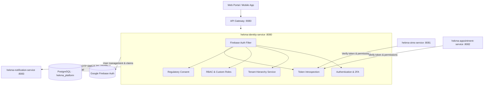
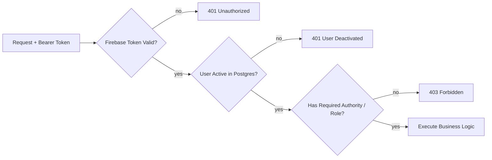
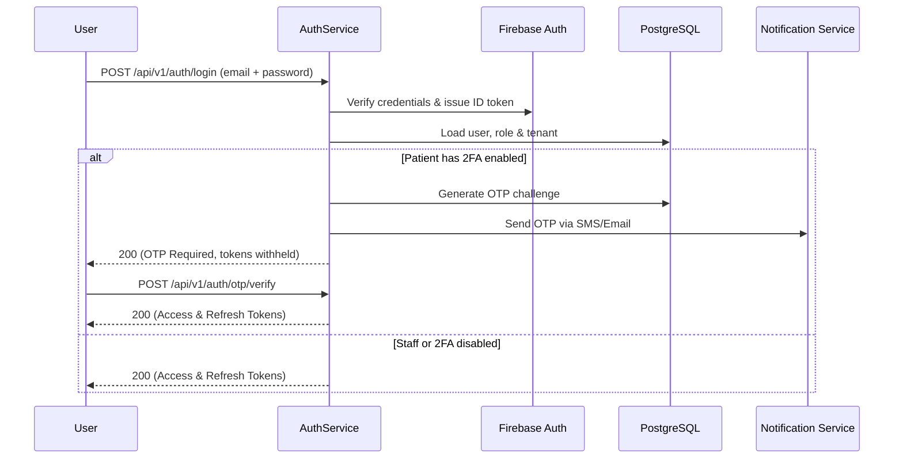
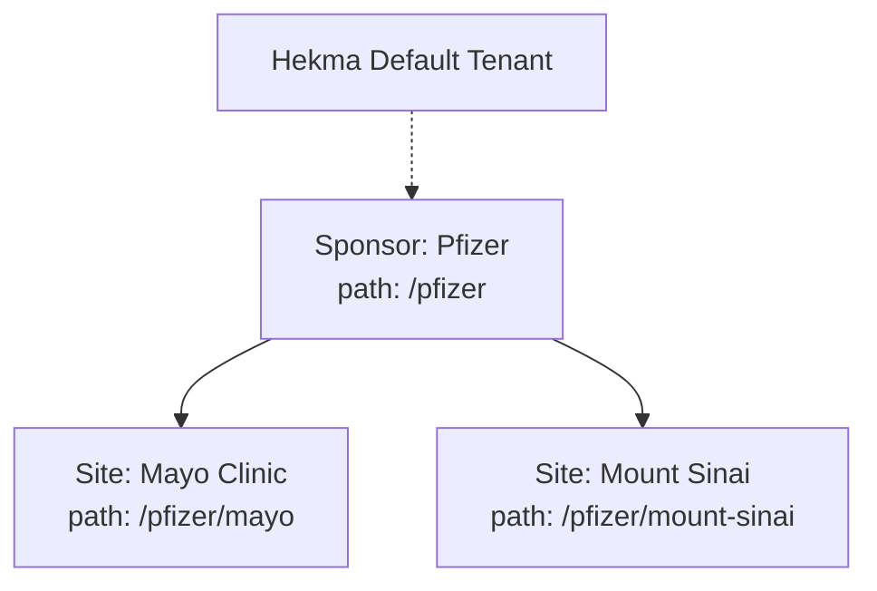
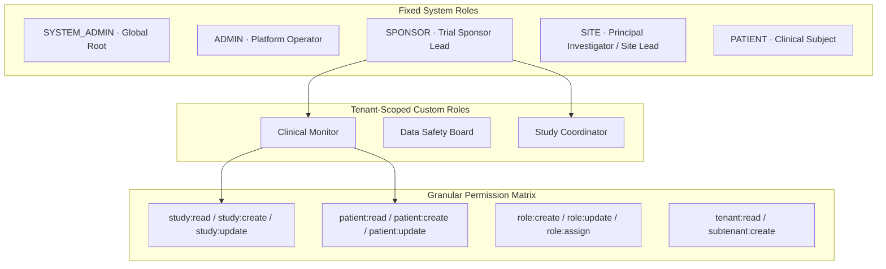
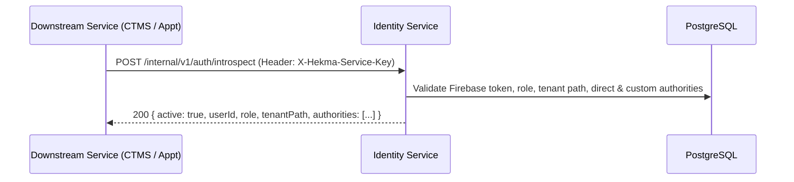
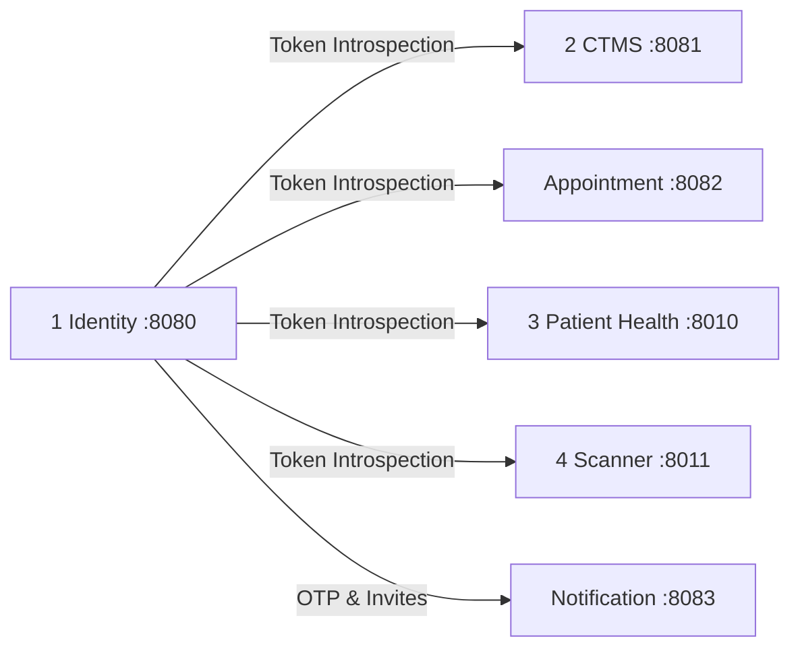

# Identity Service

**Service:** `hekma-identity-service` · **Port:** 8080 · **Role:** S1 in the platform (Core Authentication & Authorization)

This is the centralized authentication, authorization, regulatory consent, and tenant hierarchy authority for the Hekma platform.

It is **not** CTMS (clinical trials/studies), **not** Clinical AI, **not** Appointments/Scheduling, and **not** Patient Health (EHR/FHIR). All other services in the platform rely on this service to validate tokens, resolve user roles, verify fine-grained authorities, and enforce multi-tenant organization boundaries.

---

## What it supports

| Component | What the user sees | Owns |
|-----------|--------------------|------|
| **1 · Authentication & Session** | Login, signup, password reset, 2FA OTP | Dual-write Firebase Auth & PostgreSQL; OTP issuance & validation; session tokens |
| **2 · Hierarchical Multi-Tenancy** | Organizations, sponsor accounts, hospital sites | Materialized path tenant tree (`/top-org/sub-org`), tenant registration & lifecycle |
| **3 · RBAC, Authorities & Custom Roles** | Role assignments, custom roles, permission matrix | Fixed role hierarchy, 17+ granular authorities, tenant-scoped custom roles |
| **4 · Regulatory Consent & Clinical Profile** | Consent forms, legal e-signatures, clinical details | Immutable regulatory audit trail, patient profile metadata |
| **5 · Token Introspection** | Seamless SSO across all microservices | Inter-service `/internal/v1/auth/introspect` endpoint for downstream microservices |

---

## High-level architecture



**Rule:** Identity is the single source of truth for who a user is, what organization they belong to, and what permissions they hold. Other services never validate passwords or assign tenant hierarchies.

---

## Request path (every call)



Public exceptions: `/api/v1/auth/login`, `/api/v1/auth/signup`, `/api/v1/auth/register-tenant`, `/api/v1/auth/otp/**`, `/swagger-ui/**`, `/v3/api-docs/**`.

---

## 1 · Authentication & Session Management

Manages registration, credential validation, and multi-factor authentication. Enforces dual-write consistency between Firebase Auth and PostgreSQL.



| API | Purpose |
|-----|---------|
| `POST /api/v1/auth/login` | Email/password login with conditional 2FA challenge |
| `POST /api/v1/auth/signup` | Public self-registration (Patients only) |
| `POST /api/v1/auth/register-tenant` | Self-service registration of top-level Sponsor / Site tenant |
| `POST /api/v1/auth/otp/verify` | Verify OTP code and complete login |
| `POST /api/v1/auth/password/reset-request` | Initiate password recovery flow |
| `POST /api/v1/auth/password/reset-confirm` | Complete password reset with secure token |

---

## 2 · Hierarchical Multi-Tenancy

Implements tree-based multi-tenancy using materialized paths (e.g. `/pfizer/site-nyc`). Sub-tenants inherit boundaries, and users are strictly isolated to their tenant subtree.



| API | Purpose |
|-----|---------|
| `POST /api/v1/tenants/sub-tenants` | Create sub-tenant site under current sponsor (`subtenant:create`) |
| `GET /api/v1/tenants/my-tenant` | Retrieve tenant details and subscription tier |
| `PUT /api/v1/tenants/{tenantId}` | Update tenant branding and contact information (`tenant:update`) |
| `GET /api/v1/tenants` | List tenants within caller's subtree |

---

## 3 · RBAC, Authorities & Custom Roles

Combines high-level system roles with 17+ granular permissions and tenant-scoped custom roles.



| API | Purpose |
|-----|---------|
| `GET /api/v1/roles/authorities/catalogue` | Catalogue of all 17+ platform authorities |
| `GET /api/v1/roles/custom` | List custom roles defined in caller's tenant |
| `POST /api/v1/roles/custom` | Create a new custom role with authority subset (`role:create`) |
| `PUT /api/v1/roles/custom/{roleId}` | Modify custom role authorities (`role:update`) |
| `POST /api/v1/users/{userId}/custom-roles` | Assign custom roles to a staff member (`role:assign`) |

---

## 4 · Token Introspection (Inter-Service Contract)

Downstream microservices (CTMS, Appointment, Scanner) validate caller tokens by calling Identity's internal introspection endpoint:



| API | Purpose |
|-----|---------|
| `POST /internal/v1/auth/introspect` | Internal high-throughput token validation for microservices |

---

## Where it sits on the platform



| This service does | Another service does |
|-------------------|----------------------|
| Auth credentials, passwords, 2FA | CTMS: Studies, protocols, adverse events |
| Tenant hierarchy, materialized paths | Appointment: Booking, calendar conflict detection |
| System roles & custom roles | Notification: Email/SMS delivery, support tickets |
| Token introspection | Patient Health: EHR, FHIR stores, medications |

---

## Data stores

| Store | Used for |
|-------|----------|
| PostgreSQL (`hekma_platform`) | `identity_users`, `identity_tenants`, `identity_custom_roles`, `identity_otp_requests`, `identity_consents` |
| Google Firebase Auth | Secure password hashing, ID token minting, phone authentication |

---

## Run & Test

```powershell
cd hekma-identity-service
$env:JAVA_HOME="C:\Users\Acer_PTS\.jdks\graalvm-jdk-25"; $env:Path="$env:JAVA_HOME\bin;" + $env:Path
.\mvnw.cmd test
.\mvnw.cmd spring-boot:run
```
