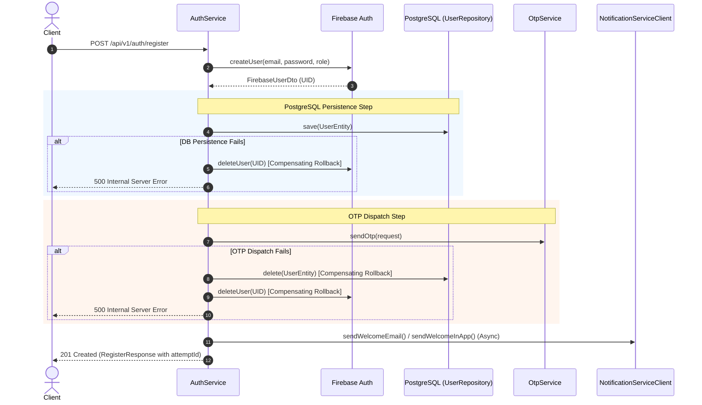

# System Architecture: Hekma Identity Service

## 1. High-Level Architecture Overview

The **Hekma Identity Service** is structured as a decoupled, domain-driven microservice responsible for authentication, authorization, clinical user profile governance, and regulatory consent tracking across the Hekma Platform.

```
                           +---------------------------+
                           |  Client Web / Mobile App  |
                           +-------------+-------------+
                                         |
                                         v
                         +---------------+---------------+
                         |   Spring Security & Filters   |
                         |   Stateless / Bearer Tokens   |
                         +---------------+---------------+
                                         |
               +-------------------------+-------------------------+
               |                                                   |
               v                                                   v
   +-----------------------+                           +-----------------------+
   |    REST Controllers   |                           |  GraphQL Controller   |
   | (Auth, OTP, User,     |                           | (Query, Mutation,     |
   |  SystemAdmin)         |                           |  Batch Schema Resolv) |
   +-----------+-----------+                           +-----------+-----------+
               |                                                   |
               +-------------------------+-------------------------+
                                         |
                                         v
                         +---------------+---------------+
                         |     Service Business Layer    |
                         | - AuthService                 |
                         | - OtpService                  |
                         | - UserManagementService       |
                         | - UserQueryService            |
                         +-------+---------------+-------+
                                 |               |
                +----------------+               +----------------+
                |                                                 |
                v                                                 v
  +-------------+-------------+                     +-------------+-------------+
  |    Firebase Integration   |                     | Notification Integration  |
  | - FirebaseAuthService     |                     | - NotificationClient      |
  | - MockFirebaseService     |                     |   (HTTP REST Client)      |
  +-------------+-------------+                     +-------------+-------------+
                |                                                 |
                v                                                 v
  +-------------+-------------+                     +-------------+-------------+
  |  Google Firebase / STS    |                     | hekma-notification-svc   |
  |  (IdP / Token Issuance)   |                     | (SMS / Email Delivery)    |
  +---------------------------+                     +---------------------------+
                |
                v
  +-------------+-------------+
  |    Spring Data JPA Layer  |
  | - BaseAuditEntity         |
  | - Soft Delete Filter      |
  +-------------+-------------+
                |
                v
  +-------------+-------------+
  |   PostgreSQL 18 Database  |
  |   (Managed via Flyway)    |
  +---------------------------+
```

---

## 2. Major Services & Responsibilities

| Component / Service | Package | Primary Responsibilities |
| :--- | :--- | :--- |
| **`AuthService`** | `com.hekma.identity.service` | Public registration, login credential validation, Firebase dual-write saga, compensating rollbacks, token refresh via Google STS, and system admin bootstrap. |
| **`OtpService`** | `com.hekma.identity.service` | 6-digit OTP generation, BCrypt hash storage, attempt tracking (max 5), resend limiting (max 3), rate-limiting (5/hour), lockout triggering (30 min), and security audit logging. |
| **`UserManagementService`** | `com.hekma.identity.service` | Administrative status modifications (`isActive`), role hierarchy verification, soft deletion (`is_deleted = true`), and patient 2FA preference toggles. |
| **`UserQueryService`** | `com.hekma.identity.service` | Read-only administrative querying, role filtering, pagination/ordering, and GraphQL batch schema field resolvers. |
| **`FirebaseAuthService`** | `com.hekma.identity.firebase` | Interacts with Firebase Admin SDK for user record creation, custom claim assignment (`role`), user deletion during rollbacks, and Google STS token refresh. |
| **`MockFirebaseService`** | `com.hekma.identity.firebase` | Local development and test stand-in simulating Firebase operations in memory. |
| **`NotificationServiceClient`** | `com.hekma.identity.notification` | Synchronous HTTP REST client dispatching SMS OTP, Email OTP, and Welcome notifications to `hekma-notification-service`. |

---

## 3. Communication Patterns & External Integrations

### 3.1 Dual-Write Saga with Compensating Rollbacks
User creation coordinates state between Google Firebase Authentication and PostgreSQL:



### 3.2 Inter-Service Communication
- **Protocol**: HTTP/1.1 REST using Spring `RestTemplate`.
- **Target**: `hekma-notification-service` (`/api/v1/notifications/send`).
- **Security**: Secured via HTTP header `X-Hekma-Service-Key` configured in `app.notification-service.service-key`.
- **Resilience**: Welcome notification dispatch is non-blocking to the registration flow (failure logs a warning rather than aborting registration).

---

## 4. Authentication & Authorization Design

### 4.0 Request Authentication Pipeline (RBAC Phase 1)
```
Request ─► FirebaseAuthenticationFilter ─► TenantFilter ─► Controller (@PreAuthorize) ─► Service (scoped queries)
             │ no Bearer → anonymous (only public POST endpoints succeed)
             │ verifyIdToken(token, checkRevoked=true) fails → 401
             │ load user + tenant from PostgreSQL; inactive user, or tenant/any ancestor not ACTIVE → 403
             └ SecurityContext ← HekmaPrincipal{userId, role, tenantId, tenantPath, authorities}
               granted authorities = ROLE_<role> + authority keys (admins: all, staff: from DB, patients: none)
```
- Public endpoints are an exact list in `SecurityConfig.PUBLIC_POST_ENDPOINTS`; everything else requires authentication.
- Login: the API validates the password via Firebase `signInWithPassword(auth_email)` and returns Firebase tokens; `otp/verify` exchanges a custom token for an ID token server-side.
- Sessions are revoked via `revokeRefreshTokens` on deactivation, soft deletion, password reset and password change.
- Password management is API-only, credentials stored only in Firebase: create (Admin SDK `createUser`), validate (`signInWithPassword`), reset after OTP and change after re-validating the current password (Admin SDK `updatePassword`; `change-password` returns fresh tokens).
- **Tenant hierarchy (Phase 2)**: tenants carry `parent_tenant_id` + materialized `path`; SPONSOR/SITE scope = `path LIKE '<own path>%'` (`HekmaPrincipal.canSeeTenant`, `TenantEntity.containsInSubtree`). Top-level tenants come from `POST /api/v1/auth/register-tenant` (tenant + owner `PENDING_VERIFICATION`, activated by the owner's OTP). See ADR-011.
- **Authorities (Phase 3)**: `@PreAuthorize("hasAuthority('patient:read')")` etc. on handlers; services enforce subtree scope and grant ≤ own (`AuthorityService`); staff invitations (`StaffInvitationService`, hashed single-use tokens); privileged actions recorded by `AuditService` in `identity_authz_audit_log`. See ADR-012/013 and [docs/RBAC_PLAN.md](../RBAC_PLAN.md).

### 4.1 Role-Based Access Control (RBAC) Hierarchy
Enforced programmatically in `UserManagementService` and `AuthService`:
1. **`SYSTEM_ADMIN`**: Root platform administrator bootstrapped at application startup with a randomized 20-character password. Only role permitted to invite or create `ADMIN` users. Cannot be deactivated or deleted.
2. **`ADMIN`**: Platform operational administrator. Can manage `SPONSOR`, `SITE`, and `PATIENT` users. Cannot modify other `ADMIN` users or `SYSTEM_ADMIN`.
3. **`SPONSOR`**, **`SITE`**, **`PATIENT`**: Permitted for public self-registration.

### 4.2 Conditional Two-Factor Authentication (2FA)
- Available for `PATIENT` users.
- When `twoFactorEnabled == true`, logging in via `/api/v1/auth/login` dispatches an OTP challenge, withholding JWT tokens until verified via `/api/v1/auth/otp/verify`.
- When `twoFactorEnabled == false` or for non-patient roles, login directly returns Firebase ID and refresh tokens.

---

## 5. Persistence, Auditing & Soft Deletion

- **Auditing**: All JPA entities inherit from `BaseAuditEntity`, automatically recording:
  - `createdAt`, `updatedAt` via Spring Data JPA `@EntityListeners(AuditingEntityListener.class)`.
  - `createdBy`, `updatedBy` tracked via JPA Auditor aware.
  - `@Version private Long version` providing optimistic locking against concurrent edits.
- **Soft Deletion**: `UserEntity` is annotated with Hibernate `@SQLRestriction("is_deleted = false")`.
  - Calling `DELETE /api/v1/users/{userId}` executes soft deletion: `isDeleted = true`, `isActive = false`, `status = INACTIVE`.
  - Soft-deleted entities are automatically excluded from all standard JPA queries and foreign key lookups.
- **Schema Management**: Flyway manages versioned migrations (`V1` through `V3`) executed automatically on application startup.

---

## 6. Important Architectural Constraints

1. **Compensating Rollbacks**: Any modification spanning Firebase and PostgreSQL must implement explicit compensating rollback logic in case of intermediate failure.
2. **Plaintext Password & OTP Invariant**: Plaintext passwords and OTP codes are strictly ephemeral. OTPs are BCrypt-hashed before persistence.
3. **Hibernate Restriction Invariant**: Never execute physical database row deletions on user accounts. Regulatory compliance requires maintaining historical records via soft deletion.
