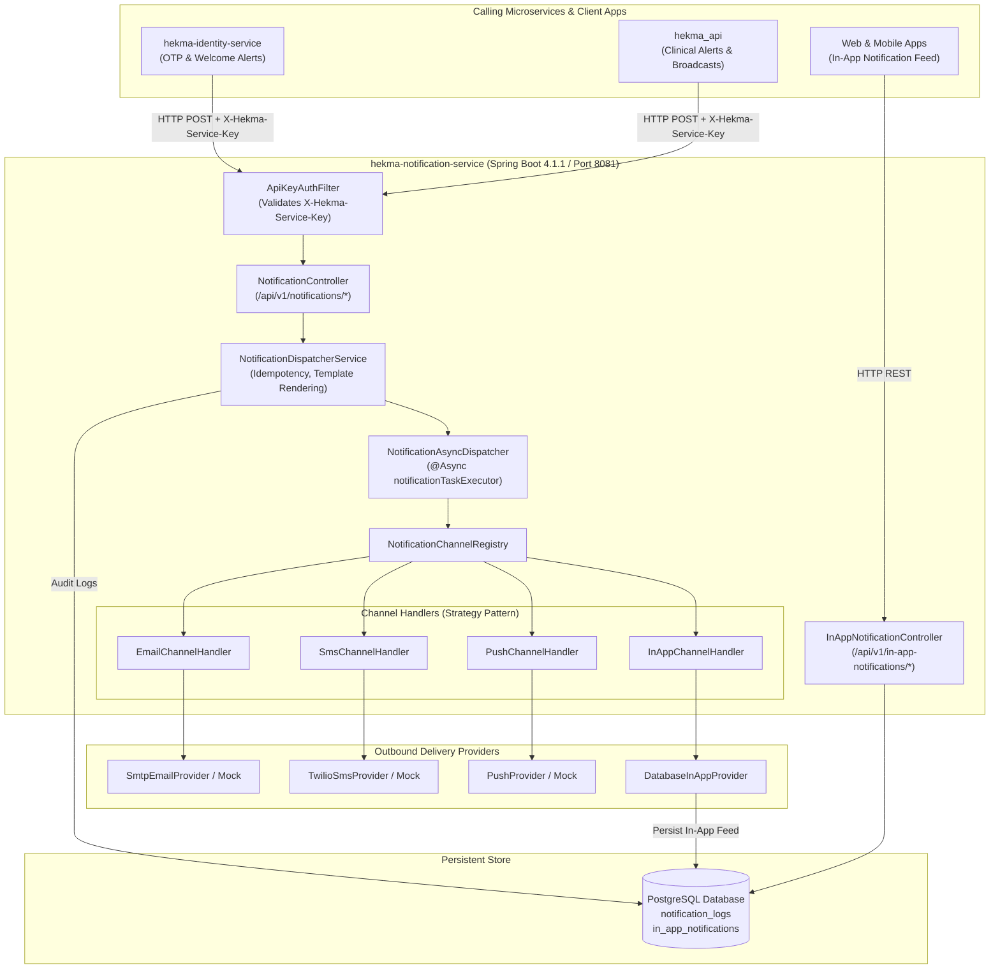
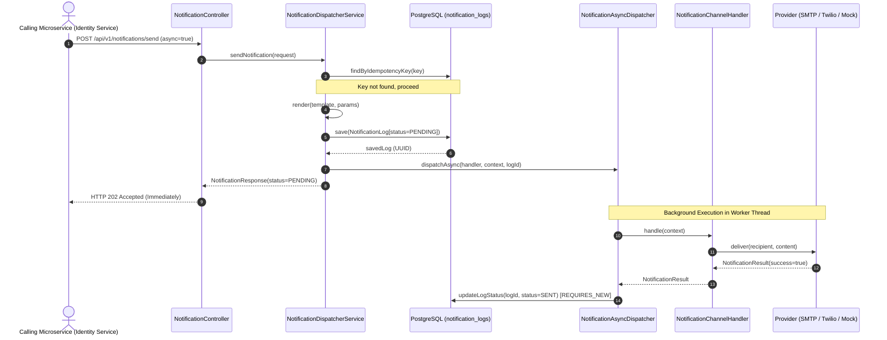
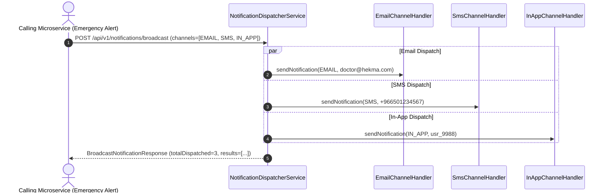
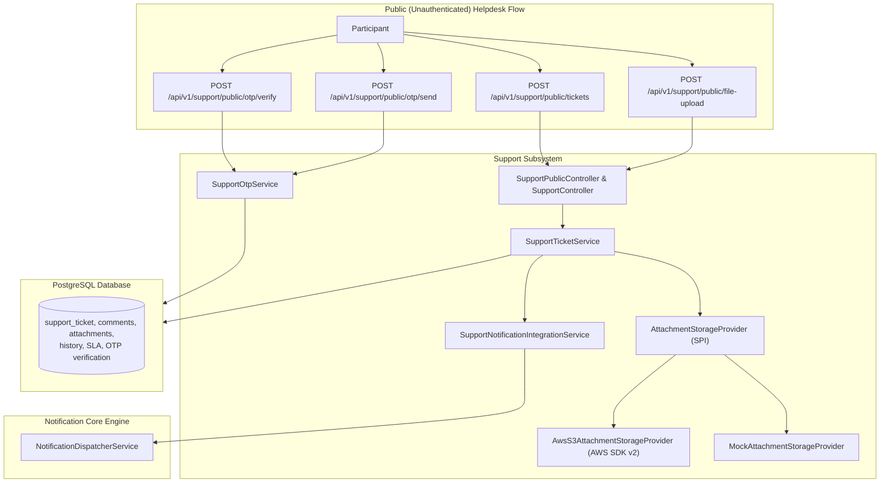

# System Architecture: Hekma Notification Service (`hekma-notification-service`)

## 1. High-Level Architectural Overview

The **Hekma Notification Service** is architected around the **Strategy Pattern (Channel SPI)**, separating channel dispatch orchestration from specific third-party provider integrations:

---

## 2. Component & Service Responsibilities

### 2.1 Security & Ingestion Layer
- **[ApiKeyAuthFilter.java](file:///D:/coding/hekma/hekma-notification-service/src/main/java/com/hekma/notification/config/ApiKeyAuthFilter.java)**:
  - Intercepts incoming requests.
  - Validates the `X-Hekma-Service-Key` header against `hekma.security.service-api-key`.
  - Assigns `ROLE_INTERNAL_SERVICE` to authenticated callers.
  - Rejects unauthorized calls to `/api/v1/notifications/**` with HTTP `401 Unauthorized`.
  - Whitelists `/api/v1/in-app-notifications/**`, Actuator, and Swagger documentation.
- **[SecurityConfig.java](file:///D:/coding/hekma/hekma-notification-service/src/main/java/com/hekma/notification/config/SecurityConfig.java)**:
  - Configures stateless session policy (`SessionCreationPolicy.STATELESS`).
  - Disables CSRF, form login, and HTTP basic auth.

### 2.2 Core Dispatching Engine
- **[NotificationDispatcherService.java](file:///D:/coding/hekma/hekma-notification-service/src/main/java/com/hekma/notification/service/NotificationDispatcherService.java)**:
  - Orchestrates idempotency checks via `findByIdempotencyKey`.
  - Performs parameter substitution via [TemplateRenderer.java](file:///D:/coding/hekma/hekma-notification-service/src/main/java/com/hekma/notification/service/TemplateRenderer.java).
  - Creates the initial `NotificationLog` entry with status `PENDING`.
  - Delegates execution to `NotificationAsyncDispatcher` (for async requests) or invokes channel handlers directly (for synchronous requests).
  - Implements multi-channel broadcasting iterating across requested channels.
- **[NotificationAsyncDispatcher.java](file:///D:/coding/hekma/hekma-notification-service/src/main/java/com/hekma/notification/service/NotificationAsyncDispatcher.java)**:
  - Annotated with `@Async("notificationTaskExecutor")`.
  - Executes the target channel handler off the calling thread.
  - Updates the `NotificationLog` status to `SENT` or `FAILED` in an isolated transaction (`@Transactional(propagation = Propagation.REQUIRES_NEW)`).
- **[AsyncConfig.java](file:///D:/coding/hekma/hekma-notification-service/src/main/java/com/hekma/notification/config/AsyncConfig.java)**:
  - Configures `ThreadPoolTaskExecutor` (`notificationTaskExecutor`) with core pool size 5, max pool size 20, queue capacity 500, and graceful shutdown (30 seconds await termination).

### 2.3 Channel Handler Strategy Pattern (SPI)
- **[NotificationChannelRegistry.java](file:///D:/coding/hekma/hekma-notification-service/src/main/java/com/hekma/notification/channel/NotificationChannelRegistry.java)**:
  - Discovers all Spring beans implementing `NotificationChannelHandler` at boot time and registers them in an `EnumMap`.
- Handlers:
  - **`EmailChannelHandler`**: Delegates to `EmailProvider` (`SmtpEmailProvider` via `JavaMailSender` or `MockEmailProvider`).
  - **`SmsChannelHandler`**: Delegates to `SmsProvider` (`TwilioSmsProvider` or `MockSmsProvider`).
  - **`PushChannelHandler`**: Delegates to `PushProvider` (`MockPushProvider` or live Firebase FCM).
  - **`InAppChannelHandler`**: Directly persists records in `in_app_notifications` table via `InAppNotificationRepository`.

---

## 3. Communication Patterns & External Integrations

### 3.1 Inter-Service Client Integration (`hekma-identity-service`)
- `hekma-identity-service` invokes `POST http://localhost:8081/api/v1/notifications/send` via its HTTP client `NotificationServiceClient`.
- Includes header: `X-Hekma-Service-Key: hekma-internal-secret-key-2026`.
- Payloads include channel (`EMAIL`, `SMS`, `IN_APP`), recipient address, title, content, priority, and `templateParams`.

### 3.2 External Third-Party Providers
- **SMTP Provider**: Connects to configured SMTP host (e.g. `smtp.gmail.com:587` with TLS authentication).
- **Twilio SMS Provider**: Connects to Twilio REST API using `TWILIO_ACCOUNT_SID` and `TWILIO_AUTH_TOKEN`.
- **Firebase FCM Push Provider**: Connects to Google Firebase using service account credentials.

---

## 4. Key Architectural Workflows

### 4.1 Asynchronous Notification Dispatch Flow

### 4.2 Multi-Channel Broadcast Flow

---

## 5. Detailed Channel Flows

For exhaustive lifecycle steps, provider implementations (Mock vs. SMTP vs. Twilio), payload formats, and delivery status tracking for each channel, see **[docs/NOTIFICATION_FLOW.md](file:///D:/coding/hekma/hekma-notification-service/docs/NOTIFICATION_FLOW.md)**.

---

## 6. Support Center Subsystem Architecture

The Support Center module provides end-to-end helpdesk tracking for both public (OTP-verified) and authenticated users:

