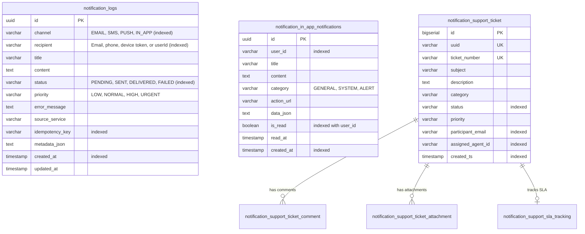

# Database Architecture & Schema: Hekma Notification Service (`hekma-notification-service`)

## 1. Overview & Technology Stack

The **Hekma Notification Service** relies on a relational schema optimized for high-throughput write auditing and paginated user notification feeds:

- **Primary Database**: PostgreSQL (version 14+ compatible).
- **Test Database**: H2 In-Memory Database (`jdbc:h2:mem:notificationdb;DB_CLOSE_DELAY=-1;MODE=PostgreSQL`).
- **ORM / Persistence**: Spring Data JPA / Hibernate ORM 7.x / Spring Boot 4.1.1.
- **Connection Pooling**: HikariCP.
- **Database Migrations**: Managed via **Flyway** (`flyway-database-postgresql` 12.4.0) with dedicated schema history table `notification_flyway_schema_history` (`spring.flyway.table`) with scripts located in `classpath:db/migration` to safely co-locate on the shared `hekmaai` database with `hekma-identity-service`.
- **Entity Identity**: Cryptographically random UUIDs generated via JPA `@PrePersist`.

---

## 2. Entity-Relationship Diagram (ERD)

---

## 3. Flyway Migration History

All database schema versions are tracked in [src/main/resources/db/migration](file:///D:/coding/hekma/hekma-notification-service/src/main/resources/db/migration):

| Migration Script | Description | Applied Changes |
| :--- | :--- | :--- |
| **`V1__init_notification_schema.sql`** | Consolidated Notification Service Baseline Schema | Fresh DB initialization creating all 11 tables with `notification_` prefix (`notification_logs`, `notification_in_app_notifications`, `notification_support_ticket`, `notification_support_ticket_comment`, `notification_support_ticket_attachment`, `notification_support_ticket_assignment_history`, `notification_support_ticket_status_history`, `notification_support_ticket_notification_history`, `notification_support_ticket_audit_log`, `notification_support_sla_tracking`, `notification_support_otp_verification`) with all indexes and constraints. |

---

## 4. Table Schema & Column Specifications

### 4.1 `notification_logs` Table
Maintains an immutable record of every outbound notification attempt.

| Column | Type | Nullable | Default | Description |
| :--- | :--- | :--- | :--- | :--- |
| `id` | `UUID` | No | - | Primary Key |
| `channel` | `VARCHAR(20)` | No | - | `EMAIL`, `SMS`, `PUSH`, `IN_APP` |
| `recipient` | `VARCHAR(255)`| No | - | Destination address (email, E.164 phone, token, userId) |
| `title` | `VARCHAR(255)`| Yes | - | Notification subject or title |
| `content` | `TEXT` | No | - | Rendered message body |
| `status` | `VARCHAR(20)` | No | `'PENDING'` | `PENDING`, `SENT`, `DELIVERED`, `FAILED` |
| `priority` | `VARCHAR(20)` | No | `'NORMAL'` | `LOW`, `NORMAL`, `HIGH`, `URGENT` |
| `error_message` | `TEXT` | Yes | - | Provider failure details if status is `FAILED` |
| `source_service` | `VARCHAR(100)`| Yes | - | Name of caller (e.g. `hekma-identity-service`) |
| `idempotency_key`| `VARCHAR(120)`| Yes | - | Unique request deduplication key |
| `metadata_json` | `TEXT` | Yes | - | Additional caller metadata serialized as JSON |
| `created_at` | `TIMESTAMPTZ` | No | `CURRENT_TIMESTAMP` | Initial ingestion timestamp |
| `updated_at` | `TIMESTAMPTZ` | No | `CURRENT_TIMESTAMP` | Last status update timestamp |

### 4.2 `notification_in_app_notifications` Table
Stores persistent notifications displayed in patient and clinician dashboard inboxes.

| Column | Type | Nullable | Default | Description |
| :--- | :--- | :--- | :--- | :--- |
| `id` | `UUID` | No | - | Primary Key |
| `user_id` | `VARCHAR(100)`| No | - | Target recipient user ID |
| `title` | `VARCHAR(255)`| No | - | Notification banner title |
| `content` | `TEXT` | No | - | Notification message text |
| `category` | `VARCHAR(50)` | Yes | `'GENERAL'` | Classification (e.g. `SYSTEM`, `ALERT`, `TRIAL`) |
| `action_url` | `VARCHAR(500)`| Yes | - | Optional deep link URL |
| `data_json` | `TEXT` | Yes | - | Optional structured context payload |
| `is_read` | `BOOLEAN` | No | `FALSE` | Read state flag |
| `read_at` | `TIMESTAMPTZ` | Yes | - | Timestamp when user marked notification as read |
| `created_at` | `TIMESTAMPTZ` | No | `CURRENT_TIMESTAMP` | Creation timestamp |

### 4.3 `notification_support_*` Tables
Helpdesk and ticketing support tables:
- `notification_support_ticket`: Core participant inquiry ticket.
- `notification_support_ticket_comment`: Public and internal staff commentary.
- `notification_support_ticket_attachment`: Attachment metadata and presigned URLs.
- `notification_support_ticket_assignment_history`: Agent assignment tracking.
- `notification_support_ticket_status_history`: Lifecycle state transition log.
- `notification_support_ticket_notification_history`: Outbound alert log for ticket events.
- `notification_support_ticket_audit_log`: Security audit trail of ticket operations.
- `notification_support_sla_tracking`: Response and resolution SLA deadlines and breaches.
- `notification_support_otp_verification`: Email verification and session OTP challenge state.

---

## 5. Indexing & Query Optimizations

1. **`notification_idx_logs_idempotency` (`idempotency_key`)**:
   - Enables fast `O(1)` indexed lookups during request deduplication in `NotificationDispatcherService.sendNotification()`.
2. **`notification_idx_in_app_is_read` (`user_id, is_read`)**:
   - Composite index specifically optimizing `countByUserIdAndIsReadFalse(userId)` unread badge counts and filtering unread notifications.
3. **`notification_idx_in_app_created_at` (`created_at`)**:
   - Supports paginated descending ordering for inbox feeds.
