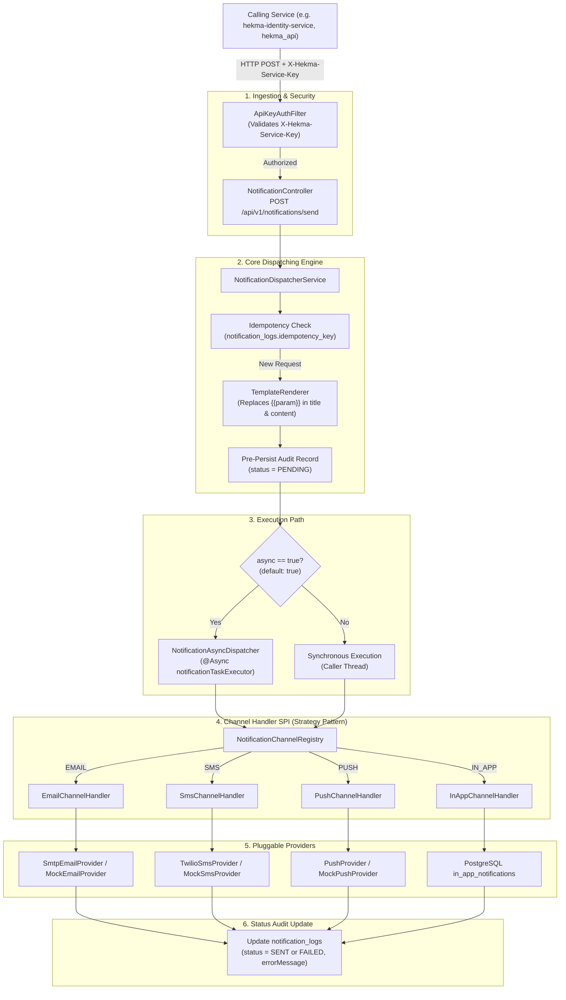
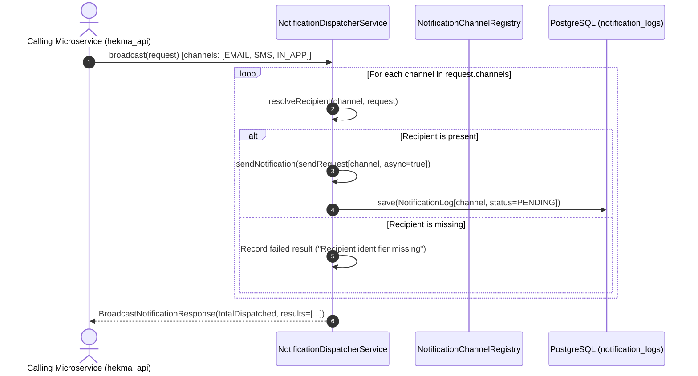

# Notification Delivery Flow: Hekma Notification Service (`hekma-notification-service`)

This document provides a comprehensive, end-to-end technical explanation of how notifications are ingested, authorized, processed, rendered, and dispatched across all supported channels (`EMAIL`, `SMS`, `PUSH`, `IN_APP`) within the Hekma Platform.

---

## 1. High-Level Flow Architecture



---

## 2. Step-by-Step Dispatch Lifecycle

### Step 1: Ingestion & Inter-Service Security
- **Caller Entry**: The calling microservice (e.g. `hekma-identity-service` sending an OTP or welcome message) issues an HTTP POST to `/api/v1/notifications/send` or `/api/v1/notifications/broadcast`.
- **Authentication**: [ApiKeyAuthFilter.java](file:///D:/coding/hekma/hekma-notification-service/src/main/java/com/hekma/notification/config/ApiKeyAuthFilter.java) intercepts the request and verifies the `X-Hekma-Service-Key` header against `hekma.security.service-api-key`.
  - **Valid Key**: Injects `ROLE_INTERNAL_SERVICE` into `SecurityContextHolder`.
  - **Missing or Invalid Key**: Rejects immediately with HTTP `401 Unauthorized`.
- **Payload Validation**: [NotificationController.java](file:///D:/coding/hekma/hekma-notification-service/src/main/java/com/hekma/notification/controller/NotificationController.java) validates the [NotificationSendRequest.java](file:///D:/coding/hekma/hekma-notification-service/src/main/java/com/hekma/notification/dto/NotificationSendRequest.java) using Jakarta Validation (`@NotNull` channel, `@NotBlank` recipient, `@NotBlank` content).

### Step 2: Idempotency Verification
- If `idempotencyKey` is present and non-blank:
  - [NotificationDispatcherService.java](file:///D:/coding/hekma/hekma-notification-service/src/main/java/com/hekma/notification/service/NotificationDispatcherService.java) queries PostgreSQL: `notificationLogRepository.findByIdempotencyKey(key)`.
  - **If Found**: Duplicate dispatching is bypassed. The existing `NotificationLog` is mapped to `NotificationResponse` and returned immediately.
  - **If Not Found**: Processing continues.

### Step 3: Template Variable Rendering
- [TemplateRenderer.java](file:///D:/coding/hekma/hekma-notification-service/src/main/java/com/hekma/notification/service/TemplateRenderer.java) evaluates `templateParams` map against `title` and `content`.
- Any matching placeholder in the form `{{key}}` is replaced by the corresponding parameter string value (e.g. `{{code}}` becomes `84729`, `{{name}}` becomes `Sarah`).
- If no parameters are provided, the template strings are passed through unmodified.

### Step 4: Initial Audit Record Persistence
- A new [NotificationLog.java](file:///D:/coding/hekma/hekma-notification-service/src/main/java/com/hekma/notification/domain/entity/NotificationLog.java) record is built with:
  - `channel`: Target `NotificationChannel` (`EMAIL`, `SMS`, `PUSH`, `IN_APP`).
  - `recipient`: Address, phone number, device token, or user ID.
  - `title`: Rendered title.
  - `content`: Rendered body content.
  - `priority`: `NotificationPriority` (default `NORMAL`).
  - `status`: `NotificationStatus.PENDING`.
  - `sourceService`: Name of calling service (e.g. `hekma-identity-service`).
  - `idempotencyKey`: Unique deduplication key.
  - `metadataJson`: Caller metadata map serialized to JSON via Jackson.
- The record is persisted to the `notification_logs` table.

### Step 5: Asynchronous vs. Synchronous Execution

#### Asynchronous Path (`async = true`, Default)
1. `NotificationDispatcherService` builds a `ChannelDispatchContext` and invokes:
   ```java
   asyncDispatcher.dispatchAsync(handler, context, savedLog.getId());
   ```
2. The caller's HTTP request completes immediately with HTTP **`202 Accepted`** and payload status `PENDING`.
3. The background task executes on `notificationTaskExecutor` ([AsyncConfig.java](file:///D:/coding/hekma/hekma-notification-service/src/main/java/com/hekma/notification/config/AsyncConfig.java)):
   - Core Pool Size: 5
   - Max Pool Size: 20
   - Queue Capacity: 500
   - Thread Prefix: `notif-worker-`
4. When the provider returns, `asyncDispatcher.updateLogStatus(logId, result)` executes in an isolated transaction (`@Transactional(propagation = Propagation.REQUIRES_NEW)`):
   - **Success**: Status updated to `SENT`.
   - **Failure**: Status updated to `FAILED`, with `errorMessage` recorded.

#### Synchronous Path (`async = false`)
1. The channel handler is invoked directly on the calling HTTP thread.
2. The caller waits for the provider round-trip.
3. `NotificationLog` is updated with `SENT` or `FAILED` before returning HTTP `202 Accepted` (or `200 OK`) to the caller.

---

## 3. Channel-by-Channel Execution Details

```
                              Channel Dispatch Context
                                         |
     +-------------------+---------------+-------------------+-------------------+
     |                   |                                   |                   |
     v                   v                                   v                   v
[ EMAIL ]             [ SMS ]                             [ PUSH ]           [ IN_APP ]
     |                   |                                   |                   |
EmailChannelHandler  SmsChannelHandler                   PushChannelHandler  InAppChannelHandler
     |                   |                                   |                   |
     +---+               +---+                               +---+               |
     |   |               |   |                               |   |               v
     |   v               |   v                               |   v         Insert directly into
     | SmtpEmailProvider | TwilioSmsProvider                 | Live FCM    in_app_notifications
     | (JavaMailSender)  | (Twilio REST API)                 | Provider    (PostgreSQL)
     v                   v                                   v
MockEmailProvider    MockSmsProvider                     MockPushProvider
(Console Log)        (Console Log)                       (Console Log)
```

### 3.1 EMAIL Channel Flow

- **Handler**: [EmailChannelHandler.java](file:///D:/coding/hekma/hekma-notification-service/src/main/java/com/hekma/notification/channel/email/EmailChannelHandler.java)
- **Recipient Format**: Standard email address (e.g. `patient@hekma.com`).
- **Sender Address**: Injected from `hekma.notification.channels.email.default-sender` (default: `bareet.dev@gmail.com` or `no-reply@hekma.com`).
- **Provider Delegation**:
  - **`SmtpEmailProvider`** (`hekma.notification.channels.email.provider=smtp`):
    - Uses Spring Boot's `JavaMailSender` (`jakarta.mail.internet.MimeMessage`).
    - Configured with `MimeMessageHelper(message, true, "UTF-8")`.
    - Transmits HTML email through SMTP host (e.g. `smtp.gmail.com:587` with TLS).
    - Returns `NotificationResult.success("smtp-" + UUID)`.
    - On SMTP handshake or transport error, returns `NotificationResult.failure("SMTP delivery failed: " + ex.getMessage())`.
  - **`MockEmailProvider`** (`hekma.notification.channels.email.provider=mock`, default):
    - Generates a mock identifier: `mock-email-<UUID>`.
    - Outputs full message details to application SLF4J logs.
    - Returns `NotificationResult.success()`.

### 3.2 SMS Channel Flow

- **Handler**: [SmsChannelHandler.java](file:///D:/coding/hekma/hekma-notification-service/src/main/java/com/hekma/notification/channel/sms/SmsChannelHandler.java)
- **Recipient Format**: E.164 international phone number (e.g. `+1234567890`, `+966501234567`).
- **Message Formatting**: If `title` is present, it is formatted as: `"{title}: {content}"`.
- **Provider Delegation**:
  - **`TwilioSmsProvider`** (`hekma.notification.channels.sms.provider=twilio`):
    - Reads `account-sid`, `auth-token`, and `from-number` from configuration.
    - Constructs URL-encoded form body: `To={phone}&From={fromNumber}&Body={message}`.
    - Sends an HTTP POST using Java `HttpClient` with Basic Authentication to:
      `https://api.twilio.com/2010-04-01/Accounts/{accountSid}/Messages.json`.
    - If HTTP status is `200..299`: Returns `NotificationResult.success("twilio-" + UUID)`.
    - If HTTP status >= 400 or network fails: Returns `NotificationResult.failure("Twilio responded with error status: " + response.statusCode())`.
  - **`MockSmsProvider`** (`hekma.notification.channels.sms.provider=mock`, default):
    - Generates a mock identifier: `mock-sms-<UUID>`.
    - Logs SMS payload to console/logger: `[MOCK SMS DISPATCHED] ID: ... | To: ... | Message: ...`.
    - Returns `NotificationResult.success()`.

### 3.3 PUSH Channel Flow

- **Handler**: [PushChannelHandler.java](file:///D:/coding/hekma/hekma-notification-service/src/main/java/com/hekma/notification/channel/push/PushChannelHandler.java)
- **Recipient Format**: Target device registration token (FCM registration token).
- **Payload Handling**: Passes `recipient`, `title`, `content`, and arbitrary key-value metadata.
- **Provider Delegation**:
  - **`MockPushProvider`** (`hekma.notification.channels.push.provider=mock`, default):
    - Generates mock identifier: `mock-push-<UUID>`.
    - Logs device token, title, body, and data map to SLF4J logs.
    - Returns `NotificationResult.success()`.
  - **Live Push Provider**: Extensible SPI for Firebase Cloud Messaging (FCM) integration using Firebase Admin SDK credentials.

### 3.4 IN_APP Channel Flow

- **Handler**: [InAppChannelHandler.java](file:///D:/coding/hekma/hekma-notification-service/src/main/java/com/hekma/notification/channel/inapp/InAppChannelHandler.java)
- **Recipient Format**: Platform User ID (e.g. `usr_12345` or UUID).
- **Storage Target**: Dedicated PostgreSQL table `in_app_notifications`.
- **Metadata Extraction**:
  - `category`: Extracted from metadata map (default: `'GENERAL'`).
  - `actionUrl`: Extracted from metadata map (e.g. `'/dashboard/trials/123'`).
  - `dataJson`: Entire metadata map serialized to JSON.
- **Entity Creation**:
  - Constructs and saves [InAppNotification.java](file:///D:/coding/hekma/hekma-notification-service/src/main/java/com/hekma/notification/domain/entity/InAppNotification.java) with `isRead = false`, `readAt = null`, and `createdAt = Instant.now()`.
  - Returns `NotificationResult.success(saved.getId().toString())`.
- **Client Feed Access**: Frontend web and mobile clients retrieve and manage these records using `/api/v1/in-app-notifications/**` endpoints (see [docs/API_DOCUMENTATION.md](file:///D:/coding/hekma/hekma-notification-service/docs/API_DOCUMENTATION.md)).

---

## 4. Multi-Channel Broadcast Flow

When a calling service invokes `POST /api/v1/notifications/broadcast` ([BroadcastNotificationRequest.java](file:///D:/coding/hekma/hekma-notification-service/src/main/java/com/hekma/notification/dto/BroadcastNotificationRequest.java)):



1. The service iterates over each requested channel in `request.getChannels()`.
2. Resolves the appropriate recipient attribute from the broadcast payload:
   - `EMAIL` -> `request.getEmail()`
   - `SMS` -> `request.getPhone()`
   - `PUSH` -> `request.getPushToken()`
   - `IN_APP` -> `request.getUserId()`
3. Dispatches each channel as an independent asynchronous notification request.
4. Aggregates all individual `NotificationResponse` objects into a unified `BroadcastNotificationResponse`.

---

## 5. Status Tracking & Delivery Polling

Callers can query delivery outcomes at any point:
- **Endpoint**: `GET /api/v1/notifications/{id}/status`
- **Security**: Requires `X-Hekma-Service-Key` header.
- **Status Lifecycle**:
  ```
  [Ingested] ----> PENDING
                     |
         +-----------+-----------+
         |                       |
         v                       v
       SENT                   FAILED
  (Provider Success)     (Provider Error)
  ```
- **Response**:
  ```json
  {
    "id": "e8a93a10-2b1c-4b5f-9e67-0c7f66a87b92",
    "channel": "EMAIL",
    "recipient": "patient@hekma.com",
    "status": "SENT",
    "providerMessageId": "smtp-550e8400-e29b-41d4-a716-446655440000",
    "errorMessage": null,
    "createdAt": "2026-10-01T12:00:00Z"
  }
  ```

---

## 6. Channel Configuration Reference

All channel behaviors and provider selections are managed via `application.yml` or environment variables:

| Property | Environment Variable | Default | Allowed Values | Description |
| :--- | :--- | :--- | :--- | :--- |
| `hekma.notification.channels.email.provider` | `EMAIL_PROVIDER` | `smtp` | `mock`, `smtp` | Provider for email dispatching |
| `hekma.notification.channels.email.default-sender` | `EMAIL_DEFAULT_SENDER` | `bareet.dev@gmail.com` | Email address | Default `From` address |
| `hekma.notification.channels.sms.provider` | `SMS_PROVIDER` | `mock` | `mock`, `twilio` | Provider for SMS text messages |
| `hekma.notification.channels.sms.twilio.account-sid` | `TWILIO_ACCOUNT_SID` | - | String | Twilio Account SID |
| `hekma.notification.channels.sms.twilio.auth-token` | `TWILIO_AUTH_TOKEN` | - | String | Twilio Authentication Token |
| `hekma.notification.channels.sms.twilio.from-number` | `TWILIO_FROM_NUMBER` | - | Phone number | Outbound Twilio caller ID |
| `hekma.notification.channels.push.provider` | `PUSH_PROVIDER` | `mock` | `mock`, `firebase` | Provider for push notifications |
| `hekma.security.service-api-key` | `HEKMA_SERVICE_API_KEY` | `hekma-internal-secret-key-2026` | Secret string | Shared secret for inter-service calls |
