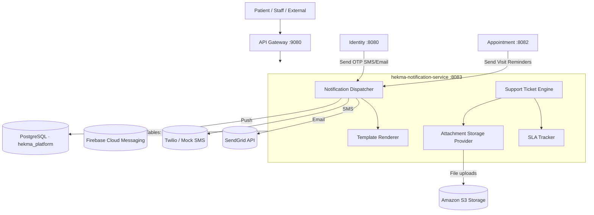
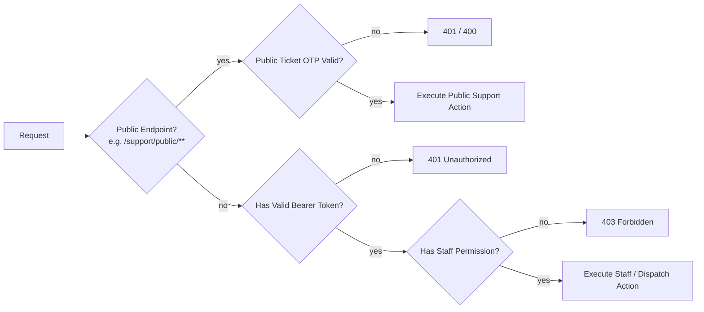
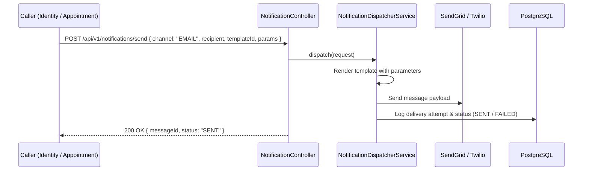
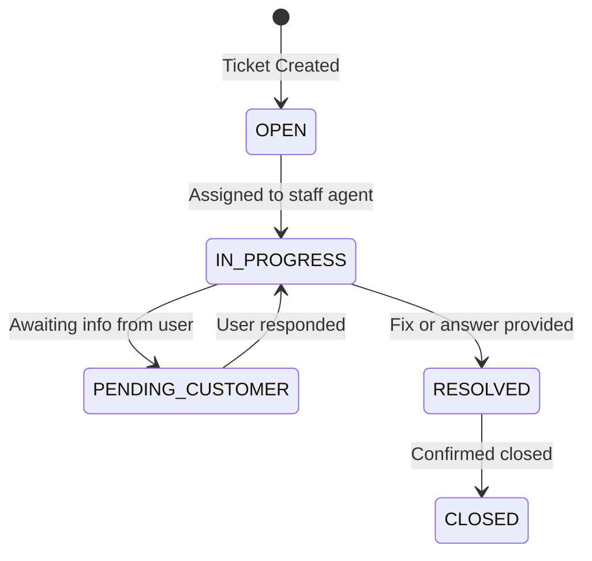
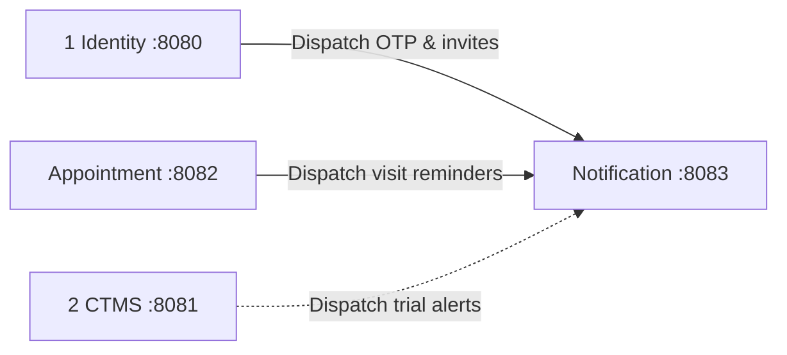

# Notification & Support Service

**Service:** `hekma-notification-service` · **Port:** 8083 · **Role:** Multi-Channel Messaging, Templates & Help Desk

This is the centralized communications hub and customer support desk microservice for the Hekma platform. It handles delivery of SMS, Email, Push notifications, and In-App alerts, as well as the support ticket lifecycle with SLA tracking.

It is **not** Identity (does not authenticate credentials), **not** CTMS, and **not** Appointment (does not decide when a visit occurs; it only delivers the notification message requested by other services).

---

## What it supports

| Component | What the user sees | Owns |
|-----------|--------------------|------|
| **1 · Multi-Channel Dispatch** | SMS codes, emails, push alerts, in-app bell | Delivery pipelines (SendGrid, Twilio, FCM, In-App database store) |
| **2 · Dynamic Template Rendering** | Branded email & SMS text with user names | Template catalog, parameter substitution, multi-language rendering |
| **3 · Support Ticket Desk** | "Submit a ticket / Contact Support" | Public & staff support tickets, comments, assignment workflows |
| **4 · SLA Tracking & Audit Log** | Ticket response timers, resolution metrics | SLA compliance tracking, full chronological timeline of ticket events |
| **5 · Secure Attachment Storage** | Screenshots / diagnostic files attached to tickets | S3 Presigned upload URLs, attachment metadata storage |

---

## High-level architecture



**Rule:** Other microservices never talk directly to email or SMS gateways. All communication requests must flow through this service so audit logs, delivery statuses, and templates are centrally managed.

---

## Request path (every call)



---

## 1 · Multi-Channel Notification Dispatch

Accepts notification payloads from internal services or staff operators and delivers them across configured channels.



| API | Purpose |
|-----|---------|
| `POST /api/v1/notifications/send` | Generic multi-channel notification dispatch |
| `GET /api/v1/notifications/in-app/{userId}` | Fetch in-app notifications for bell icon dropdown |
| `PUT /api/v1/notifications/in-app/{id}/read` | Mark in-app alert as read |

---

## 2 · Support Ticket Desk & Lifecycle

Complete customer support and bug reporting engine. Supports both authenticated staff and unauthenticated public visitors (via email OTP).



| API | Purpose |
|-----|---------|
| `POST /api/v1/support/public/otp/send` | Send OTP to verify email before submitting public ticket |
| `POST /api/v1/support/public/tickets` | Submit verified public support ticket |
| `GET /api/v1/support/tickets` | Staff view and filter ticket queue (`support:read`) |
| `GET /api/v1/support/tickets/{id}` | Detailed ticket view with comments & timeline |
| `POST /api/v1/support/tickets/{id}/comments` | Add public reply or internal staff note |
| `PATCH /api/v1/support/tickets/{id}` | Update status, priority, or assigned agent |

---

## 3 · Attachment Storage (S3 Presigned URLs)

Allows uploading screenshots and diagnostic attachments without routing heavy file bytes through the backend server.

| API | Purpose |
|-----|---------|
| `POST /api/v1/support/attachments/presigned-url` | Generate secure S3 PUT upload URL |

---

## Where it sits on the platform



| This service does | Another service does |
|-------------------|----------------------|
| Multi-channel messaging (Email, SMS, Push, In-App) | Identity: Auth, login, tenant hierarchy |
| Customer support desk & ticket SLAs | Appointment: Calendar slots & conflict detection |
| Communications audit log | CTMS: Studies, protocols, adverse events |

---

## Data stores

| Store | Used for |
|-------|----------|
| PostgreSQL (`hekma_platform`) | `notification_logs`, `notification_templates`, `support_tickets`, `support_comments`, `support_sla_tracking` |
| Amazon S3 | Ticket attachments, screenshots, and crash logs |

---

## Run & Test

```powershell
cd hekma-notification-service
$env:JAVA_HOME="C:\Users\Acer_PTS\.jdks\graalvm-jdk-25"; $env:Path="$env:JAVA_HOME\bin;" + $env:Path
.\mvnw.cmd test
.\mvnw.cmd spring-boot:run
```
