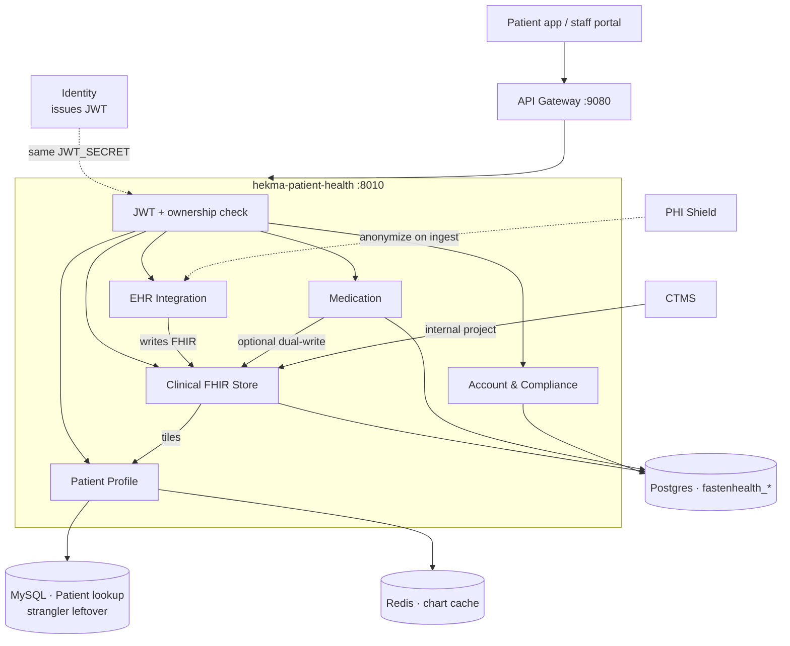
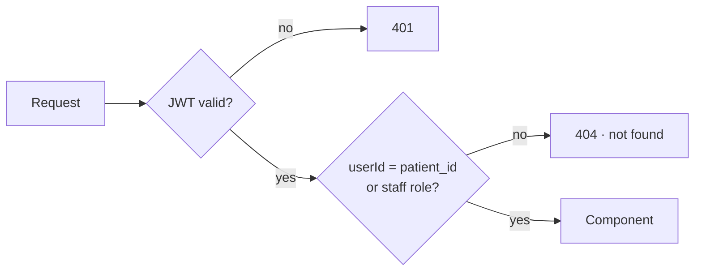
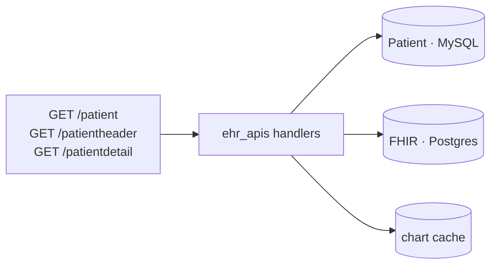
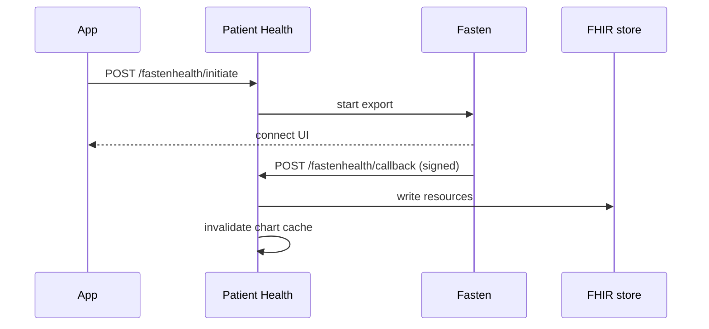
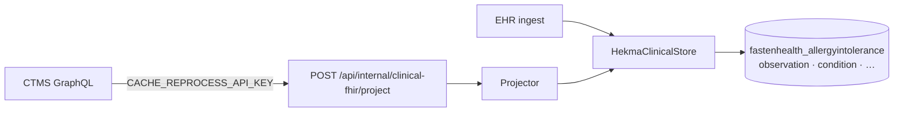
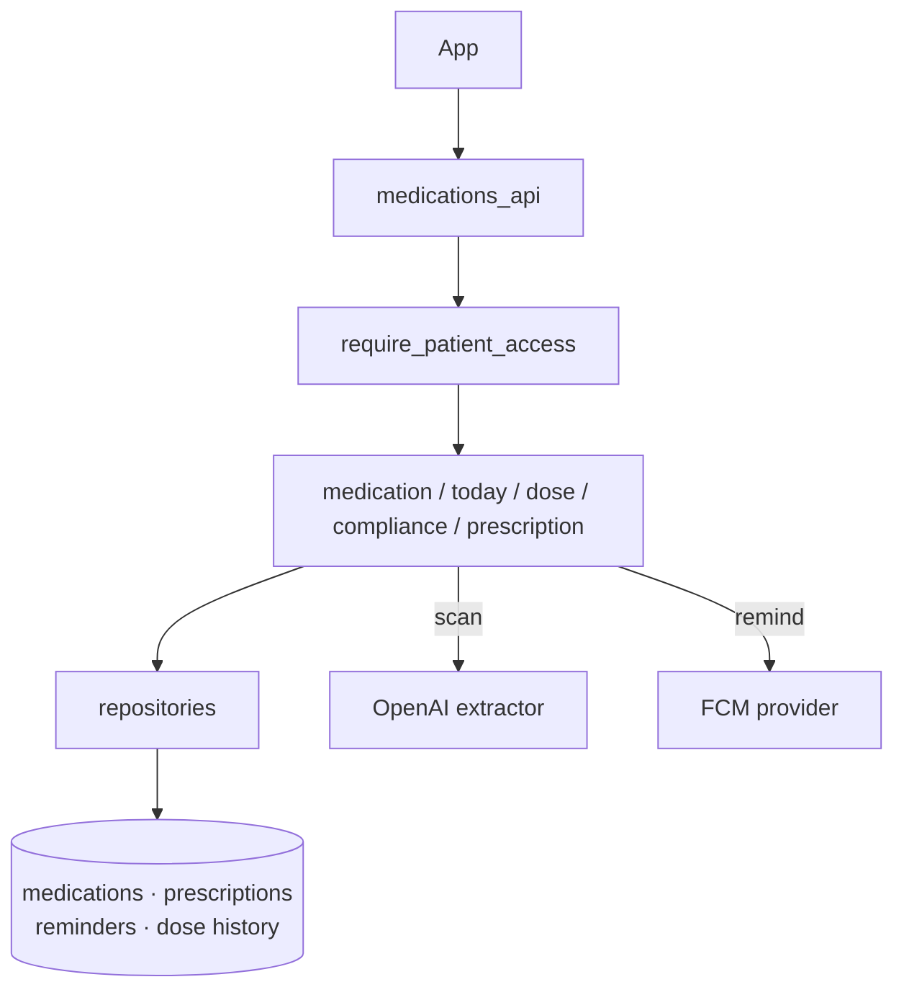
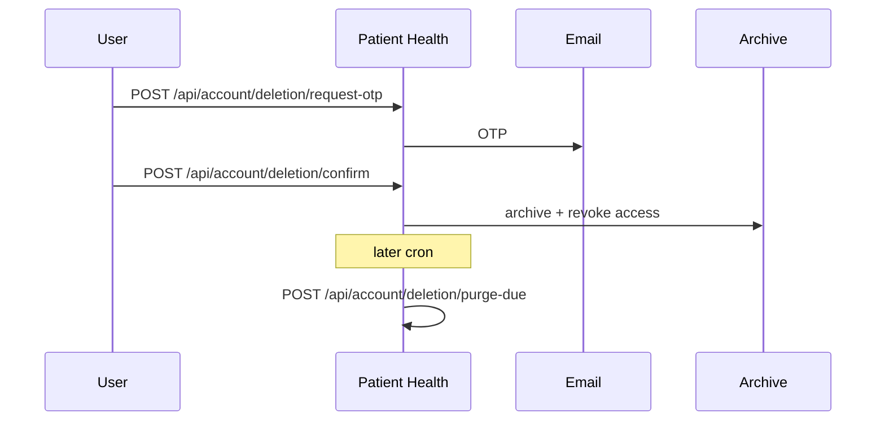
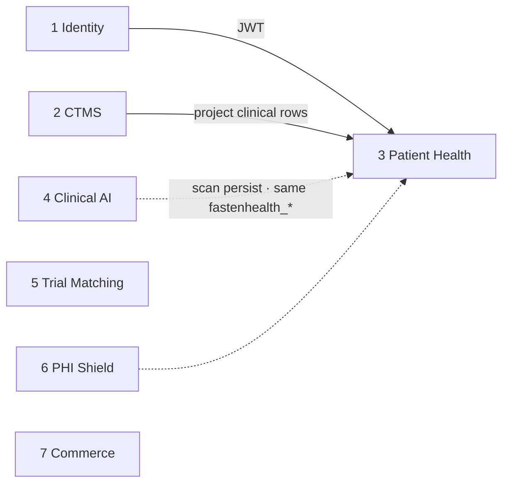

# Patient Health Service

**Service:** `hekma-patient-health` · **Port:** 8010 · **Role:** S3 in the platform

This is the patient-facing clinical record. One deployable owns the person's
profile, their connected EHR, the FHIR store, medications, and account deletion.

It is **not** CTMS, **not** Clinical AI (scanner / summaries), and **not**
Identity. Those services call this one when they need patient health data.

The Python monolith was left as-is. Domain code was copied here.

---

## What it supports

| Component | What the user sees | Owns |
|-----------|--------------------|------|
| **1 · Patient Profile** | Header, search, clinical tiles | Who the patient is; cached chart views |
| **2 · EHR Integration** | “Connect my hospital record” | Fasten OAuth, webhooks, ingest |
| **3 · Clinical FHIR Store** | Allergies, labs, vitals, conditions | Unified `fastenhealth_*` tables |
| **4 · Medication** | Meds list, today, doses, Rx scan, reminders | Prescriptions, schedules, adherence |
| **5 · Account & Compliance** | Delete my account | OTP, archive, delayed PHI purge |

---

## High-level architecture



**Rule:** Identity issues the token. This service only validates it and checks
that the caller may see *this* patient.

---

## Request path (every call)



Mismatch is **404**, not 403, so a patient cannot probe whether another record
exists. Staff roles (`SITE`, `SPONSOR`, `ADMIN`, `CRC`, `PI`, …) may open a
patient they are treating.

Public exceptions: `/health`, `/ready`, Fasten webhooks (signed), deletion
retention policy.

---

## 1 · Patient Profile

Shows the patient chart the app already knows: who they are, header counts, and
per-tile detail (allergies, labs, vitals, …).



Implementation lives in the old Lambda-style handlers under `ehr_apis/`. The
HTTP layer is thin (`apis/patient_api.py`). If a `patientId` is in the query,
ownership is checked before those handlers run.

| API | Purpose |
|-----|---------|
| `GET /patient` | List / search. A patient token is forced to their own id |
| `GET /patientheader` | Header strip (counts, identifiers) |
| `GET /patientdetail` | One tile (`eventType` = allergy, lab, vital, …) |

---

## 2 · EHR Integration

Connects a patient to their provider record through Fasten, then pulls the
export into the FHIR store.



| API | Purpose |
|-----|---------|
| `POST /fastenhealth/initiate` | Start a connect / export for a patient |
| `POST /fastenhealth/callback` | Fasten webhook. Signature verified. No JWT |
| `POST /fastenhealth/vault/revoke` | Drop connections |

Implementation: `fasten_health/fasten_handler.py` talks to Fasten; 
`resource_writer.py` batches inserts; `ingest_export.py` maps the export into
`fastenhealth_*`. PHI Shield is called on the write path when configured.

---

## 3 · Clinical FHIR Store

One Postgres store for clinical tiles — EHR, manual entry from CTMS, and
(later) scan output from Clinical AI.



This is **not** its own microservice. It is the write model Patient Profile
reads.

| API | Purpose |
|-----|---------|
| `POST /api/internal/clinical-fhir/project` | Upsert or retire one clinical record. Service-to-service only |

Implementation: `services/clinical_fhir/projector.py` maps a CTMS-shaped
payload to FHIR; `hekma_clinical_store.py` writes Postgres only (no MySQL
clinical tables).

---

## 4 · Medication

Full medication feature: list, create, schedule, today view, dose log, daily
counts, prescription upload/scan, device tokens, reminders, staff compliance
dashboard.



| API | Purpose |
|-----|---------|
| `GET/POST /api/patients/{id}/medications` | List / create (reminders included) |
| `GET /api/patients/{id}/medications/today` | Today's doses + metrics |
| `POST /api/patients/{id}/medications/dose-log` | Record a taken / skipped dose |
| `POST /api/patients/{id}/prescriptions/scan` | Upload Rx image/PDF → extract → persist |
| `POST /api/patients/{id}/devices` | Register a push token |
| `GET /api/medications/compliance/dashboard` | Staff only |

Implementation is the copied `services/medications/` package
(`MedicationService`, `TodayMedicationService`, `PrescriptionService`, …).
Every `{patient_id}` route goes through `require_patient_access`.

---

## 5 · Account & Compliance

Google Play–style deletion: OTP, confirm, archive now, hard-delete PHI later.



| API | Purpose |
|-----|---------|
| `GET /api/account/deletion/retention-policy` | Public policy text |
| `POST /api/account/deletion/request-otp` | JWT (in-app) or email+password (web) |
| `POST /api/account/deletion/confirm` | OTP + confirmation phrase |
| `POST /api/account/deletion/purge-due` | Worker. Needs `ACCOUNT_DELETION_PURGE_API_KEY` |

Confirm already binds the JWT `userId` — this was the one deletion flow that
did ownership correctly in the monolith.

---

## Where it sits on the platform



| This service does | Another service does |
|-------------------|----------------------|
| Patient's health record | Identity: login / RBAC |
| Fasten + FHIR + meds | Clinical AI: document scan, EHR summary |
| Account deletion | CTMS: studies, sites, support tickets |
| | Commerce: plans and entitlements |

---

## Data stores

| Store | Used for |
|-------|----------|
| PostgreSQL | FHIR resources, medications, prescriptions, deletion archive |
| MySQL | `Patient` lookup until CTMS stops sharing that table |
| Redis | Chart cache + JWT blacklist check |

One Postgres schema, one service role, when the cluster is split. Until then
it uses the platform Postgres from `docker-compose`.

---

## Run

```bash
cd hekma-patient-health
cp .env.example .env          # JWT_SECRET must match Identity / hekma_api
python -m pytest
uvicorn hekma_patient_health.main:app --app-dir src --port 8010
```

Gateway routes `/patient*`, `/fastenhealth`, `/api/patients/`, `/api/account/`,
and `/api/internal/clinical-fhir/` here. Clinical scan and EHR summary live in
`hekma-scanner`. HealthKit stays on the Python monolith.
