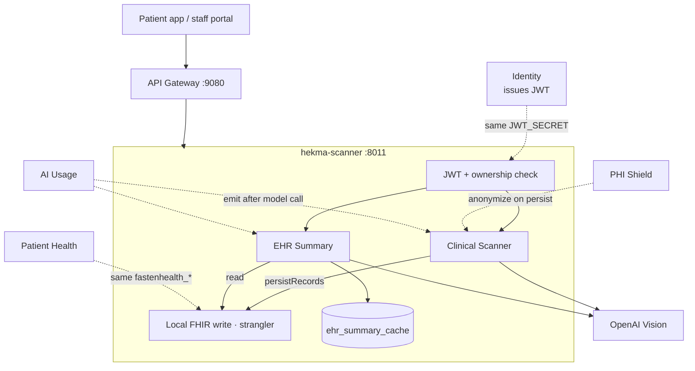
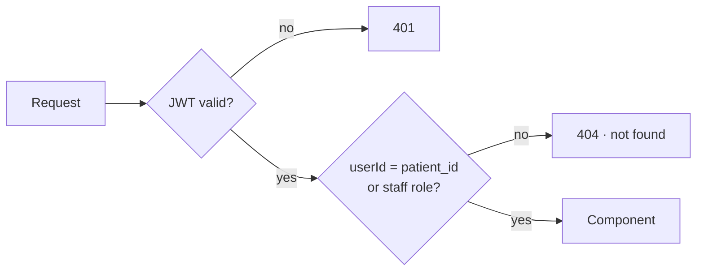
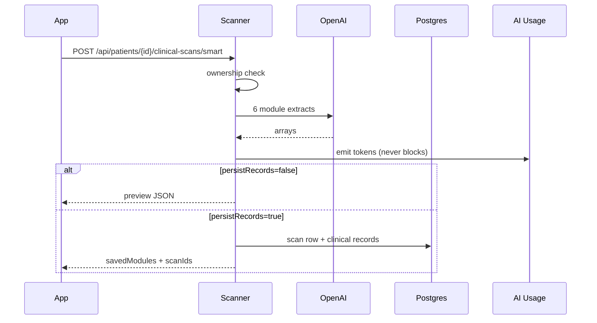
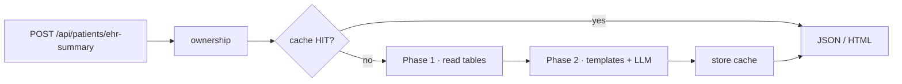
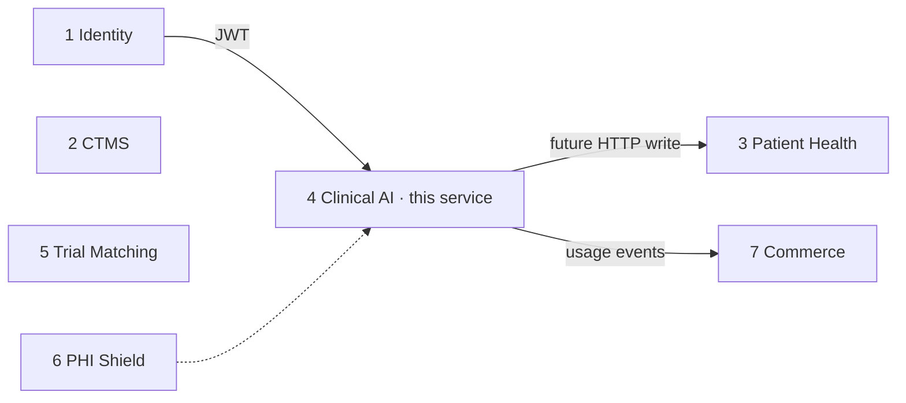

# Scanner Service (Clinical AI)

**Service:** `hekma-scanner` · **Port:** 8011 · **Role:** S4 in the platform

This is the GPU/LLM-heavy clinical AI service. One deployable owns document
scan (MS-11) and EHR summary (MS-13). They share the same model vendor,
token budget, and failure domain — a 429 or a bad key should not take down
Patient Health.

It is **not** Patient Health, **not** Identity, and **not** a medication
product. Medication APIs stay on Patient Health. When `persistRecords=true`,
the scan path may still write extracted medicines (strangler leftover).

The Python monolith was left as-is. Domain code was copied here.

---

## What it supports

| Component | What the user sees | Owns |
|-----------|--------------------|------|
| **1 · Clinical Scanner** | Upload a lab / Rx / visit note | Vision extract + scan metadata |
| **2 · EHR Summary** | “Health summary” timeline | Cached condensed chart + HTML download |

---

## High-level architecture



**Rule:** Identity issues the token. This service only validates it and checks
that the caller may see *this* patient.

---

## Request path (every call)



Mismatch is **404**, not 403. Staff roles (`SITE`, `SPONSOR`, `ADMIN`, `CRC`,
`PI`, …) may open a patient they are treating.

Email-only EHR summary (no `patient_id`) is staff-only — a patient token
must not look up another chart by email.

Public exceptions: `/health`, `/ready`.

---

## 1 · Clinical Scanner (MS-11)

Upload or URL. Six focused Vision calls in parallel, then optional persist
into `fastenhealth_*` (and medication tables when the medicines module is
saved).



| API | Purpose |
|-----|---------|
| `GET /api/patients/{id}/clinical-scans` | List scan metadata |
| `GET /api/patients/{id}/clinical-scans/{scanId}` | One scan + extracted JSON |
| `POST /api/patients/{id}/clinical-scans/smart` | Upload file · preview or persist |
| `POST /api/patients/{id}/clinical-scans/smart/url` | Same from a URL |
| `DELETE /api/patients/{id}/clinical-scans/{scanId}` | Soft-delete scan + rows |

Implementation: `services/clinical_scans/smart_scan_service.py` +
`vision_extractor.py`. Config: `config/clinical_scan_config.json`.

The sellable async `202` job API is **not** in this extract. Calls stay
synchronous, as in the monolith.

---

## 2 · EHR Summary (MS-13)

Read-only condensation of `fastenhealth_*` plus live overlay of Hekma/manual
and scan rows. Cache-first in `ehr_summary_cache`.



| API | Purpose |
|-----|---------|
| `POST /api/patients/ehr-summary` | JSON summary (`force_refresh`, `include_records`) |
| `POST /api/patients/ehr-summary/download` | JSON attachment |
| `POST /api/patients/ehr-summary/download-pdf` | Print-ready HTML |
| `DELETE /api/patients/{id}/ehr-summary/cache` | Invalidate cache |
| `GET /api/patients/ehr-summary/cache-stats` | Staff only |

Implementation: `fasten_health/ehr_summary_service.py`. Original FHIR rows
are never rewritten. `EHR_SUMMARY_SKIP_AI=true` disables all LLM calls.

---

## Where it sits on the platform



| This service does | Another service does |
|-------------------|----------------------|
| Document scan + EHR summary | Identity: login / RBAC |
| LLM / Vision calls | Patient Health: profile, Fasten, meds APIs |
| Scan metadata + summary cache | CTMS: studies, sites, support |
| | Trial Matching: eligibility |
| | Commerce: plans and entitlements |

---

## Data stores

| Store | Used for |
|-------|----------|
| PostgreSQL | `clinical_scans`, `ehr_summary_cache`, `fastenhealth_*` writes |
| MySQL | CTMS patient lookup leftover on some summary identity paths |
| Redis | JWT blacklist check + dashboard cache invalidation |

One Postgres schema, one service role, when the cluster is split. Until then
it uses the platform Postgres from `docker-compose`.

---

## Run

```bash
cd hekma-scanner
cp .env.example .env          # JWT_SECRET must match Identity / hekma_api
python -m pytest
uvicorn hekma_scanner.main:app --app-dir src --port 8011
```

Gateway routes `/api/patients/{id}/clinical-scans*` and
`/api/patients/ehr-summary*` here. Patient profile, Fasten, medications, and
HealthKit do not.
