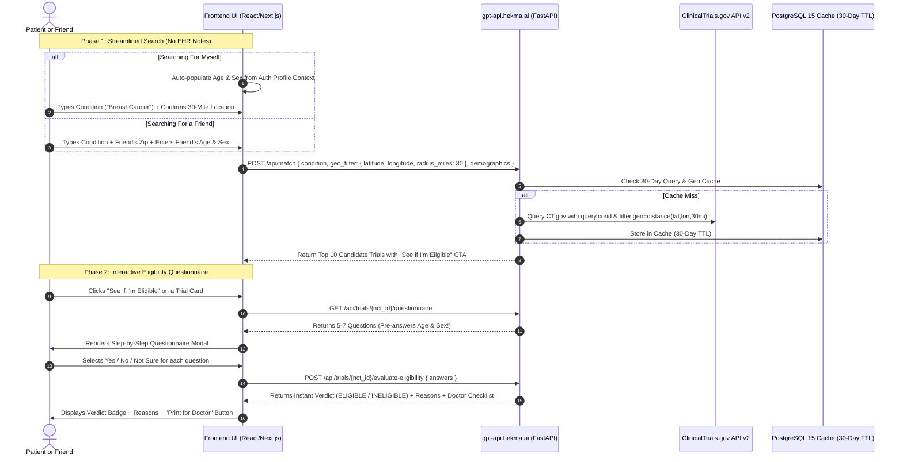

# TrialGPT: Clinical Trial Matching & Search Frontend Integration Guide

**Document Version:** 2.0.0  
**Target Audience:** Frontend Engineering Team, Fullstack Developers, UI/UX, QA, Product  
**Production API Gateway:** [https://gpt-api.hekma.ai/docs#/Trial%20Matching%20&%20Search](https://gpt-api.hekma.ai/docs#/Trial%20Matching%20&%20Search)  
**Local Development Gateway:** `http://localhost:8000/docs#/Trial%20Matching%20&%20Search`  

---

## 1. Executive Summary & Architecture

The **Trial Matching & Search API** is a high-performance clinical trial matching platform providing:
1. **Streamlined Search (No EHR Notes Required):**
   * **Flow 1 (For Myself):** Medical Condition + 30-Mile Location. Patient Age and Gender are auto-fetched from the user profile.
   * **Flow 2 (For a Friend):** Medical Condition + 30-Mile Location + Friend's Age and Gender prompts.
2. **Native 30-Mile Geo-Radius Proximity:**
   * Powered by NIH ClinicalTrials.gov REST API v2 `filter.geo=distance(lat,lon,30mi)` with zero external AI or API costs.
3. **100% Offline Eligibility Questionnaire ("See if I'm Eligible"):**
   * For any matched trial, generates 5–7 patient-friendly Yes/No questions derived from protocol inclusion/exclusion criteria.
   * Cleans out laboratory noise and technical cutoffs (platelets, ANC, creatinine).
   * Evaluates patient responses in `< 1ms` to deliver instant `ELIGIBLE`, `INELIGIBLE`, or `LIKELY_ELIGIBLE` verdicts with a printable doctor discussion checklist.
4. **Standardized Error Localization Schema:**
   * Unified error envelope across all endpoints with machine-readable error codes and frontend localization keys (`localized_key`) for multi-language UI support (English, Arabic, Spanish).
5. **30-Day PostgreSQL Cache-Aside Layer:**
   * All search queries, match reports, and study protocols are cached in PostgreSQL 15 (`JSONB`) with `< 10ms` response times.

---

## 2. End-to-End User Flow & Sequence Diagram



---

## 3. API Endpoints Specification

### Endpoint 1: Match Clinical Trials (Search & 30-Mile Proximity)
* **Path:** `POST /api/match`
* **Purpose:** Searches ClinicalTrials.gov with optional 30-mile geo-radius proximity and demographic criteria.
* **Default Behavior:** Returns the **top 10 results** (`page_size=10`) with pagination tokens.

#### Request Schema:
```json
{
  "condition": "triple negative breast cancer",
  "city_or_zip": "Boston, MA",
  "search_radius_miles": 30,
  "demographics": {
    "age": 52,
    "sex": "FEMALE"
  },
  "geo_filter": {
    "city_or_zip": "Boston, MA",
    "distance_miles": 30
  },
  "page_size": 10,
  "page_token": null,
  "recruiting_only": true,
  "force_refresh": false
}
```

#### Request Parameters Reference:
| Parameter | Type | Required | Default | Description |
| :--- | :--- | :--- | :--- | :--- |
| `condition` | string | **Yes** | — | Targeted medical condition or disease name. |
| `city_or_zip` | string | No | `null` | **City, State or 5-digit US Zip Code** (e.g. `'Boston, MA'`, `'90210'`). Automatically geocoded on the backend. |
| `search_radius_miles`| number | No | `30` | Search proximity radius in miles (1 to 500). Used with `city_or_zip`. |
| `demographics` | object | No | `null` | Streamlined patient demographics (`age`, `sex`). |
| `demographics.age` | number | No | `null` | Age in years (0 to 125). |
| `demographics.sex` | string | No | `null` | Biological sex: `'FEMALE'`, `'MALE'`, or `'ALL'`. |
| `geo_filter` | object | No | `null` | Proximity filter center point (accepts `city_or_zip` OR `latitude`/`longitude`). |
| `geo_filter.city_or_zip`| string | No | `null` | City or Zip code (auto-geocoded to GPS coordinates). |
| `geo_filter.latitude`| number | No | — | Decimal latitude (-90 to 90). |
| `geo_filter.longitude`| number | No | — | Decimal longitude (-180 to 180). |
| `geo_filter.radius_miles`| number | No | `30` | Proximity radius in miles (`distance_miles` also accepted). |
| `page_size` | number | No | `10` | Results per page (default: 10). |
| `page_token` | string | No | `null` | Token for next page (`null` for Page 1). |
| `recruiting_only`| boolean | No | `true` | Filter for actively recruiting studies. |
| `force_refresh` | boolean | No | `false` | Bypasses 30-day PostgreSQL cache to pull fresh NIH data. |

---

### Endpoint 2: Get Offline Eligibility Questionnaire ("See if I'm Eligible")
* **Path:** `GET /api/trials/{nct_id}/questionnaire`
* **Purpose:** Generates 5–7 patient-friendly Yes/No questions 100% offline from the trial's inclusion and exclusion criteria.
* **When to Use:** When user clicks the **"See if I'm Eligible"** CTA button on any trial card.

#### Query Parameters:
| Parameter | In | Type | Required | Description |
| :--- | :--- | :--- | :--- | :--- |
| `nct_id` | Path | string | **Yes** | ClinicalTrials.gov identifier, e.g. `NCT05801029`. |
| `force_refresh` | Query | boolean | No | Set `true` to force fresh pull from CT.gov. |

#### Example Response:
```json
{
  "nct_id": "NCT05801029",
  "trial_title": "Study of Osimertinib in Patients with EGFR-Mutated Metastatic NSCLC",
  "total_questions": 6,
  "pre_answered_demographics": {
    "minimum_age": "18 Years",
    "maximum_age": "No Upper Limit",
    "sex_restriction": "ALL",
    "note": "Age and sex eligibility are pre-screened based on your profile."
  },
  "questions": [
    {
      "id": "inc_0",
      "category": "INCLUSION",
      "question_text": "Has your doctor confirmed that your condition is Stage 4 or metastatic?",
      "original_criterion": "Histologically or cytologically confirmed Stage IV metastatic NSCLC.",
      "favorable_answer": "YES",
      "options": ["YES", "NO", "NOT_SURE"]
    },
    {
      "id": "inc_1",
      "category": "INCLUSION",
      "question_text": "Have you previously received chemotherapy for your condition?",
      "original_criterion": "Prior systemic chemotherapy completed at least 4 weeks prior.",
      "favorable_answer": "YES",
      "options": ["YES", "NO", "NOT_SURE"]
    },
    {
      "id": "exc_0",
      "category": "EXCLUSION",
      "question_text": "Do you have active or untreated tumors in the brain (brain metastases)?",
      "original_criterion": "Active or untreated central nervous system (CNS) metastases.",
      "favorable_answer": "NO",
      "options": ["YES", "NO", "NOT_SURE"]
    },
    {
      "id": "exc_1",
      "category": "EXCLUSION",
      "question_text": "Are you currently pregnant or breastfeeding?",
      "original_criterion": "Pregnant, nursing, or breastfeeding females.",
      "favorable_answer": "NO",
      "options": ["YES", "NO", "NOT_SURE"]
    }
  ]
}
```

---

### Endpoint 3: Evaluate Patient Answers & Get Verdict
* **Path:** `POST /api/trials/{nct_id}/evaluate-eligibility`
* **Purpose:** Evaluates patient questionnaire answers in `< 1ms` against study rules, emitting instant verdict, reasons, and a doctor checklist.

#### Request Schema:
```json
{
  "nct_id": "NCT05801029",
  "answers": [
    { "question_id": "inc_0", "answer": "YES" },
    { "question_id": "inc_1", "answer": "YES" },
    { "question_id": "exc_0", "answer": "NO" },
    { "question_id": "exc_1", "answer": "NO" }
  ]
}
```

#### Example Response (Eligible Outcome):
```json
{
  "nct_id": "NCT05801029",
  "verdict": "ELIGIBLE",
  "score": 0.95,
  "summary": "Great news! Based on your self-reported responses, you meet all major eligibility criteria for this trial.",
  "criteria_evaluations": [
    {
      "criterion": "Has your doctor confirmed that your condition is Stage 4 or metastatic?",
      "category": "INCLUSION",
      "status": "MET",
      "user_answer": "YES",
      "reason": "Answer 'YES' satisfies protocol criteria."
    },
    {
      "criterion": "Do you have active or untreated tumors in the brain (brain metastases)?",
      "category": "EXCLUSION",
      "status": "MET",
      "user_answer": "NO",
      "reason": "Answer 'NO' satisfies protocol criteria."
    }
  ],
  "doctor_checklist": [
    "Bring your latest pathology and biopsy reports to your consultation.",
    "Provide your complete medication history and prior chemotherapy/immunotherapy records.",
    "Standard laboratory blood counts (platelets, neutrophils, liver & kidney panels) will be verified by the clinical research site."
  ]
}
```

#### Example Response (Ineligible Outcome):
```json
{
  "nct_id": "NCT05801029",
  "verdict": "INELIGIBLE",
  "score": 0.17,
  "summary": "Based on your answers, you are likely ineligible for this trial due to 1 conflicting criteria: Exclusion criterion triggered: Do you have active or untreated tumors in the brain (brain metastases)?.",
  "criteria_evaluations": [
    {
      "criterion": "Do you have active or untreated tumors in the brain (brain metastases)?",
      "category": "EXCLUSION",
      "status": "UNMET",
      "user_answer": "YES",
      "reason": "Answer 'YES' triggers study exclusion: 'Do you have active or untreated tumors in the brain (brain metastases)?'."
    }
  ],
  "doctor_checklist": [
    "Discuss alternative trials that allow patients with treated brain metastases with your oncologist."
  ]
}
```

---

### Endpoint 4: Get Single Trial Protocol Details (14 Sections)
* **Path:** `GET /api/trials/{nct_id}`
* **Purpose:** Retrieves all 14 detailed protocol sections for a single trial by NCT ID.
* **When to Use:** Standalone `/trials/:nctId` permalink route.

---

### Endpoint 5: PostgreSQL Cache Diagnostics
* **Path:** `GET /api/cache/stats`
* **Purpose:** Live operational metrics on cached queries, matches, and 30-day retention status.

---

## 4. Standardized Error Localization Schema

All API errors return a uniform HTTP response body so the frontend client can perform reliable error handling and multi-language localization.

### A. Universal Error Envelope
```json
{
  "success": false,
  "error": {
    "code": "ERR_CONDITION_REQUIRED",
    "message": "Condition query parameter is required.",
    "localized_key": "errors.search.conditionRequired",
    "param": "condition",
    "status_code": 400,
    "timestamp": "2026-10-07T06:00:00Z"
  }
}
```

### B. Complete Error Code Catalog & Frontend Localization Dictionary

| HTTP Status | Error Code (`code`) | Trigger Condition | Frontend Localization Key (`localized_key`) | Default English UI Message |
| :---: | :--- | :--- | :--- | :--- |
| **400** | `ERR_CONDITION_REQUIRED` | `condition` parameter is missing or empty | `errors.search.conditionRequired` | "Please enter a medical condition or disease." |
| **400** | `ERR_DEMOGRAPHICS_REQUIRED` | Age or sex missing in "For a Friend" flow | `errors.search.demographicsRequired` | "Please enter your friend's age and gender." |
| **400** | `ERR_AGE_INVALID` | Age is negative or > 125 | `errors.search.ageInvalid` | "Please enter a valid age between 0 and 125." |
| **400** | `ERR_GEO_INVALID_COORDS` | Latitude/longitude values are out of bounds | `errors.location.invalidCoords` | "Invalid location coordinates provided." |
| **400** | `ERR_GEO_RADIUS_INVALID` | Radius is $\le 0$ or $> 500$ miles | `errors.location.invalidRadius` | "Search radius must be between 1 and 500 miles." |
| **400** | `ERR_NCT_ID_INVALID` | NCT ID format is invalid | `errors.trial.invalidNctId` | "Invalid ClinicalTrials.gov ID. Format: NCTxxxxxxxx." |
| **400** | `ERR_ANSWERS_EMPTY` | Submitted empty answers array to evaluation | `errors.questionnaire.emptyAnswers` | "Please answer the eligibility questions before submitting." |
| **400** | `ERR_ANSWERS_INVALID_OPTION` | Answer choice is not `YES`, `NO`, or `NOT_SURE` | `errors.questionnaire.invalidOption` | "Answer must be Yes, No, or Not Sure." |
| **404** | `ERR_TRIAL_NOT_FOUND` | NCT ID does not exist in registry or cache | `errors.trial.notFound` | "The requested clinical trial was not found." |
| **500** | `ERR_INTERNAL_SERVER_ERROR` | Unhandled backend exception | `errors.system.internalError` | "An unexpected error occurred. Please try again." |

---

## 5. TypeScript Definitions

```typescript
export type VerdictType = 
  | 'ELIGIBLE' 
  | 'LIKELY_ELIGIBLE' 
  | 'INELIGIBLE' 
  | 'UNCERTAIN' 
  | 'RETRIEVED_ONLY';

export interface GeoFilter {
  latitude: number;
  longitude: number;
  radius_miles?: number;
}

export interface DemographicsInput {
  age?: number | null;
  sex?: 'FEMALE' | 'MALE' | 'ALL' | null;
}

export interface MatchRequest {
  condition: string;
  demographics?: DemographicsInput | null;
  geo_filter?: GeoFilter | null;
  page_size?: number;
  page_token?: string | null;
  recruiting_only?: boolean;
  force_refresh?: boolean;
}

export interface EligibilityQuestion {
  id: string;
  category: 'INCLUSION' | 'EXCLUSION';
  question_text: string;
  original_criterion: string;
  favorable_answer: 'YES' | 'NO';
  options: Array<'YES' | 'NO' | 'NOT_SURE'>;
}

export interface EligibilityQuestionnaireResponse {
  nct_id: string;
  trial_title: string;
  total_questions: number;
  questions: EligibilityQuestion[];
  pre_answered_demographics: {
    minimum_age?: string;
    maximum_age?: string;
    sex_restriction?: string;
    note?: string;
  };
}

export interface QuestionAnswer {
  question_id: string;
  answer: 'YES' | 'NO' | 'NOT_SURE';
}

export interface EligibilityEvaluationRequest {
  nct_id: string;
  answers: QuestionAnswer[];
}

export interface CriterionEvaluationItem {
  criterion: string;
  category: 'INCLUSION' | 'EXCLUSION';
  status: 'MET' | 'UNMET' | 'UNCERTAIN';
  user_answer: string;
  reason: string;
}

export interface EligibilityEvaluationResponse {
  nct_id: string;
  verdict: VerdictType;
  score: number;
  summary: string;
  criteria_evaluations: CriterionEvaluationItem[];
  doctor_checklist: string[];
}

export interface ApiErrorDetail {
  code: string;
  message: string;
  localized_key: string;
  param?: string | null;
  status_code: number;
  timestamp: string;
}

export interface ErrorResponseEnvelope {
  success: false;
  error: ApiErrorDetail;
}
```

---

## 6. React / Next.js Implementation Hook

```typescript
import { useState, useCallback } from 'react';
import type { 
  MatchRequest, 
  ConditionMatchReport, 
  EligibilityQuestionnaireResponse, 
  EligibilityEvaluationResponse, 
  ErrorResponseEnvelope 
} from './types';

const API_BASE = process.env.NEXT_PUBLIC_TRIALGPT_API || 'https://gpt-api.hekma.ai';

export function useTrialMatching() {
  const [trials, setTrials] = useState<any[]>([]);
  const [nextPageToken, setNextPageToken] = useState<string | null>(null);
  const [isLoading, setIsLoading] = useState(false);
  const [apiError, setApiError] = useState<ErrorResponseEnvelope['error'] | null>(null);

  // Search Trials
  const searchTrials = useCallback(async (payload: MatchRequest) => {
    setIsLoading(true);
    setApiError(null);
    try {
      const res = await fetch(`${API_BASE}/api/match`, {
        method: 'POST',
        headers: { 'Content-Type': 'application/json' },
        body: JSON.stringify(payload),
      });

      const data = await res.json();
      if (!res.ok) {
        setApiError(data.error);
        return null;
      }

      setTrials(prev => payload.page_token ? [...prev, ...data.trials] : data.trials);
      setNextPageToken(data.next_page_token);
      return data;
    } catch (err: any) {
      setApiError({
        code: 'ERR_NETWORK_ERROR',
        message: err.message || 'Network request failed',
        localized_key: 'errors.system.networkError',
        status_code: 0,
        timestamp: new Date().toISOString(),
      });
      return null;
    } finally {
      setIsLoading(false);
    }
  }, []);

  // Fetch Questionnaire for "See if I'm Eligible"
  const fetchQuestionnaire = useCallback(async (nctId: string): Promise<EligibilityQuestionnaireResponse | null> => {
    try {
      const res = await fetch(`${API_BASE}/api/trials/${nctId}/questionnaire`);
      const data = await res.json();
      if (!res.ok) {
        setApiError(data.error);
        return null;
      }
      return data;
    } catch (err: any) {
      return null;
    }
  }, []);

  // Submit Questionnaire Answers
  const evaluateAnswers = useCallback(async (
    nctId: string, 
    answers: Array<{ question_id: string; answer: string }>
  ): Promise<EligibilityEvaluationResponse | null> => {
    try {
      const res = await fetch(`${API_BASE}/api/trials/${nctId}/evaluate-eligibility`, {
        method: 'POST',
        headers: { 'Content-Type': 'application/json' },
        body: JSON.stringify({ nct_id: nctId, answers }),
      });
      const data = await res.json();
      if (!res.ok) {
        setApiError(data.error);
        return null;
      }
      return data;
    } catch (err: any) {
      return null;
    }
  }, []);

  return {
    trials,
    nextPageToken,
    isLoading,
    apiError,
    searchTrials,
    fetchQuestionnaire,
    evaluateAnswers,
  };
}
```
