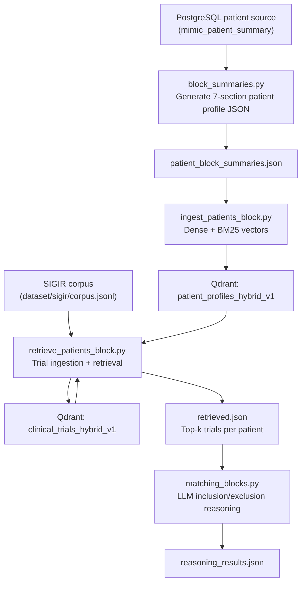
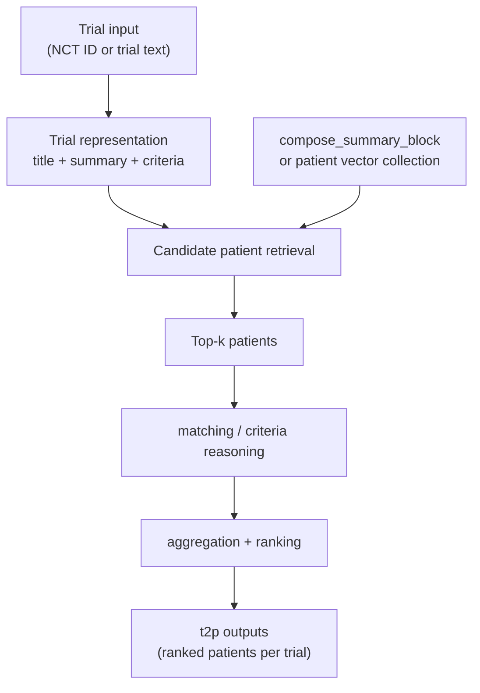

# TrialGPT_RAG P2T + T2P Flow - CLI Runbook (Windows)

This document captures the exact command-line flow you ran successfully, including troubleshooting steps, and explains why each step is needed.

---

## End-to-End Flow Diagram



### Flow explanation (stage-by-stage)

1. **Patient structuring**
   - `block_summaries.py` converts raw patient summary text into a 7-key structured profile.
   - Output is saved to `patient_block_summaries.json`.

2. **Patient vector ingestion**
   - `ingest_patients_block.py` embeds each structured profile into dense + sparse vectors.
   - Vectors are stored in Qdrant collection `patient_profiles_hybrid_v1`.

3. **Trial vector ingestion**
   - `retrieve_patients_block.py` (without `--no-ingest`) ingests trial corpus vectors into `clinical_trials_hybrid_v1`.
   - This step is required at least once before retrieval-only runs.

4. **Patient-to-trials retrieval (P2T)**
   - For each patient, retrieval uses hybrid dense/sparse prefetch + RRF fusion over trial vectors.
   - Output is `retrieved.json` with top-k scored trial candidates.

5. **LLM eligibility reasoning**
   - `matching_blocks.py` evaluates inclusion/exclusion criteria per patient-trial pair.
   - Final output is `reasoning_results.json`.

---

## T2P Flow Diagram (Trial -> Patients)



### T2P in this repository (important)

- Your **validated standalone script flow** above is for **P2T** under `TrialGPT_RAG`.
- For **T2P**, current operational path is workflow/API-oriented (`workflows/trial_to_patients.py`) rather than a completed standalone `TrialGPT_RAG` script equivalent.
- In current code, T2P retrieval uses patient summaries from DB (`compose_summary_block`) and BM25 ranking before matching + aggregation.

---

## 0) Prerequisites

- Windows machine with Python venv at:
  - `C:\Users\ADMIN\Documents\Hekma_gpt\trailgpt\.venv`
- Repository root:
  - `C:\Users\ADMIN\Documents\Hekma_gpt\trailgpt`
- TrialGPT_RAG scripts folder:
  - `C:\Users\ADMIN\Documents\Hekma_gpt\trailgpt\TrialGPT_RAG`
- OpenAI/Anthropic/DB env variables configured as needed by scripts.

---

## 1) Install missing Python dependencies in the correct venv

### Why
Initial failures were caused by missing packages (`psycopg`, `fastembed`, etc.) or package installs in global Python instead of project venv.

### Commands

```powershell
cd C:\Users\ADMIN\Documents\Hekma_gpt\trailgpt
.\.venv\Scripts\Activate.ps1
python -m pip install "psycopg[binary]"
python -m pip install fastembed qdrant-client
```

### Verify interpreter and package

```powershell
python -c "import sys; print(sys.executable)"
python -c "import psycopg; print('ok', psycopg.__version__)"
```

You should see executable path under `...\trailgpt\.venv\Scripts\python.exe`.

---

## 2) Generate block summaries JSON

### Why
Creates patient structured profiles (7 sections) used for patient vector ingestion.

### Command

```powershell
cd C:\Users\ADMIN\Documents\Hekma_gpt\trailgpt\TrialGPT_RAG
C:\Users\ADMIN\Documents\Hekma_gpt\trailgpt\.venv\Scripts\python.exe .\block_summaries.py --max 5 --output .\patient_block_summaries.json
```

### Expected output artifact

- `TrialGPT_RAG\patient_block_summaries.json`

---

## 3) Bring up Qdrant locally

### Why
Vector ingestion/retrieval scripts require running Qdrant at `localhost:6333`.

### What happened in your case

- Docker initially failed (not installed / daemon not running).
- WSL was missing, installed via `wsl --install`.
- After reboot and Docker Desktop startup, Qdrant became reachable.

### Final working state

- Qdrant running:
  - REST: `http://localhost:6333`
  - gRPC: `localhost:6334`
  - Dashboard: `http://localhost:6333/dashboard`

---

## 4) Ingest patient profiles into Qdrant

### Why
Creates patient vector collection used during retrieval.

### Command

```powershell
cd C:\Users\ADMIN\Documents\Hekma_gpt\trailgpt\TrialGPT_RAG
C:\Users\ADMIN\Documents\Hekma_gpt\trailgpt\.venv\Scripts\python.exe .\ingest_patients_block.py --json-path .\patient_block_summaries.json --batch-size 50
```

### Successful output (example)

- `[init] Collection 'patient_profiles_hybrid_v1' created.`
- `[done] Ingested 5 patients into 'patient_profiles_hybrid_v1'.`

---

## 5) Ingest trial corpus and retrieve P2T in one run

### Why
Your `ingest_trials.py` file did not expose a direct CLI main block in this code version, so `retrieve_patients_block.py` without `--no-ingest` was used to perform ingestion + retrieval.

### Command (ingest trials + retrieve)

```powershell
cd C:\Users\ADMIN\Documents\Hekma_gpt\trailgpt\TrialGPT_RAG
C:\Users\ADMIN\Documents\Hekma_gpt\trailgpt\.venv\Scripts\python.exe .\retrieve_patients_block.py -c ..\dataset\sigir\corpus.jsonl -p .\patient_block_summaries.json -o .\retrieved.json --top-k 10 -t 0.1
```

### Successful output (example)

- `[init] Collection 'clinical_trials_hybrid_v1' created.`
- `[done] Ingested 3621 trials into 'clinical_trials_hybrid_v1'.`

---

## 6) Retrieval-only run (no re-ingest)

### Why
After trial collection exists, you can run fast retrieval only.

### Command

```powershell
cd C:\Users\ADMIN\Documents\Hekma_gpt\trailgpt\TrialGPT_RAG
C:\Users\ADMIN\Documents\Hekma_gpt\trailgpt\.venv\Scripts\python.exe .\retrieve_patients_block.py -c ..\dataset\sigir\corpus.jsonl -p .\patient_block_summaries.json -o .\retrieved.json --top-k 10 -t 0.1 --no-ingest
```

### Successful output (example)

- Each patient line: `... | 10 trials retrieved`
- `[done] Saved results for 5 patients to '.\retrieved.json'.`

---

## 7) Run criterion-level matching/reasoning

### Why
Applies LLM reasoning over retrieved patient-trial pairs to generate inclusion/exclusion decisions.

### Command

```powershell
cd C:\Users\ADMIN\Documents\Hekma_gpt\trailgpt\TrialGPT_RAG
C:\Users\ADMIN\Documents\Hekma_gpt\trailgpt\.venv\Scripts\python.exe .\matching_blocks.py -r .\retrieved.json -c ..\dataset\sigir\corpus.jsonl -o .\reasoning_results.json
```

### Successful output

- `[done] Saved to .\reasoning_results.json`

---

## 8) Final artifacts produced

- `TrialGPT_RAG\patient_block_summaries.json`
- `TrialGPT_RAG\retrieved.json`
- `TrialGPT_RAG\reasoning_results.json`

---

## 9) T2P CLI run (current repo path)

### Why
Runs trial-to-patients using the existing workflow implementation, including retrieval, matching, aggregation, and final ranking persistence.

### Command

```powershell
cd C:\Users\ADMIN\Documents\Hekma_gpt\trailgpt
C:\Users\ADMIN\Documents\Hekma_gpt\trailgpt\.venv\Scripts\python.exe .\workflows\trial_to_patients.py <job_id> <nct_id> [corpus] [model] [llm_service]
```

### Example

```powershell
C:\Users\ADMIN\Documents\Hekma_gpt\trailgpt\.venv\Scripts\python.exe .\workflows\trial_to_patients.py JOB_T2P_001 NCT01234567 sigir gpt-3.5-turbo-0125 openai
```

### Notes

- `<job_id>` should correspond to a valid job context in your system.
- `<nct_id>` must exist in `trialgpt_corpus`.
- This route persists retrieval/matching/aggregation/final ranks into DB tables used by your app.

---

## Common pitfalls you hit (and fixes)

1. **Wrong working directory**
   - Error: `can't open file ... ingest_patients_block.py`
   - Fix: run from `TrialGPT_RAG` or use absolute script path.

2. **Wrong interpreter**
   - Package installed globally, script using different Python.
   - Fix: always run `...\trailgpt\.venv\Scripts\python.exe ...`.

3. **Qdrant connection refused**
   - Error: WinError 10061
   - Fix: start Docker Desktop + ensure Qdrant container up.

4. **Trial collection not found**
   - Error: `Collection clinical_trials_hybrid_v1 doesn't exist`
   - Fix: run retrieval once without `--no-ingest` to ingest corpus.

---

## Re-run cheat sheet (minimal)

```powershell
cd C:\Users\ADMIN\Documents\Hekma_gpt\trailgpt\TrialGPT_RAG

# 1) Patient ingest
C:\Users\ADMIN\Documents\Hekma_gpt\trailgpt\.venv\Scripts\python.exe .\ingest_patients_block.py --json-path .\patient_block_summaries.json --batch-size 50

# 2) Retrieve (no ingest if trial collection already exists)
C:\Users\ADMIN\Documents\Hekma_gpt\trailgpt\.venv\Scripts\python.exe .\retrieve_patients_block.py -c ..\dataset\sigir\corpus.jsonl -p .\patient_block_summaries.json -o .\retrieved.json --top-k 10 -t 0.1 --no-ingest

# 3) Matching
C:\Users\ADMIN\Documents\Hekma_gpt\trailgpt\.venv\Scripts\python.exe .\matching_blocks.py -r .\retrieved.json -c ..\dataset\sigir\corpus.jsonl -o .\reasoning_results.json
```

### T2P quick run (workflow path)

```powershell
cd C:\Users\ADMIN\Documents\Hekma_gpt\trailgpt
C:\Users\ADMIN\Documents\Hekma_gpt\trailgpt\.venv\Scripts\python.exe .\workflows\trial_to_patients.py <job_id> <nct_id> sigir gpt-3.5-turbo-0125 openai
```

