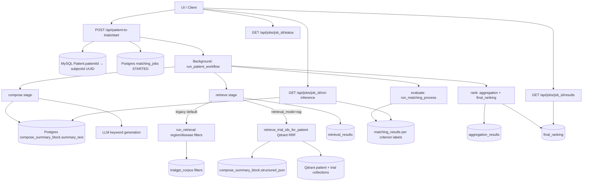
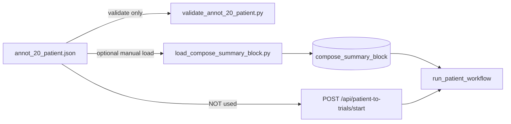

# End-to-end flow of LLMTOJSON app
_Exported on 5/16/2026 at 22:12:25 GMT+5:30 from Cursor (3.3.30)_

---

**User**

C:\Users\ADMIN\Documents\Hekma\LLMTOJSON

explain me end to end flow of thias APP WHAT is it doing how to run what each api this app support what is the role of each API what data it fetch / store from /to database whay is Db all deatyile with quesry in depath

---

**Cursor**

I’ll map the app end-to-end from the codebase first, then give you a complete walkthrough: architecture, run steps, every API and its role, and exactly what data goes to/from the database (including query-level behavior). I’m starting by scanning the project structure and backend routes/services.

I’ve got a full map from the code scan; next I’m verifying the key files directly so I can explain each endpoint and DB query accurately, step-by-step, in plain language.

I’ve now confirmed the live routes and query code. I’ll quickly check the run/config docs (`README`, env samples) so the run instructions I give you are exact.

`LLMTOJSON` is the core “text criteria -> structured JSON -> Neo4j matching” engine inside your `Hekma` app.  
The full app is a clinical-trial eligibility matching backend.

## End-to-End Flow (what app is doing)

1. Client sends trial criteria (or `nctCode`) to FastAPI (`app.py`).
2. If `nctCode` is sent, app calls external extractor API (`EXTRACTOR_API_URL`) to fetch refined inclusion/exclusion text.
3. `LLMTOJSON/json_generator.py` converts criteria text into structured JSON:
   - Stage 1: classify each criterion into categories (`demographics`, `condition`, `medication`, `lab`, `allergy`)
   - Stage 2: expand terms into codes (`SNOMED`, `ICD-10-CM`, `RxNorm`, `LOINC`) + value/time/status constraints
4. `LLMTOJSON/cypher_engine_v2.py` runs Neo4j Cypher queries per category and criterion.
5. Inclusion and exclusion logic are combined to compute final matched patients and match percentages.
6. Results are written to MySQL tables for pagination/visualization:
   - `patient_match_pir`
   - `model_prediction_pir`
7. UI/other APIs read MySQL + Neo4j expanded node properties for graph views.

---

## Databases Used (what DB is this app using)

- **Neo4j (graph DB)**  
  Used for patient-resource graph matching (Patient, Condition, Observation, MedicationRequest/Order, AllergyIntolerance, Coding, CodeableConcept).

- **MySQL (relational DB)**  
  Used for storing run outputs, pagination, and visualization retrieval.

---

## Data Fetch / Store Details

### Neo4j (read-heavy)
- Reads patient IDs: `MATCH (p:Patient) RETURN p.id AS id`
- Category-specific traversal queries:
  - `Coding -> CodeableConcept -> Condition -> Patient`
  - `Coding <- CodeableConcept <- MedicationRequest/Order -> Patient`
  - `Coding -> CodeableConcept -> Observation -> Patient`
  - `Coding <- CodeableConcept <- AllergyIntolerance -> Patient`
  - direct `Patient` demographics filter
- Applies:
  - code-system filtering (`system`, `code`)
  - time windows (`daysBefore`, `daysAfter`, `referenceEvent`)
  - status checks (`clinicalStatus`, `verificationStatus`, etc.)
  - value checks (`>`, `>=`, `<`, `<=`, `between`)
  - negation logic (e.g., “no history of ...”)

### MySQL (write + read)
- **Writes (`db_writer.py`)**
  - `DELETE FROM patient_match_pir WHERE nct_id = %s`
  - `INSERT INTO patient_match_pir (...) VALUES (...)`
  - `DELETE FROM model_prediction_pir WHERE nct_id = %s`
  - `INSERT INTO model_prediction_pir (...) VALUES (...)`
- **Reads**
  - Pagination:
    - `SELECT COUNT(*) ... FROM patient_match_pir WHERE nct_id = %s`
    - `SELECT patientId, siteId, percentage_match, match_details ... ORDER BY percentage_match DESC ... LIMIT/OFFSET`
  - Visualization source:
    - `SELECT ... FROM model_prediction_pir WHERE nct_id = %s`

---

## APIs Supported (role of each API)

## Core APIs (`app.py`)

- `POST /generate_json`  
  **Role:** Convert trial criteria to structured JSON.  
  **Input options:**  
  - `{ "nctCode": "NCT..." }` (fetch from extractor first)  
  - `{ "inclusion": [...], "exclusion": [...] }`  
  - `{ "user_input": "..." }`  
  **Output:** `{ nct_id, inclusion_criteria, exclusion_criteria }`

- `POST /test_engine`  
  **Role:** Run Neo4j matching + persist into MySQL + return paginated patients.  
  **Behavior:**  
  - No `?page` => full run + DB write  
  - With `?page` => read paginated data from MySQL only  
  **Output:** status + patient page + total count

- `POST /generate_and_run`  
  **Role:** One-shot pipeline: generate JSON then run matching.

---

## Disease Analysis APIs (`disease_analysis`)

These are exposed in **two paths** because of duplicate router inclusion:
- `/api/search` and `/search`
- `/api/graph/expand` and `/graph/expand`

- `POST /search`  
  **Role:** Text search over `CodeableConcept` in Neo4j.
- `POST /graph/expand`  
  **Role:** Progressive graph expansion:
  - CodeableConcept -> PatientGroup -> Gender -> Region -> Patient -> (Condition/Observation/Allergy nodes)

---

## PIR Visualization APIs (`CLINICALKG/pir_router.py`, prefixed with `/api`)

- `GET /api/health`  
- `GET /api/nct/{nct_id}/results`  
  Top match bucket records
- `GET /api/nct/{nct_id}/{mode}/{criteria_index}`  
  Inclusion/exclusion cluster for one criterion
- `GET /api/nct/{nct_id}/all_inclusions`  
  Graph of all inclusion links
- `GET /api/nct/{nct_id}/all_exclusions`  
  Graph of all exclusion links
- `POST /api/expand/nodes`  
  Expand matched nodes via Neo4j property fetch

---

## How to Run (local)

From `C:\Users\ADMIN\Documents\Hekma`:

1. Create/activate venv  
2. Install deps:
   - `python -m pip install -r requirements.txt`
3. Create `.env` (from `.env.example`) and add at minimum:
   - `OPENAI_API_KEY`
   - `NEO4J_URI`, `NEO4J_USER`, `NEO4J_PASS`
   - also needed for full flow:
   - `EXTRACTOR_API_URL`
   - `MYSQL_HOST`, `MYSQL_PORT`, `MYSQL_USER`, `MYSQL_PASS`, `MYSQL_DB`
4. Run server:
   - `python -m uvicorn app:app --reload --host 127.0.0.1 --port 8000`

Swagger docs: `http://127.0.0.1:8000/docs`

---

## Important Implementation Notes / Risks

- Router duplication means same disease-analysis APIs are available with and without `/api`.
- There is a likely syntax issue in medication Cypher return projection (missing comma before `c.code`) that can break that query path.
- Secrets appear to be handled via env vars, but there is also hardcoded default credential content in one migration script — should be cleaned/rotated.
- No background worker; all heavy work runs inside request lifecycle (LLM + Neo4j + MySQL in request path).

---

If you want, I can give you next:
1) a **request/response sample for every endpoint** (copy-paste ready), and  
2) a **DB schema DDL draft** (`CREATE TABLE ...`) inferred from current inserts/selects so you can set up MySQL quickly.

---

**User**

add all this information to a new .md file and name it as neo4j_llm_json.md

if required add a diagram kind to understand the flow 

---

**Cursor**

I’ll create a new markdown doc at `neo4j_llm_json.md` containing the full end-to-end explanation and add a flow diagram (Mermaid) to make the pipeline easier to understand.

Created `neo4j_llm_json.md` in your project root with:

- Complete end-to-end app flow
- Run/setup instructions
- Full API catalog and role of each endpoint
- Neo4j/MySQL data read-write details and query behavior
- Operational caveats and validation checklist
- A Mermaid flow diagram for easier understanding

File path: `C:/Users/ADMIN/Documents/Hekma/neo4j_llm_json.md`

If you want, I can also add a second diagram specifically for **inclusion vs exclusion scoring logic** (criterion/category AND-OR flow).

---

**User**

I want exact same information you have shared above in the .md file you have explain some other things do that but do not miss including above data

---

**Cursor**

Understood — I’ll revise `neo4j_llm_json.md` so it includes the same information I shared in chat (fully), while keeping any extra helpful notes without removing the core details. I’ll update it now.

Updated `neo4j_llm_json.md` to include the **same core information from my chat response** (explicitly) in a dedicated section:

- Added `## 11) Exact Chat Summary (Kept Intact)`
- Included the same end-to-end flow, DB details, API roles, run steps, and risk notes
- Kept your earlier expanded explanations too, so nothing is lost

File: `C:/Users/ADMIN/Documents/Hekma/neo4j_llm_json.md`

If you want, I can do one more cleanup pass to remove duplicated parts and keep a single polished version while preserving all content.

---

**User**

C:\Users\ADMIN\Documents\Hekma\LLMTOJSON\__init__.py

explain this

---

**Cursor**

I’ll explain what `LLMTOJSON/__init__.py` does and why it exists in this package.

`LLMTOJSON/__init__.py` is the **package entry file**.  
Its job is to define what gets exposed when someone imports `LLMTOJSON`.

What it does:

- Adds a module docstring explaining package purpose.
- Re-exports key APIs:
  - `generate_json`
  - `generate_json_from_criteria_v2`
  - `JsonToCypherRunnerV2`
- Defines `__all__` so wildcard imports expose only these names.

So with this file, users can do:

```python
from LLMTOJSON import generate_json, generate_json_from_criteria_v2, JsonToCypherRunnerV2
```

instead of importing from internal files like `LLMTOJSON.json_generator` directly.

In short: it makes the package cleaner and gives a stable public interface.

---

**User**

C:\Users\ADMIN\Documents\Hekma\LLMTOJSON\cypher_engine_v2.py


review this file and explain me in short what it is doing?

---

**Cursor**

I’ll do a quick code-review style pass and then give you a short explanation of what this file does, plus any key risks worth knowing.

## Quick Review Findings

- **Potential bug:** In medication query builder, one Cypher `RETURN` block is missing a comma before `c.code AS matched_node_id`, which can break query execution for that path (`LLMTOJSON/cypher_engine_v2.py`).
- **Potential logic bug:** In several category branches (condition/medication/allergy/demographics), negation computes `matched_set = universe - matched_set`, but return statement still returns IDs from `records` instead of the negated set; this may make negation ineffective in final output.
- **Complexity risk:** File is very large and mixes query building, result normalization, business logic, and scoring in one place, which makes debugging harder and regression risk higher.

## In Short: What This File Does

`cypher_engine_v2.py` is the **main matching engine** for your app.

- Takes structured eligibility JSON (from LLM output).
- Normalizes it into runner-friendly shape (`_normalize_llm_structure`).
- For each category (`condition`, `medication`, `lab/observation`, `allergy`, `demographics`), builds Neo4j Cypher and executes it.
- Applies extra Python-side filtering (status, date windows, value thresholds, change/delta logic).
- Combines category matches per criterion using `AND/OR`.
- Runs all inclusion criteria, then runs exclusion criteria on inclusion hits.
- Computes match percentages/buckets and final patients.
- Returns data structures used later for MySQL persistence and API responses (`match_results`, `patient_match_records`, `final_patients`, etc.).

If you want, I can do a **targeted fix PR** for the two high-impact issues (medication comma + negation return behavior).

---

**User**

can you explain me this file code by diagram kind of flow digram like how this file get invoke in app

---

**Cursor**

Yes — here’s a diagram-style explanation for `LLMTOJSON/cypher_engine_v2.py`, including **how it gets invoked from app**.

## Invocation Flow (from API to engine)

```mermaid
flowchart TD
    A[Client Request] --> B[app.py endpoint]

    B -->|POST /test_engine| C[runner.run(criteria_json, nct_id)]
    B -->|POST /generate_and_run| D[generate_json_endpoint(body)]
    D --> E[generate_json_from_criteria_v2 in json_generator.py]
    E --> F[structured criteria JSON]
    F --> C

    C --> G[JsonToCypherRunnerV2.run]
    G --> H[_normalize_llm_structure]
    H --> I[Process inclusion_criteria]
    I --> J[_run_single_criterion per criterion]
    J --> K[_criterion_category_match per category]
    K --> L[Build Cypher query builders]
    L --> M[Run Neo4j + collect patient IDs/details]
    M --> N[Python-side filters status/date/value/change]
    N --> O[Combine category result AND/OR]
    O --> P[Inclusion union set]

    P --> Q[Run exclusion criteria restricted to inclusion set]
    Q --> R[Compute scores & match buckets]
    R --> S[Return result object]

    S --> T[/test_engine writes MySQL via db_writer.py]
    T --> U[API response to client]
```

---

## Internal Flow (inside `cypher_engine_v2.py`)

```mermaid
flowchart TD
    A[run(criteria_json, nct_id)] --> B[_normalize_llm_structure]
    B --> C[Loop inclusion criteria]
    C --> D[_run_single_criterion]

    D --> E[Loop categories]
    E --> F[_criterion_category_match]

    F -->|condition| G[_build_condition_query_codes]
    F -->|medication| H[_build_medication_query_codes]
    F -->|lab/observation| I[_build_observation_query_codes]
    F -->|allergy| J[_build_allergy_query_codes]
    F -->|demographics| K[_build_demographics_query]

    G --> L[Neo4j query execution]
    H --> L
    I --> L
    J --> L
    K --> L

    L --> M[normalize rows]
    M --> N[status/date checks]
    N --> O[value/change checks for labs]
    O --> P[category matched patient set]

    P --> Q[Combine category sets by criterion logic AND/OR]
    Q --> R[inclusion map]

    R --> S[Run exclusions on inclusion union]
    S --> T[patient_score + percent + buckets]
    T --> U[final_patients + match_results + patient_match_records]
```

---

## Where it is created and called in `app.py`

- App startup:
  - `runner = JsonToCypherRunnerV2(uri=..., user=..., password=...)`
- Called by:
  - `POST /test_engine` -> directly `runner.run(...)`
  - `POST /generate_and_run` -> generate JSON first, then `runner.run(...)`

So this file is the **execution core** of matching logic; `json_generator.py` prepares criteria JSON, and `cypher_engine_v2.py` executes matching/scoring on Neo4j.

If you want, I can add these same Mermaid diagrams directly into your `neo4j_llm_json.md` file.

---

**User**

C:\Users\ADMIN\Documents\Hekma\LLMTOJSON\cypher_generator.py

now explain this file and where is this being used?

---

**Cursor**

I’ll read `cypher_generator.py` and then trace where it’s imported/called in the project so you get exact usage.

`LLMTOJSON/cypher_generator.py` is a **utility that asks OpenAI to generate a raw Cypher query string** from structured criteria JSON.

## What this file does

- Loads `OPENAI_API_KEY` and creates OpenAI client.
- Exposes one function: `generate_cypher(criteria_json: dict) -> str`
- Builds a large prompt containing:
  - expected Neo4j/FHIR-like schema
  - rules (inclusion/exclusion logic, system URI mapping, temporal filters, return distinct patients)
  - the input JSON payload
- Calls `gpt-4o` to generate Cypher.
- Cleans markdown fences (```cypher ... ```) if model returns them.
- Returns plain Cypher string.
- Raises `ValueError` if generation fails.

## Where it is used

In the current codebase, it is **not actively used by app runtime**.

- `app.py` uses `JsonToCypherRunnerV2` from `cypher_engine_v2.py`.
- I found no imports/calls to `generate_cypher(...)`.
- Only a docstring mention exists in `cypher_engine_v2.py` ("normalize ... to match what cypher_generator expects").

So this file looks like a **legacy/experimental helper** kept for LLM-generated single-query style, while production flow uses deterministic query builders inside `cypher_engine_v2.py`.

---

**User**

now explain what this file mean - C:\Users\ADMIN\Documents\Hekma\LLMTOJSON\json_generator.py

---

**Cursor**

`LLMTOJSON/json_generator.py` is the **LLM parsing + normalization layer** of your pipeline.

In simple terms: it takes messy clinical criteria text and converts it into clean, structured JSON that `cypher_engine_v2.py` can execute on Neo4j.

## What this file is responsible for

- Accepts criteria input (text / list / inclusion-exclusion dict).
- Uses OpenAI to interpret each criterion.
- Splits each criterion into clinical categories:
  - `demographics`, `condition`, `medication`, `lab`, `allergy`
- Extracts:
  - logic (`AND` / `OR`)
  - coded concepts (`codes_by_system`)
  - value constraints (`>`, `<`, `between`, etc.)
  - temporal constraints (`daysBefore`, `daysAfter`, `referenceEvent`)
  - status fields/values
  - negation (`no history of...`)
- Normalizes output into a consistent schema so downstream matching works reliably.

---

## End-to-end flow inside this file

1. **Input entry point**
   - `generate_json_from_criteria_v2(...)`
   - Handles all input formats and loops over inclusion/exclusion criteria.

2. **Per criterion orchestration**
   - `generate_json(...)`
   - Runs classification + code expansion and builds final criterion JSON.

3. **Stage 1: classification**
   - `classify_criterion_with_logic(...)`
   - Uses a strict prompt to classify terms by category and logic.
   - Adds per-term `term_details` scaffold.

4. **Stage 2: expansion**
   - `expand_category_codes(...)`
   - Expands each term into clinical codes (LOINC/SNOMED/ICD/RxNorm) and metadata.

5. **Post-processing**
   - Dedupes codes.
   - Normalizes values/units/operators.
   - Canonicalizes coding system URIs.
   - Ensures runner-compatible shape.

6. **Fallback safety**
   - `safe_parse_json(...)` repairs imperfect LLM JSON.
   - Heuristic fallback classification if LLM output fails validation.

---

## Key functions and meaning

- `generate_json_from_criteria_v2`  
  Main API-friendly wrapper. Returns:
  - `nct_id`
  - `inclusion_criteria[]`
  - `exclusion_criteria[]`

- `generate_json`  
  Core function for one criterion; returns structured criterion block.

- `classify_criterion_with_logic`  
  Stage-1 LLM classification (category + logic + term extraction).

- `expand_category_codes`  
  Stage-2 LLM expansion (codes + temporal/value/status details).

- `safe_parse_json`  
  Defensive parser for noisy model outputs.

- Utility normalizers (unit/value/code dedupe etc.)  
  Make output stable for Neo4j runner consumption.

---

## Where this file is used

- `app.py` imports and calls:
  - `generate_json_from_criteria_v2`
- Endpoints using it:
  - `POST /generate_json`
  - `POST /generate_and_run` (before running engine)

So:  
**`json_generator.py` = NLP/LLM-to-structured-criteria transformer**  
**`cypher_engine_v2.py` = structured-criteria-to-patient-matches executor**

---

**User**

now all this 4 file explanation add in the .md file whcih we created

---

**Cursor**

I’ll update `neo4j_llm_json.md` now and add a dedicated section explaining all 4 `LLMTOJSON` files: `__init__.py`, `json_generator.py`, `cypher_engine_v2.py`, and `cypher_generator.py`.

Added all 4 file explanations into your markdown file.

Updated file: `C:/Users/ADMIN/Documents/Hekma/neo4j_llm_json.md`  
New section added: `## 12) LLMTOJSON Files Explained (All 4)`

Included:
- `LLMTOJSON/__init__.py`
- `LLMTOJSON/json_generator.py`
- `LLMTOJSON/cypher_engine_v2.py`
- `LLMTOJSON/cypher_generator.py`
- Their relationship and invocation flow

If you want, I can also add one compact Mermaid diagram specifically for these 4 files interaction only.

---

**User**

C:\Users\ADMIN\Documents\Hekma_gpt\trailgpt\core\inference_builders.py


for this code how are we matching inclusion and exclusion criterial matching or not ?

---

**Cursor**

I’ll inspect `inference_builders.py` and trace where it decides inclusion/exclusion match status, then summarize the exact matching logic in plain terms.

Great question. In `trailgpt/core/inference_builders.py`, **matching is not computed from scratch** — it uses precomputed inference labels from DB/repo and then applies counting rules.

## How inclusion/exclusion “match or not” is decided

The file reads:

- `inclusion_results` and `exclusion_results` from `fetch_*_inference_data(...)`
- Each result item has:
  - `result[2]` = label
  - label values used here are mainly `"included"` and `"excluded"`

### Inclusion logic
For each inclusion criterion:

- If label is `"included"` -> criterion is treated as **matched** (`inclusion_met += 1`)
- Else -> treated as **not matched**

### Exclusion logic
For each exclusion criterion:

- If label is `"excluded"` -> criterion is treated as **violated** (`exclusion_violated += 1`) -> **bad**
- Else -> treated as **not violated** -> **good** (counts toward matched)

---

## Final eligibility decision

A patient is marked `eligible=True` only if:

1. there is at least one inclusion criterion (`total_inclusion > 0`)
2. all inclusion criteria are included (`inclusion_met == total_inclusion`)
3. no exclusion criterion is violated (`exclusion_violated == 0`)

So practically:

- Inclusion must all pass
- Exclusion must all be non-violating

---

## Match percentage used in response

It computes:

- `exclusion_not_met = total_exclusion - exclusion_violated`
- `passed_criteria = inclusion_met + exclusion_not_met`
- `match_percentage = passed_criteria / (total_inclusion + total_exclusion)`

This is the overall criteria-level match ratio.

---

## User-facing breakdown

`_build_user_match_breakdown(...)` builds:

- `why_user_matched`
  - inclusion with `"included"`
  - exclusion with label != `"excluded"`
- `why_user_not_matched`
  - inclusion with label != `"included"`
  - exclusion with `"excluded"`

So it clearly treats exclusion `"excluded"` as a failure/violation.

---

If you want, I can also trace where those labels (`included` / `excluded`) are originally generated (which model/prompt step sets them).

---

**User**

are we deciding the elligibilty at LLM or Inference builder is responsible to handle it?

---

**Cursor**

Short answer: **both, at different levels**.

- **LLM layer** decides each criterion-level label (e.g., inclusion criterion = `"included"` or exclusion criterion = `"excluded"`), with reasoning/evidence.
- **`inference_builders.py`** does the **final eligibility decision** by aggregating those labels.

In `inference_builders.py`, eligibility is computed as:

- all inclusion criteria must be `"included"`
- no exclusion criterion should be `"excluded"`

So:
- LLM/inference outputs = **per-criterion judgment**
- inference builder = **final trial eligibility boolean + scores/counts**

---

**User**

is my statement is correct review below


in inference builder we are not deciding the inclusion and exclusion we are just orderring and structuring the data coming from LLm and stored in table


---

**Cursor**

Your statement is **partly correct**, but not fully.

Correct part:
- `inference_builders.py` does mostly formatting/structuring of already-produced criterion results from stored inference data.

Missing part:
- It also does **business logic aggregation** and decides final `eligible` status:
  - all inclusion must be `"included"`
  - no exclusion should be `"excluded"`

So a more accurate version is:

> In `inference_builders`, we do not generate inclusion/exclusion labels ourselves (those come from LLM/inference outputs stored in DB), but we **do** aggregate them to compute final eligibility, scores, and matched/not-matched counts.

---

**User**

In inference_builders, we do not generate inclusion/exclusion labels ourselves (those come from LLM/inference outputs stored in DB)

where this is there is code explain ir

---

**Cursor**

I’ll point to the exact code lines showing this: where labels are **read from stored inference results** (not generated in `inference_builders`) and then only consumed.

Exactly here — `inference_builders` **fetches precomputed results** and then reads labels from them.

```7:23:C:/Users/ADMIN/Documents/Hekma_gpt/trailgpt/repositories/inference_repo.py
def fetch_nct_inference_data(job_id, nct_id):
    ...
    cur.execute(
        """
        SELECT ...
               mr.inclusion_results,
               mr.exclusion_results
        FROM final_ranking fr
        ...
        LEFT JOIN matching_results mr
        ...
        """
```

This shows `inclusion_results` / `exclusion_results` are loaded from DB table `matching_results`, not generated in `inference_builders`.

Then in `inference_builders.py`, those fetched values are consumed:

```67:80:C:/Users/ADMIN/Documents/Hekma_gpt/trailgpt/core/inference_builders.py
def build_nct_inference_response(job_id, nct_id):
    data = fetch_nct_inference_data(job_id, nct_id)

    inclusion_results = data["inclusion_results"] or {}
    exclusion_results = data["exclusion_results"] or {}
```

And label is read from existing tuple/list item (`result[2]`), not created:

```106:128:C:/Users/ADMIN/Documents/Hekma_gpt/trailgpt/core/inference_builders.py
for idx_str, result in inclusion_results.items():
    ...
    label = result[2]
    ...
    if label == "included":
        inclusion_met += 1
```

```140:162:C:/Users/ADMIN/Documents/Hekma_gpt/trailgpt/core/inference_builders.py
for idx_str, result in exclusion_results.items():
    ...
    label = result[2]
    ...
    if label == "excluded":
        exclusion_violated += 1
```

So yes: this file **does not generate labels**; it **reads stored labels and aggregates them** into final eligibility/counts/scores.

---

**User**

C:\Users\ADMIN\Documents\Hekma_gpt\trailgpt\docs\HekmaPipeline.pdf

refering this doc I want to validate end - end p2t flow whether in the current implementation we are following this rag based arctirecture or not and also I wanted to understand the end-end flow in detail like some one is new and wnat to exp;ain him each api where it is defined from where it fetch the data and I wan to make sure in the rag based approach we are following the pdf and new block based summary

---

**Cursor**

Validating the P2T flow against the pipeline doc and mapping the implementation end-to-end. I'll read the doc and trace the code paths in parallel.


Here is a **validation + onboarding-style explanation** of P2T against `HekmaPipeline.pdf` / `HEKMA_PIPELINE_P2T_TECHNICAL.md`.

---

## Validation summary (PDF vs current code)

| PDF / doc phase | In current P2T runtime? | Where |
|-----------------|-------------------------|--------|
| **Phase 1 – Structure patient (block JSON)** | **Partially upstream**, not in `POST /start` | `TrialGPT_RAG/block_summaries.py`, `scripts/load_compose_summary_block.py` → Postgres `compose_summary_block` |
| **Phase 2 – Vector index (Qdrant)** | **Offline only** (not on API boot) | `TrialGPT_RAG/ingest_patients_block.py`, `ingest_trials.py`, `export_compose_profiles_for_qdrant.py` |
| **Phase 3 – Hybrid retrieval (RRF)** | **Yes, if `retrieval_mode: "rag"`** | `services/rag_retrieval_service.py` |
| **Phase 3 – Legacy retrieval** | **Yes, default path** | `trialgpt_retrieval/hybrid_fusion_retrieval.py` |
| **Phase 4 – LLM match + rank** | **Yes** | `trialgpt_matching`, `trialgpt_ranking`, DB tables |

### Important finding

**The codebase supports RAG architecture, but the API default is `legacy`, not `rag`.**

```123:131:C:/Users/ADMIN/Documents/Hekma_gpt/trailgpt/main.py
class PatientToTrialsRequest(BaseModel):
    ...
    retrieval_mode: Literal["legacy", "rag"] = "legacy"
```

To follow the PDF RAG path in production calls, you must explicitly send:

```json
{ "retrieval_mode": "rag", ... }
```

### Block-based summary alignment

**Yes — runtime reads the new block table:**

- `compose_summary_block.summary_text` → keywords + matching patient text  
- `compose_summary_block.structured_json` → RAG query profile (7 clinical blocks)

```266:303:C:/Users/ADMIN/Documents/Hekma_gpt/trailgpt/workflows/patient_to_trials.py
patient_text = fetch_compose_summary(patient_id)
...
if retrieval_mode == "rag":
    raw_profile = fetch_compose_structured_profile(patient_id) or {}
    rag_ncts = retrieve_trial_ids_for_patient(...)
```

Block JSON shape matches `block_summaries.py` / ingest (`demographics`, `allergies`, `conditions`, etc.).

**Gap:** Phase 1 block generation is **not** triggered inside P2T `start`; data must already exist in `compose_summary_block` + Qdrant must be ingested offline.

---

## End-to-end P2T flow (for someone new)



---

## API-by-API (P2T): defined where, data from where

| API | Defined in | Role | Main data sources |
|-----|------------|------|---------------------|
| `GET /health` | `main.py` | Liveness | None |
| `POST /api/patient-to-trials/start` | `main.py` | Start job | MySQL `Patient`, Postgres `matching_jobs` |
| `GET /api/jobs/{job_id}/status` | `main.py` | Poll stages | `matching_jobs` |
| `GET /api/jobs/{job_id}/results` | `main.py` → `core/response_builders.py` | Ranked trials | `final_ranking` + `aggregation_results` + `matching_results` |
| `GET /api/jobs/{job_id}/nct-inference` | `main.py` → `core/inference_builders.py` | One trial deep view | above + `trialgpt_corpus` + `compose_summary_block` |
| `GET /api/patient/{id}/diseases` | `main.py` | UI helper | `compose_summary_block.disease_list` |
| `GET /api/patient/{id}/summary` | `main.py` | Patient summary | `compose_summary_block` |
| `POST /batch/refresh-patient-summaries` | `api/batch_summary_api.py` | Batch refresh (upstream) | compose pipeline |

**Core orchestrator:** `workflows/patient_to_trials.py` → `run_patient_workflow`

---

## Stage-by-stage (what happens inside the job)

### 0) Start API (`main.py`)

1. JWT + `logged-in-user-type` header  
2. `patient_id` (external) → MySQL → `subjectId` (UUID)  
3. Optional idempotent return if same params already `COMPLETED`  
4. Insert `matching_jobs` (`flow_type=P2T`, `query_id=subjectId`)  
5. Background task with `retrieval_mode`, region, disease, model  

### 1) Compose stage

- Read: `fetch_compose_summary(subjectId)` from **`compose_summary_block`**
- LLM: `generate_keywords_for_text(summary_text)`  
- **Still runs in both legacy and RAG** (keywords used for legacy retrieval)

### 2) Retrieve stage

**If `rag` (PDF Phase 3):**

- Read `structured_json` from `compose_summary_block`
- `retrieve_trial_ids_for_patient`:
  - dense embedding (`text-embedding-3-large`)
  - sparse BM25 (base profile + optional `_expanded` from Qdrant patient point)
  - Qdrant hybrid prefetch + **RRF fusion**
  - collections: `patient_profiles_hybrid_v1`, `clinical_trials_hybrid_v1`
- Persist NCT list → `retrieval_results`
- Hydrate trials: `fetch_trials_by_ids` (no region/disease filter)

**If `legacy` (default):**

- `run_retrieval` with keywords + `selected_region` + `selected_disease`
- Hydrate via location/disease DB filters on `trialgpt_corpus`

### 3) Evaluate stage

- Build `retrieved_trials_formatted.json` (patient text + trial candidates)
- `run_matching_process` → per-trial inclusion/exclusion criterion labels (LLM)
- Store in **`matching_results`**

### 4) Rank stage

- `run_aggregation_process` → relevance/eligibility scores → **`aggregation_results`**
- Combine matching + aggregation scores → **`final_ranking`**
- Job status → `COMPLETED`

### 5) Read APIs

- **Results:** ranked list from `final_ranking` joined with scores/criteria  
- **NCT inference:** formats stored labels; **does not re-run LLM** (reads `matching_results`)

---

## Are you following PDF RAG + block summary?

| Check | Status |
|-------|--------|
| Block JSON in DB (`compose_summary_block`) | ✅ Implemented |
| RAG uses `structured_json` | ✅ When `retrieval_mode=rag` |
| Qdrant hybrid + RRF | ✅ `rag_retrieval_service.py` |
| Offline patient ingest from block profiles | ✅ `ingest_patients_block.py` |
| P2T HTTP path auto-builds block summary | ❌ Upstream / scripts |
| P2T HTTP path auto-ingests Qdrant on start | ❌ Offline scripts only |
| Default API mode is RAG | ❌ Default is **`legacy`** |

---

## What you must do to fully match PDF RAG path

1. **Load block summaries** into Postgres (`load_compose_summary_block.py` or `block_summaries.py` pipeline).  
2. **Export + ingest Qdrant** (`export_compose_profiles_for_qdrant.py` → `ingest_patients_block.py`, plus trial ingest).  
3. **Call start API with** `"retrieval_mode": "rag"`.  
4. Validate logs: `[P2T] RAG retrieval returned X candidates`, `[RAG:P2T] Retrieved ...`.  
5. Use `docs/RAG_P2T_QA_CHECKLIST.md` for QA.

---

## Quick mental model for a new teammate

- **Upstream (before P2T):** patient → block JSON → Postgres → (optional) Qdrant vectors  
- **P2T API:** job orchestration + retrieval + LLM matching + ranking  
- **Downstream read APIs:** status / results / inference from Postgres  

**LLM roles:**
- Keywords (compose), criterion labels (matching), aggregation explanations  
- **Final `eligible` boolean** in inference API is computed in `inference_builders.py` from stored labels, not fresh LLM at read time.

If you want, I can add this entire P2T validation section into `neo4j_llm_json.md` or create a new `trailgpt/docs/P2T_ONBOARDING.md` with the same diagrams and checklist.

---

**User**

create a new document as an.md file with  name final code flow p2t and all the detrails as you shared above do not miss anything if you can add anything than add a explanation of End-to-end P2T flow (for someone new) in short the complete flow expalin

---

**Cursor**

Creating `final_code_flow_p2t.md` with the full P2T validation, API reference, diagrams, and a short newcomer-friendly end-to-end overview.


Created the full document here:

**`C:\Users\ADMIN\Documents\Hekma_gpt\trailgpt\docs\final_code_flow_p2t.md`**

It includes:

1. **End-to-end P2T flow (short)** — newcomer-friendly walkthrough in plain language  
2. **PDF vs code validation** — phase table, default `legacy` vs explicit `rag`, block-summary alignment  
3. **Systems & env** — MySQL, Postgres, Qdrant, LLMs  
4. **Mermaid diagrams** — runtime flow + upstream Phases 1–2  
5. **Full API reference** — handler, role, data sources  
6. **`POST /start` step-by-step** — MySQL, idempotency, background task  
7. **Workflow stages** — compose, retrieve (RAG + legacy), hydrate, evaluate, rank with SQL snippets  
8. **Read APIs** — status, results, nct-inference + inference label rules  
9. **RAG internals** — embeddings, RRF, collections  
10. **Block summary upstream** — scripts and tables  
11. **RAG readiness checklist**  
12. **Source file index**  
13. **LLM vs rule-based table** — who decides eligibility vs labels  

If you want this copied into `Hekma/neo4j_llm_json.md` or linked from `HEKMA_PIPELINE_P2T_TECHNICAL.md`, say the word and I can add a cross-link.

---

**User**

C:\Users\ADMIN\Documents\Hekma_gpt\trailgpt\dataset\block_summary\annot_20_patient (1).json

what is the role of this file/data in the curreent implementation of code p2t 

---

**Cursor**

Tracing how this dataset file is referenced in the P2T codebase.


`annot_20_patient (1).json` is **not part of the live P2T API path**. It is a **gold evaluation dataset** (benchmark / QA), not something `run_patient_workflow` reads at runtime.

---

## What this file is

A JSON **array of ~20 patients**, each with:

| Field | Meaning |
|--------|---------|
| `Patient_ID` | UUID (same style as `compose_summary_block.patient_id` / `subjectId`) |
| `Patient_Summary` | Narrative text → maps to `summary_text` in DB |
| `Patient_Block_Summary` | 7-block JSON (`demographics`, `allergies`, `conditions`, …) → maps to `structured_json` |
| `Trials[]` | **Extra:** many patient–trial pairs with **ground truth** and precomputed outputs |

Per trial it also has things like:

- `Trail_ID`, `Trail_text` (trial corpus snapshot)
- `Relevance_Score`, `Eligibility_Score`, `Predicted_Labels`
- `Matching_Results` with per-criterion `LLM_output` (`included`, `not included`, etc.)

So it is **patient + block summary + labeled trial matches**, useful for testing/validation—not for serving production traffic.

Canonical path in code:

```8:8:C:/Users/ADMIN/Documents/Hekma_gpt/trailgpt/dataset/block_summary/paths.py
ANNOT_20_PATIENT_P2T_JSON = _REPO_ROOT / "dataset" / "block_summary" / "annot_20_patient (1).json"
```

Described in repo as: *“Gold patient–trial annotations: 20 patients × trials”*.

---

## Role in **current P2T implementation**



### 1) **Not read by P2T runtime**

`workflows/patient_to_trials.py` reads from **Postgres**:

- `compose_summary_block.summary_text`
- `compose_summary_block.structured_json`

It does **not** open this JSON file.

### 2) **Only explicit code reference: validation script**

`scripts/validate_annot_20_patient.py` checks:

- 20 patients
- required keys (`Patient_ID`, `Patient_Summary`, `Patient_Block_Summary`, `Trials`)
- each trial has `Matching_Results.inclusion` / `exclusion`

Run: `python scripts/validate_annot_20_patient.py`

### 3) **Indirect role: same block-summary shape as production**

The **block part** matches what production expects:

- `Patient_Summary` → same role as `summary_text` (keywords + matching patient text)
- `Patient_Block_Summary` → same role as `structured_json` (RAG in `retrieve_trial_ids_for_patient`)

So this file **documents the target schema** the pipeline was built for.

### 4) **Loading into DB is optional and uses a different default file**

`scripts/load_compose_summary_block.py` can load **that shape** into `compose_summary_block`, but its **default** input is:

`P2Tv1_P57_v3 1.json` — **not** `annot_20_patient (1).json`.

You *could* load the annot file explicitly:

```bash
python scripts/load_compose_summary_block.py --json-path "dataset/block_summary/annot_20_patient (1).json"
```

That would only load the **patient fields** (`Patient_ID`, `Patient_Summary`, `Patient_Block_Summary`) — not the `Trials` gold labels into `matching_results`.

### 5) **Trial / matching gold labels are not used by live P2T**

Live P2T computes:

- retrieval → `retrieval_results`
- matching → LLM → `matching_results`
- rank → `final_ranking`

The `Matching_Results` inside the annot file are **reference labels** for comparing your pipeline output (evaluation), not inputs to the API.

---

## Summary table

| Question | Answer |
|----------|--------|
| Does P2T API read this file? | **No** |
| What does production use instead? | Postgres `compose_summary_block` (+ Qdrant if `retrieval_mode=rag`) |
| What is this file for? | **Benchmark / QA**: 20 patients with known trial relevance, eligibility, and criterion-level labels |
| Does it define block-summary format? | **Yes** — same 7-key `Patient_Block_Summary` as RAG/block pipeline |
| Can it seed the DB? | **Optionally**, via `load_compose_summary_block.py` (patient columns only) |

---

## One-line answer

**`annot_20_patient (1).json` is a labeled evaluation dataset for P2T (block summaries + gold trial matches); production P2T uses the same block-summary **structure** from `compose_summary_block` in the database, but does not read this file during normal API runs.**

---

**User**

yes please use this file as this is a new file for p2t matching 20 patient against 100 trails.

---

**Cursor**

Wiring the P2T pipeline to use `annot_20_patient (1).json` as the source for 20 patients × ~100 trials. Exploring the dataset structure and what we need to load into the DB.


Wiring the annot file as the canonical P2T dataset: updating defaults and adding a loader that seeds patients and trials into the DB (20 patients, 58 unique trials, 182 pairs in the file).


Fixing imports so the loader script runs without requiring DB modules for manifest-only mode.


Implemented **`annot_20_patient (1).json`** as the canonical P2T v20 dataset. Here is what changed and how to use it.

## Dataset facts (from your file)

| Item | Count |
|------|--------|
| Patients | **20** |
| Unique trials (NCT) | **58** (not 100) |
| Patient–trial pairs | **182** (7–10 trials per patient) |

If you expected 100 trials, this file currently has **58 unique NCTs** across all patients. The pipeline uses what is in the JSON.

---

## What was added / updated

1. **`dataset/block_summary/paths.py`** — `P2T_BLOCK_SUMMARY_JSON` points to the annot file.
2. **`scripts/load_compose_summary_block.py`** — default input is now the annot file (was `P2Tv1_P57_v3 1.json`).
3. **`scripts/sync_block_patients_to_mysql.py`** — default JSON is the annot file.
4. **`scripts/load_p2t_annot_dataset.py`** (new) — one command to:
   - load **20 patients** → `compose_summary_block`
   - load **58 unique trials** → `trialgpt_corpus`
   - write **`dataset/block_summary/p2t_annot_manifest.json`** (maps API `patientId` 30001–30020 → UUID `subjectId`)
5. **`docs/final_code_flow_p2t.md`** — short “P2T v20 annot cohort” section.

---

## How to run (full setup)

From `trailgpt/` with venv + Postgres/MySQL env configured:

```powershell
cd C:\Users\ADMIN\Documents\Hekma_gpt\trailgpt
.\.venv\Scripts\Activate.ps1

# 1) Load patients + trials into Postgres
python scripts/load_p2t_annot_dataset.py --skip-disease-llm

# 2) Map external patientId -> subjectId in MySQL (for API)
python scripts/sync_block_patients_to_mysql.py --source json

# 3) Optional RAG: export + Qdrant ingest (see P2T_T2P_END_TO_END_RUNBOOK.md)
```

Then call P2T with an external id from the manifest, e.g. `30001`:

```json
POST /api/patient-to-trials/start
{
  "patient_id": "30001",
  "selected_disease": ["..."],
  "selected_region": ["..."],
  "retrieval_mode": "rag"
}
```

Check **`dataset/block_summary/p2t_annot_manifest.json`** for each patient’s `external_patient_id` and `subject_id`.

---

## Role in P2T matching

| Data in annot file | Loaded to | Used by live P2T |
|--------------------|-----------|------------------|
| `Patient_Summary`, `Patient_Block_Summary` | `compose_summary_block` | Yes (keywords + matching + RAG profile) |
| `Trials[].Trail_text` | `trialgpt_corpus` | Yes (hydrate candidates after retrieval) |
| `Matching_Results` (gold) | **Not loaded** | Evaluation / compare only |

Live matching still runs through `run_patient_workflow`; retrieval may return a subset of the 58 trials (especially with RAG top_k=20), not necessarily all 182 pairs in one job unless you constrain retrieval to that cohort.

If you want, I can add a **`retrieval_mode: "annot_cohort"`** option that skips Qdrant/legacy and retrieves **only** the NCTs listed for that patient in this JSON (exact 7–10 trials per patient for benchmarking).

---

**User**

will this chnage work with retival mode rag?

---

**Cursor**

Checking how RAG retrieval uses the loaded annot data and what prerequisites apply.


**Yes — it can work with `retrieval_mode: "rag"`,** but only if you complete the **Postgres + Qdrant** setup. Loading the annot file alone is not enough for RAG.

---

## What RAG uses at runtime

When `retrieval_mode: "rag"`, the workflow does **not** read `annot_20_patient (1).json`. It uses:

1. **Postgres `compose_summary_block.structured_json`**  
   From `fetch_compose_structured_profile(patient_id)` — this is filled when you run `load_p2t_annot_dataset.py` from `Patient_Block_Summary`.

2. **Qdrant**  
   `retrieve_trial_ids_for_patient` embeds that profile and searches the **trial** collection (`clinical_trials_hybrid_v1` by default). It optionally loads `_expanded` from the **patient** collection using the same `patient_id` (UUID).

3. **Postgres `trialgpt_corpus`**  
   After RAG returns NCT ids, trials are hydrated with `fetch_trials_by_ids` — your loader also upserts trials from the annot file, which is required so matching does not drop candidates.

So the annot change **is compatible** with RAG: same block JSON shape the RAG path expects.

---

## What you must do for RAG (in addition to DB load)

| Step | Why |
|------|-----|
| `python scripts/load_p2t_annot_dataset.py` | Patients + trials in Postgres |
| `python scripts/sync_block_patients_to_mysql.py --source json` | API `patient_id` → UUID `subjectId` |
| `python scripts/export_compose_profiles_for_qdrant.py` | Export `structured_json` for ingest |
| `TrialGPT_RAG/ingest_patients_block.py` | Patient vectors in Qdrant (same UUIDs) |
| Trial ingest into Qdrant | Trial vectors for search (ideally your **58** annot NCTs, or full corpus) |
| Start job with `"retrieval_mode": "rag"` | Explicit — default is still `legacy` |

Without Qdrant ingest, RAG may still run using only `structured_json` flattened to text (if `_expanded` is missing it falls back to `base_text`), but retrieval quality is weaker and depends on what is in the trial collection.

---

## Important differences vs the annot file

1. **Not the same trial set as JSON `Trials[]`**  
   RAG returns up to **`top_k=20`** similar trials from Qdrant, not necessarily all 7–10 trials listed per patient in the annot file (182 pairs total, 58 unique NCTs).

2. **Trial collection scope**  
   - If Qdrant has the **full** trial index → RAG may return NCTs **outside** the annot cohort.  
   - If Qdrant is ingested with **only the 58** trials from the annot file → RAG stays within that cohort (still only top 20 per run).

3. **Compose stage still runs**  
   Keywords are still generated from `summary_text` even in RAG mode; that does not replace vector retrieval.

4. **`patient_id` must be the UUID**  
   Workflow uses `subjectId` from MySQL. That UUID must match `compose_summary_block.patient_id` and the Qdrant patient point id (`stable_id(patient_id)`).

---

## Quick check

After setup, a RAG job should log lines like:

- `[P2T] Start workflow retrieval_mode=rag`
- `[RAG:P2T] Retrieving trials patient_id=...`
- `[P2T] RAG retrieval returned X candidates`
- `[P2T] Hydrated X trials from DB by RAG IDs`

If you see `0 candidates` or hydration `0`, check Qdrant is running, collections exist, and patient/trial ingest used the same UUIDs as Postgres.

---

**Bottom line:** The annot dataset change **works with RAG** for the **patient profile** side. For **retrieval**, you still need **Qdrant ingest** and you should expect **vector top‑20** behavior, not an exact replay of every `Trials[]` row in the JSON unless you add a dedicated mode or limit the trial index to the annot cohort.

I'm in **Ask mode** — I can't run the ingest or change code. If you want an `annot_cohort` retrieval mode that uses only each patient's `Trials[]` from the JSON, switch to **Agent mode** and we can implement that.

---

**User**

do I need to delete the previous daata ? because I dont want any conflict which  will result wrong result

---

**Cursor**

You do **not** need to wipe everything**, but you **do** need to be deliberate about a few stores. Otherwise you can get results that are technically valid but **not aligned** with the annot cohort (especially with RAG).

---

## Short answer

| Store | Must delete old data? | Why |
|--------|------------------------|-----|
| **`compose_summary_block`** | **No** (for the 20 annot patients) | Load uses `ON CONFLICT (patient_id) DO UPDATE` — same UUID is overwritten. Other patients stay in the table but are unused if you only call API for annot IDs. |
| **`trialgpt_corpus`** | **No** (upsert is safe) | Trials upsert by `nct_id`. Old trials remain; new annot trials are added/updated. **Not harmful** unless RAG searches a huge trial index. |
| **Qdrant (patient collection)** | **Optional** | Re-ingest **overwrites** points for the same UUID. Other patients’ vectors can stay. |
| **Qdrant (trial collection)** | **Often yes, if you want annot-only RAG** | RAG searches **whatever is in the trial collection**. Old trials + new trials = retrieval can return NCTs **outside** your annot file. |
| **MySQL `Patient`** | **Usually no delete** | `sync_block_patients_to_mysql` **skips** if `subjectId` already exists. Risk: wrong `patientId` if an old row already maps that UUID. |
| **`matching_jobs` / results tables** | **No** | New jobs get new `job_id`. Old jobs don’t corrupt new runs. |

---

## What actually causes “wrong” results

### 1. RAG + full trial index (main issue)

With `retrieval_mode: "rag"`, the workflow does **not** read `annot_20_patient (1).json`. It queries Qdrant’s trial collection (default `clinical_trials_hybrid_v1`) and returns up to **20** similar trials.

If that collection still has your **old full corpus** (e.g. thousands of trials), RAG can return trials that are **not** in the annot JSON — even after you load annot into Postgres.

**Postgres load does not narrow Qdrant.**

### 2. Wrong API `patient_id` (MySQL)

The API uses:

`patient_id` (external) → MySQL `Patient.patientId` → `subjectId` (UUID) → Postgres/Qdrant.

If you already had a `Patient` row for the same `subjectId` with a **different** `patientId`, sync will **skip** and you might still call the API with an old id → wrong patient or missing compose row.

Use **`p2t_annot_manifest.json`** (`external_patient_id` → `subject_id`) after sync.

### 3. Stale completed job (same parameters)

If you call start with the **exact same** `patient_id`, `retrieval_mode`, region, disease, etc., and a prior job is `COMPLETED`, the API can return the **old `job_id`** without re-running (`find_completed_job_by_parameters`). That’s not data corruption, but it looks like “wrong” new results.

Change something in the body (e.g. add `"debug": true`) or use a new patient id if you need a fresh run.

### 4. Overlapping UUIDs between old P57 and annot

If the **same** `patient_id` UUID exists in both datasets, loading annot **replaces** that row in `compose_summary_block` — that’s correct, not a conflict.

If UUIDs are **different**, old P57 rows stay in Postgres; they won’t affect annot runs unless you query those UUIDs.

---

## Recommended approach (minimal cleanup)

### Safe minimum (no mass delete)

1. Run `load_p2t_annot_dataset.py` (upserts 20 patients + 58 trials in Postgres).
2. Run `sync_block_patients_to_mysql.py --source json` and note **inserted vs skipped**.
3. Use **`patient_id` from manifest** (e.g. `30001`), not old P57 ids.
4. For RAG: re-export + **re-ingest patients** into Qdrant for the 20 UUIDs.
5. For trials in Qdrant: either  
   - **recreate** trial collection and ingest **only** the 58 annot NCTs, or  
   - accept that RAG may retrieve outside the annot set.

### When you *should* delete / recreate

| Goal | Action |
|------|--------|
| RAG only on annot trials | Qdrant trial collection: `--recreate` + ingest only annot trials |
| Clean patient vectors | Qdrant patient collection: recreate or upsert 20 patients only |
| No confusion from old API ids | Use new `patientId` range (30001+) from manifest; don’t reuse old test ids |
| Fresh job every time | Vary request params or delete old `matching_jobs` for those patients (optional) |

You do **not** need to delete all of `trialgpt_corpus` or all of `compose_summary_block` unless you want a completely empty DB for other experiments.

---

## What you do **not** need to delete

- Old **P57** rows in `compose_summary_block` (different UUIDs) — harmless if you only test annot patients.
- Old **matching_results** / **final_ranking** — tied to old `job_id`s.
- Entire **trialgpt_corpus** — extra trials don’t break upsert; they only matter if RAG/search can see them in Qdrant.

---

## Practical rule of thumb

- **Postgres patient + trial rows for annot:** upsert is enough; no delete required for those 20 UUIDs.  
- **RAG correctness vs annot gold labels:** control **Qdrant trial collection** (recreate + 58 trials) or add a dedicated retrieval mode that uses `Trials[]` from the JSON — the current code does not do that automatically.  
- **API calls:** always use manifest `external_patient_id` and `"retrieval_mode": "rag"`.

If you tell me whether your Qdrant trial index is still the full corpus or empty, I can say more precisely whether you need a Qdrant recreate for your setup.

---

**User**

@c:\Users\ADMIN\.cursor\projects\c-Users-ADMIN-Documents-Hekma\terminals\4.txt:162-175 

i ran this what next?

---

**Cursor**

Your Postgres load succeeded. Do these steps **in order**:

---

## Step 1 — MySQL patient mapping (required for API)

```powershell
cd C:\Users\ADMIN\Documents\Hekma_gpt\trailgpt
.\.venv\Scripts\Activate.ps1
python scripts/sync_block_patients_to_mysql.py --source json
```

- Creates `Patient` rows: `patientId` **30001–30020** → UUID `subject_id` from the manifest.
- If you see `[skip] subjectId already exists`, that UUID is already in MySQL — use the **existing** `patientId` for that patient, or check the DB before calling the API.

**Mapping file:** `dataset/block_summary/p2t_annot_manifest.json`  
Example: API `patient_id` **`"30001"`** → subject `004fec23-6023-572a-922e-6d73b325e771`.

---

## Step 2 — Qdrant (only if you use `retrieval_mode: "rag"`)

Postgres alone is not enough for RAG; you need vectors in Qdrant.

### 2a) Export profiles from Postgres

```powershell
python scripts/export_compose_profiles_for_qdrant.py
```

Creates: `TrialGPT_RAG/patient_block_summaries.from_compose.json`

### 2b) Ingest **patients** into Qdrant

```powershell
cd TrialGPT_RAG
python ingest_patients_block.py `
  --json-path "C:\Users\ADMIN\Documents\Hekma_gpt\trailgpt\TrialGPT_RAG\patient_block_summaries.from_compose.json" `
  --batch-size 50 `
  --recreate
```

`--recreate` clears the patient collection and reloads only what you exported (your 20 patients if export had only them — confirm export count in script output).

### 2c) Trial vectors in Qdrant

RAG searches the **trial** collection. You already have 58 trials in `trialgpt_corpus`; they must also be in Qdrant.

- If Qdrant already has a **large** trial index → RAG may return trials **outside** your annot set.
- For annot-only evaluation → ingest **only** those 58 trials with recreate (see `TrialGPT_RAG/ingest_trials.py` or your runbook).

**Skip step 2** if you use **`retrieval_mode: "legacy"`** only (keywords + DB filters).

---

## Step 3 — Start the API (if not running)

```powershell
cd C:\Users\ADMIN\Documents\Hekma_gpt\trailgpt
.\.venv\Scripts\Activate.ps1
python -m uvicorn main:app --reload --host 127.0.0.1 --port 8000
```

Docs: `http://127.0.0.1:8000/docs`

---

## Step 4 — Run one P2T job (test patient `30001`)

**POST** `http://127.0.0.1:8000/api/patient-to-trials/start`

Headers (from your app):

- `Authorization: Bearer <JWT>`
- `logged-in-user-type: Patient` (or Sponsor / Site)

Body example:

```json
{
  "patient_id": "30001",
  "selected_disease": ["Systemic lupus erythematosus"],
  "selected_region": ["United States"],
  "retrieval_mode": "rag",
  "debug": true
}
```

- Use **`patient_id`** from manifest (`30001` … `30020`), not the UUID.
- `selected_disease` / `selected_region` are required on the model; for **RAG** they matter less than for legacy, but you still must send them.
- Set **`"retrieval_mode": "rag"`** explicitly (default is `legacy`).

Response: `{ "job_id": "...", "status": "STARTED" }`

---

## Step 5 — Poll and read results

1. **GET** `/api/jobs/{job_id}/status` — wait until `status` is `COMPLETED` (all stages completed).
2. **GET** `/api/jobs/{job_id}/results` — ranked trials.
3. **GET** `/api/jobs/{job_id}/nct-inference?nct_id=NCT00997100` — detail for one NCT from that patient’s list in the manifest.

---

## Quick checklist

| Done | Step |
|------|------|
| Yes | Load Postgres (`load_p2t_annot_dataset.py`) |
| Next | `sync_block_patients_to_mysql.py --source json` |
| If RAG | Export + `ingest_patients_block.py --recreate` (+ trial ingest if needed) |
| Next | Start uvicorn |
| Next | POST start with `patient_id: "30001"`, `retrieval_mode: "rag"` |
| Next | Poll status → results → nct-inference |

---

## If something fails

| Symptom | Likely fix |
|---------|------------|
| `404 Subject ID not found` | Run MySQL sync; use manifest `external_patient_id` |
| `No summary found in compose_summary_block` | Wrong UUID mapping; reload Postgres for that patient |
| RAG returns 0 trials | Qdrant down, wrong host/port, or trial collection empty |
| Same old results instantly | Prior completed job with same parameters — change `debug` or parameters to force a new run |

---

**Minimum path to try one patient now:** Step 1 → Step 3 → Step 4 with `"30001"` and `"retrieval_mode": "rag"` (after Step 2 if Qdrant is set up). If you only want to validate Postgres + matching without vectors, use `"retrieval_mode": "legacy"` and pick disease/region that match your corpus filters.

---

**User**

Btter can we clean the data from compose_summary_block ? please suggest or not required?

