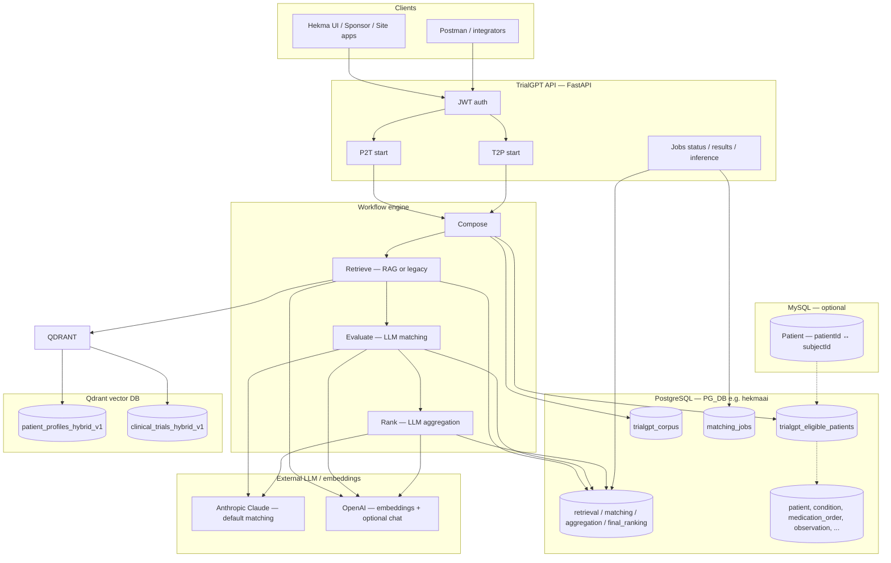
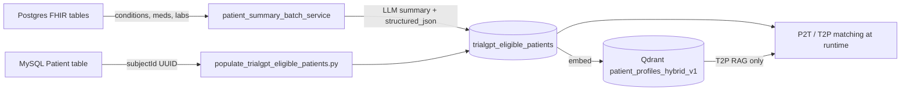
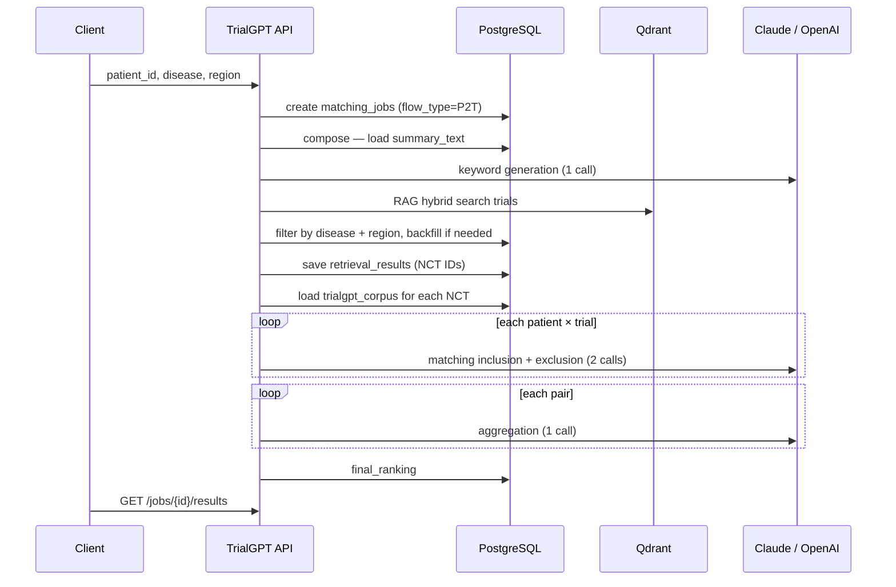
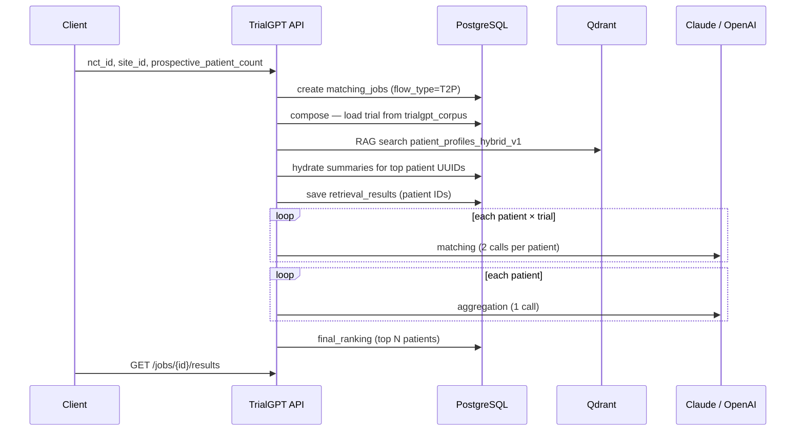
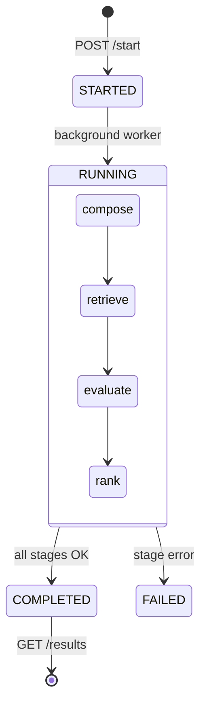
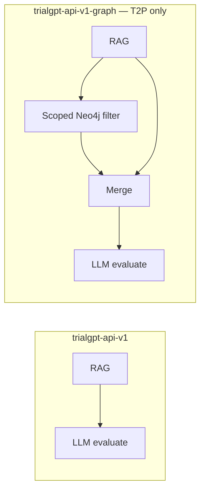

# TrialGPT — End-to-End Architecture

## 1. What TrialGPT does

TrialGPT matches **patients ↔ clinical trials** using a four-stage pipeline:

| Flow | Name | API | Question answered |
|------|------|-----|-----------------|
| **P2T** | Patient → Trials | `POST /api/patient-to-trials/start` | “Which trials fit this patient?” |
| **T2P** | Trial → Patients | `POST /api/trial-to-patients/start` | “Which patients fit this trial (site)?” |

Both flows use the same stages: **Compose → Retrieve → Evaluate → Rank**.

Results are stored in **PostgreSQL**, exposed via job status/results APIs, and optionally cached so repeat requests return instantly.

---

## 2. System context (one picture)

---

## 3. Where patients come from

Patients are **not** loaded ad hoc per request. They live in a pre-built **eligible cohort** in Postgres.

| Step | What happens | Output |
|------|----------------|--------|
| 1. Cohort registry | Sync MySQL `Patient.subjectId` + FHIR freshness into Postgres | Row in `trialgpt_eligible_patients` (~30k patients) |
| 2. Summary generation | FHIR → narrative `summary_text` + `structured_json` + `disease_list` | Same table updated |
| 3. Vector ingest | Structured profile → Qdrant hybrid collection | `patient_profiles_hybrid_v1` |
| 4. Runtime | P2T reads one patient; T2P RAG searches Qdrant then hydrates summaries from Postgres | Job results |

**Patient ID mapping at API boundary:**

- Client sends **MySQL `patient_id`** (integer) on P2T.
- API resolves → **Postgres `subject_id`** (UUID) via `repositories/mysql_repo.py`.
- Jobs and results use the **UUID** as `query_id` (P2T) or `candidate_id` (T2P).

---

## 4. Where trials come from

| Step | Source | Storage |
|------|--------|---------|
| Ingest | `POST /api/trials/ingest` → ClinicalTrials.gov API | `trialgpt_corpus` (+ optional raw JSON table) |
| Vectors | Startup auto-ingest or admin API | `clinical_trials_hybrid_v1` (Qdrant) |
| Matching | Always loaded from Postgres for criteria text | `trialgpt_corpus` |

---

## 5. P2T flow (Patient → Trials) — detail

**Request:** `POST /api/patient-to-trials/start`

| Stage | DB read | DB write | LLM? |
|-------|---------|----------|------|
| **Compose** | `trialgpt_eligible_patients.summary_text` | — | Yes — keywords from summary |
| **Retrieve** | `trialgpt_corpus` (filters), Qdrant `clinical_trials_hybrid_v1` | `retrieval_results` | Embeddings only (OpenAI) |
| **Evaluate** | Corpus trial criteria + patient summary | `matching_results` | Yes — criterion-level match |
| **Rank** | Matching output | `aggregation_results`, `final_ranking` | Yes — trial-level score |

**Retrieve modes:** `retrieval_mode=rag` (default) or `legacy` (BM25/MedCPT hybrid, no Qdrant).

---

## 6. T2P flow (Trial → Patients) — detail

**Request:** `POST /api/trial-to-patients/start`

| Stage | DB read | DB write | LLM? |
|-------|---------|----------|------|
| **Compose** | `trialgpt_corpus` by `nct_id` | — | No |
| **Retrieve** | Qdrant patients + `trialgpt_eligible_patients` | `retrieval_results` | Embeddings (OpenAI) |
| **Evaluate** | Patient summaries + trial criteria | `matching_results` | Yes |
| **Rank** | Matching output | `aggregation_results`, `final_ranking` | Yes |

**Note:** On `trialgpt-api-v1`, T2P retrieve is **RAG-only path in production** (legacy full-table BM25 avoided at ~30k scale).

---

## 7. Data stores reference

### PostgreSQL (`PG_DB` — e.g. `hekmaai`)

| Table | Role in TrialGPT |
|-------|------------------|
| **`trialgpt_eligible_patients`** | **Primary patient cohort** — `subject_id`, `summary_text`, `structured_json`, `disease_list`, `mysql_patient_id` |
| **`trialgpt_corpus`** | Trial records — NCT, title, inclusion/exclusion, diseases, locations |
| **`matching_jobs`** | Job orchestration — `flow_type` (P2T/T2P), stage statuses, parameters JSON |
| **`retrieval_results`** | Candidates after retrieve stage |
| **`matching_results`** | Per-criterion LLM inclusion/exclusion JSON |
| **`aggregation_results`** | Relevance + eligibility scores |
| **`final_ranking`** | Ordered list returned to UI |
| `patient`, `condition`, `medication_order`, `observation`, … | FHIR source for summary generation |
| `patient_annotations`, `patient_summary_validations` | Annotation / QA tooling (adjacent) |

### MySQL (`MYSQL_DATABASE`)

| Table | Role |
|-------|------|
| **`Patient`** | Maps external `patientId` → `subjectId` (UUID used in Postgres/Qdrant) |

### Qdrant

| Collection | Used by | Content |
|------------|---------|---------|
| **`patient_profiles_hybrid_v1`** | T2P retrieve | Dense + sparse (BM25) patient vectors |
| **`clinical_trials_hybrid_v1`** | P2T retrieve | Dense + sparse trial vectors |

### Job filesystem (ephemeral)

| Path | Role |
|------|------|
| `jobs/{job_id}/results/*.json` | Temp plumbing for matching/aggregation subprocesses; **canonical store is Postgres** |

---

## 8. API surface (matching-related)

| Method | Path | Flow |
|--------|------|------|
| `POST` | `/api/patient-to-trials/start` | Start P2T |
| `POST` | `/api/trial-to-patients/start` | Start T2P |
| `GET` | `/api/jobs/{job_id}/status` | Stage progress |
| `GET` | `/api/jobs/{job_id}/results` | Ranked output |
| `GET` | `/api/jobs/{job_id}/nct-inference` | P2T trial detail |
| `GET` | `/api/jobs/{job_id}/patient-inference` | T2P patient detail |
| `GET` | `/api/jobs` | History by patient or NCT |
| `GET` | `/api/patient/{id}/diseases` | Patient disease list |
| `GET` | `/api/trials/regions` | Region filter for P2T |
| `POST` | `/api/trials/ingest` | Load trials into corpus |
| `GET/POST` | `/api/admin/qdrant/*` | Vector ingest admin |

**Auth:** JWT (`JWT_SECRET`), header `logged-in-user-type` (Patient / Site / Sponsor / Admin).

---

## 9. LLM usage (cost hotspots)

| When | Calls (typical) | Default provider |
|------|-----------------|------------------|
| P2T compose | 1 / job | OpenAI or Claude |
| Retrieve (RAG) | 1 embedding query / job | OpenAI `text-embedding-3-large` |
| Evaluate (matching) | **2 × (patient × trial pairs)** | Claude Sonnet (workflow default) |
| Rank (aggregation) | **1 × pairs** | Claude Sonnet |

**Env defaults:** `WORKFLOW_DEFAULT_LLM_SERVICE=claude`, `WORKFLOW_DEFAULT_MODEL=claude-sonnet-4-6`

T2P with 10 patients ≈ 10 × 3 = **30 LLM calls** in evaluate+rank (dominates latency ~5–7 min).

---

## 10. Job lifecycle

**Caching:** If same parameters and `force_rerun=false`, API returns existing `matching_jobs` row with `cached=true`.

---

## 11. RAG-only vs RAG + Graph (branch note)

**This document describes `trialgpt-api-v1` (production baseline): RAG + LLM only.**

A parallel branch **`trialgpt-api-v1-graph`** adds:

| Feature | trialgpt-api-v1 | trialgpt-api-v1-graph |
|---------|-----------------|------------------------|
| T2P retrieve | Qdrant RAG | RAG **+ Neo4j graph pre-filter** |
| Compare API | — | `POST /api/trial-to-patients/compare` |
| Extra store | — | **Neo4j Aura** (conditions, meds, labs) |
| Data prep | Qdrant ingest | + LLM enrichment → Neo4j |

See `docs/neo4j-graph-t2p-architecture-brief.md` for graph-specific gaps (partial enrichment, trial/cohort fit).

---

## 12. Supporting pipelines (not per-request)

| Pipeline | Trigger | Purpose |
|----------|---------|---------|
| `populate_trialgpt_eligible_patients.py` | Batch / ops | Build cohort table |
| `patient_summary_batch_service` | `/batch/refresh-patient-summaries` | FHIR → summaries |
| Qdrant auto-ingest | API startup (`QDRANT_AUTO_INGEST_ON_STARTUP`) | Sync vectors |
| `scripts/enrich_neo4j_data.py` | Manual (graph branch) | ICD/RxNorm/LOINC → Neo4j |

---

## 13. One-page summary for leadership

1. **Patients** come from Postgres **`trialgpt_eligible_patients`** (~30k), fed by MySQL IDs + FHIR clinical data + LLM summaries, indexed in **Qdrant**.  
2. **Trials** come from Postgres **`trialgpt_corpus`**, indexed in **Qdrant**.  
3. **P2T** and **T2P** run the same 4 stages; results land in **`matching_jobs`** + four result tables.  
4. **Retrieve** uses hybrid vector search (fast); **Evaluate/Rank** use Claude (slow, accurate).  
5. **`trialgpt-api-v1`** is the shippable RAG baseline; **graph branch** adds structured Neo4j filtering for T2P when data is enriched.

---

*Generated for architecture review — branch `trialgpt-api-v1`.*
